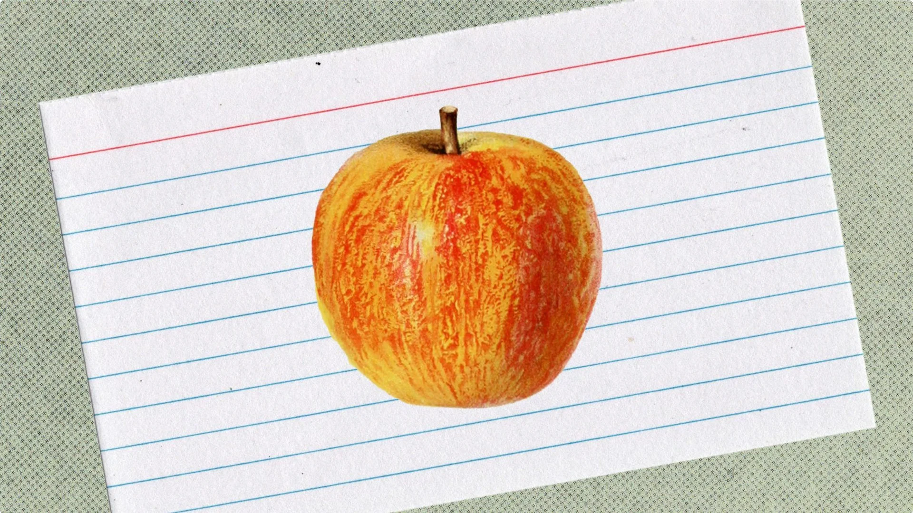
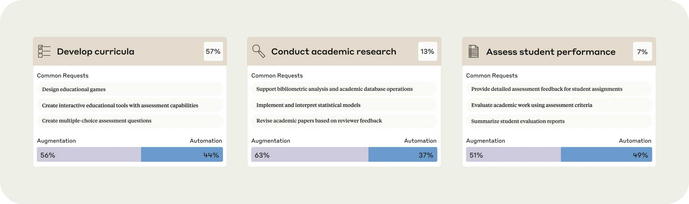
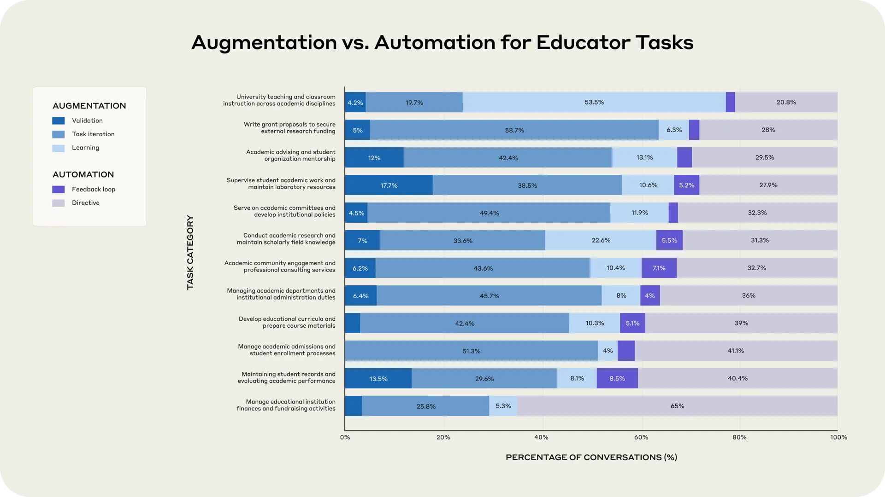

# Anthropic 教育报告：教育工作者如何使用 Claude

- 英文标题：Anthropic Education Report: How educators use Claude
- 发布日期：2025-08-27
- 官网栏目：社会影响
- 原文：[Anthropic 页面](https://www.anthropic.com/research/anthropic-education-report-how-educators-use-claude)
- 官网署名：Anthropic

> 中文机器初译，未逐篇人工校对。引用研究结论时请核对英文原文。

可以理解的是，人工智能在教育领域的大部分讨论都集中在学生如何使用大型语言模型来帮助他们学习和写作。但教育工作者也使用人工智能。在最近的盖洛普调查中，教师们表示，人工智能工具平均每周为他们节省了 5.9 个小时的时间。与通常的讨论相反，学生们开始表达对以下问题的担忧： *教授* 在课堂上使用人工智能。

我们之前 [报告数据](https://www.anthropic.com/news/anthropic-education-report-how-university-students-use-claude) 关于学生如何使用人工智能。我们的新分析着眼于教授：今年 5 月和 6 月，我们在 Claude.ai 上分析了来自世界各地高等教育专业人士的约 74,000 条匿名对话。[1](https://www.anthropic.com/research/anthropic-education-report-how-educators-use-claude#footnote-1) 我们还与东北大学合作，直接听取教师的意见，了解他们如何在大学内使用人工智能。我们的研究结果提供了教育工作者人工智能采用的实证快照，特别是在大学环境中。

## 我们发现：

**教育工作者在课堂内外使用人工智能**  
教育工作者的用途范围从开发课程材料和撰写资助提案到学术建议和管理招生和财务规划等行政任务。

**教育工作者不仅使用聊天机器人；还使用聊天机器人。他们正在利用人工智能构建自己的定制工具**教师正在使用 [Claude文物](https://www.anthropic.com/news/build-artifacts) 创建交互式教育材料，例如化学模拟、自动评分标准和数据可视化仪表板。

**教育工作者倾向于将苦差事自动化，同时了解其他事情**  
需要大量背景、创造力或直接学生互动的任务（例如设计课程、为学生提供建议和撰写资助提案）是教育工作者更有可能使用人工智能作为增强功能的领域。相比之下，财务管理和记录保存等日常行政工作则更加自动化。

**一些教育工作者正在自动化评分；其他人则强烈反对**  
在我们的 Claude.ai 数据中，教师使用 AI 进行评分和评估的频率低于其他用途，但当他们这样做时，48.9% 的时间他们以自动化为主的方式（AI 直接执行任务）使用它。尽管教育工作者对自动化评估任务感到担忧，而且我们接受调查的教师也将其评为他们认为人工智能效率最低的领域。

## 确定教育工作者对Claude的使用

在这项研究中，我们使用了 [我们的自动化分析研究工具](https://www.anthropic.com/research/clio) 这揭示了Claude的广泛使用模式，同时保护用户的隐私。

研究高等教育专业人士对 Claude.ai 的使用情况提出了独特的挑战，因为我们目前不在我们的平台上收集自我报告的职业数据。与经常明确提及课程作业或作业的学生不同，教育工作者的人工智能互动涵盖教学、研究、管理和个人学习，这使得它们更难以识别和分类。

使用我们的隐私保护工具，我们分析了与高等教育电子邮件地址相关的 Claude.ai 免费版和专业版帐户的对话，然后自动过滤对话以执行特定于教育者的任务，例如创建教学大纲、评分作业或开发课程材料。[2](https://www.anthropic.com/research/anthropic-education-report-how-educators-use-claude#footnote-2) 此次过滤产生了 5 月和 6 月期间约 74,000 条对话。我们的分析应该被视为对教育工作者如何使用人工智能来完成特定职业任务的探索，而不是对所有教育工作者人工智能使用的全面看法。

我们还将每次对话与美国 O*NET 职业信息数据库中的教育者任务综合列表中最合适的任务进行匹配。劳工部。我们将教育工作者的任务确定为与“高等教育”教学或行政职业相关的任务。

我们利用 22 名东北大学教职人员的调查数据和定性研究来补充我们的分析，这些教职人员是人工智能的早期采用者，以阐明教育工作者的动机、担忧和使用模式。

## 教育工作者的常见用途

正如我们的 Claude.ai 分析和东北大学的定性研究所揭示的那样，人工智能最突出的用途是课程开发。我们的 Claude.ai 分析还显示，学术研究和评估学生表现是第二和第三最常见的用途。

根据 Claude.ai 数据的 74,000 条对话，教育工作者中人工智能的三大用途：开发课程（占我们分析中对话的 57%）、进行学术研究（13%）和评估学生表现（7%）。还显示了教师如何使用人工智能来完成这些任务的增强/自动化范围。

在我们的调查中，东北大学的教师报告说，另一个常见案例是使用人工智能进行自己的学习（平均 29% 的人工智能时间）。然而，考虑到过滤机制以及在这些学习实例中区分学生和教育者使用情况的困难，我们的 Claude.ai 分析中并未对此进行研究。

我们在 Claude.ai 数据中发现的其他一些特别有趣的用途包括：

- 创建用于教育模拟的模拟法律场景；
- 制定职业教育和劳动力培训内容；
- 起草学术或专业申请的推荐信；
- 创建会议议程和相关行政文件。

### 为什么教师在这些情况下使用人工智能

我们与东北大学教师的定性研究暗示了为什么教育工作者经常倾向于这些常见的人工智能用途：

1. **繁琐任务的自动化** （“它负责处理繁琐的任务”；有助于“死记硬背筹款的部分”）；
2. **协作思想伙伴** （“人工智能可以找到有效的方法向学生解释我自己没有想到的概念”）；
3. **为学生提供个性化的学习体验** （“人工智能可以为我和学生提供个性化、交互式的学习体验，这是一位教师无法提供的”）。

## 教育工作者如何利用人工智能构建定制工具

最鼓舞人心的发现之一是教育工作者如何使用Claude的 [文物特征](https://www.anthropic.com/news/build-artifacts) 创建交互式教育材料。教育工作者不仅仅是进行对话，还经常构建完整的功能性资源，在某些情况下他们可以立即在课堂上部署这些资源。

正如一位接受调查的东北大学教员所说： *“*[以前] 花费巨大（时间）的事情现在变得可能了。定制模拟、插图、交互式实验。哇。对学生来说更具吸引力。”

## 教育工作者的重要创作

**互动教育游戏：**基于网络的游戏，包括密室逃脱、平台游戏和模拟，通过跨学科和级别的游戏化教授概念

**评估和评估工具**:  
基于 HTML 的测验，带有自动反馈系统、用于分析学生表现的 CSV 数据处理器以及综合评分标准

**数据可视化**:  
交互式显示屏可帮助学生直观地了解从历史时间线到科学概念的所有内容

**特定学科的学习工具**:  
专业资源，例如化学计量游戏、自动反馈的遗传学测验和计算物理模型

**学术日历和日程安排工具**:  
交互式日历可以自动填充、下载为图像或导出为 PDF，用于显示课程时间、考试时间、专业发展课程和机构活动

**预算规划和分析工具：**具有特定费用类别、成本分配和预算管理工具的教育机构预算文件

**学术文件**:  
会议纪要、与年级相关的沟通和学术诚信问题的电子邮件、教师奖项的推荐信、终身教职上诉、拨款申请、面试邀请和委员会任命

我们的自动分析研究工具显示了教育工作者在 Claude.ai 的帮助下构建的关键创作

这不仅仅是Claude。一位教授描述了新的人工智能工具如何使他们能够“将自己的内容翻译成更易于访问/参与的形式（交互式页面、模拟、播客、视频）”。

这些创作代表了人工智能从作为对话助手到人工智能作为创意合作者的转变，使教育工作者能够制作传统上可能需要大量技术专业知识或资源的个性化教育材料。

## 增强自动化谱系

基于 Anthropic 之前关于 [经济指数](https://www.anthropic.com/news/the-anthropic-economic-index).

对于给定的任务类别，教育工作者与 Claude.ai 的对话涉及增强（AI 与用户协作执行任务）与自动化（AI 直接执行任务*）的百分比。我们在美国 O*NET 职业信息数据库中确定了与教育工作者相关职业相关的任务。劳工部。我们将类似的任务分组在一起以创建高级别的任务类别，如上面所报告的。

Claude.ai 数据中不同教育任务的关键模式如下：

**任务较高 增强 倾向：**

- 大学教学和课堂教学，包括创建教育材料和练习问题（增强 77.4%）；
- 撰写资助提案以获得外部研究资金（增加 70.0%）；
- 学术咨询和学生组织指导（增加 67.5%）；
- 监督学生的学术工作（增加 66.9%）。

**任务相对较高 自动化 倾向：**

- 管理教育机构财务和筹款（自动化 65.0%）；
- 维护学生记录并评估学业成绩（自动化程度为 48.9%）；
- 管理学术招生和注册（自动化程度为 44.7%）。

这种变化表明，教育工作者完全委托人工智能的可能性取决于任务。与我们的调查结果一致，我们发现涉及日常行政和财务管理的任务比接近直接学生互动的任务（例如创建实践材料或为博士级学术研究提供建议）更有可能得到充分委托。这些人工智能交互通常需要重要的背景，因此需要人工智能和教授之间的协作。例如，正如东北大学的一位教授所说，在设计课程计划时，“人工智能需要在我们已经涵盖的内容和背景方面进行指导。”

教育工作者似乎也更有可能以增强的方式使用人工智能来完成需要创造力或复杂决策的工作，例如撰写资助提案。一位接受调查的教授在集思广益时写道，

> ““有价值的是与法学硕士的对话，而不是第一反应。这也是我试图教给学生的。将其用作思想伙伴，而不是思想替代品。””

也就是说，48.9% 的评分相关对话被确定为自动化程度较高，但仍然令人担忧。尽管接受调查的教授认为这是人工智能的唯一任务 *至少* 有效时间，从 Claude.ai 数据中可以看出。即使这仅占我们研究的 Claude.ai 对话的 7%，它也成为第二大自动化任务。这包括子任务，例如提供对学生作业的反馈以及使用评分标准对他们的作业进行评分。虽然尚不清楚这些人工智能生成的反应在多大程度上影响了最终成绩和反馈，但我们研究中出现的互动确实显示出对Claude的一定程度的委托。

在教育工作者中使用人工智能进行评分仍然是一个有争议的问题。一位东北大学教授分享道：“从道德和实践角度来看，我对使用[人工智能工具]以任何方式评估或为学生提供建议都非常谨慎。其中一部分是准确性问题。我尝试过一些实验，其中我有法学硕士学位论文，但它们对我来说根本不够好。从道德上讲，学生不是为法学硕士的时间支付学费，而是为我的时间支付学费。做好工作是我的道德义务（也许需要法学硕士的帮助）。”

虽然人工智能反馈可以通过多种方式支持学生的发展，例如通过提供形成性反馈的自动系统（例如由教育工作者在 Claude Artifacts 中构建的系统），但大多数教育工作者似乎都认为评分不应该接近完全自动化。

## 教育工作者如何重新思考教什么

许多教育工作者认识到人工智能工具正在改变学生的学习方式。这反过来又给教育工作者带来了改变教学方式的压力。正如一位接受调查的教授所说：

> ““人工智能正在迫使我彻底改变我的教学方式。我正在花费大量精力试图找出解决认知卸载问题的方法。” ”

它还改变了教授的教学内容。例如，在编码方面，一位教授表示，“基于人工智能的编码彻底改变了分析教学/学习体验。我们可以花时间讨论商业分析应用的概念，而不是调试逗号和分号。”

更广泛地说，评估人工智能生成内容的准确性的能力变得越来越重要。一位教授写道：“挑战在于，随着人工智能生成量的增加，人类验证并保持领先地位变得越来越困难。”教授们热衷于帮助学生在某一学科领域积累足够的专业知识，以拥有这种洞察力。

评估也开始变得不同。虽然学生作弊和认知负担仍然是一个问题，但一些教育工作者正在重新考虑他们的评估。

> ““如果Claude或类似的人工智能工具可以完成作业，我就不担心学生作弊；我担心我们没有尽到教育者的职责。”
> ”

在一位东北大学教授的案例中，他们表示，在与太多学生提交人工智能撰写的作业作斗争后，他们“再也不会布置传统的研究论文”。相反，他们分享道：“我将重新设计作业，这样下次就不能用人工智能来完成了。我有一个学生抱怨每周的作业很难做，他们很恼火，因为 Claude 和 ChatGPT 在完成作业时毫无用处。我告诉他们这是一种赞美，我会努力从学生那里听到更多这样的说法。”

前进的道路之一可能是基于这些新发现的工具升级作业，并期望学生能够应对更复杂、现实世界的挑战，即使在人工智能的帮助下，这些挑战仍然很困难。然而，鉴于人工智能的不断改进，这是一个不断变化的目标，可能会给教育工作者本身带来沉重的负担。此外，学生仍然需要培养独立于人工智能的基础技能，以有效评估其输出。

## 限制和注意事项

这项研究有重要的警告：

- **鉴定方法**：我们的过滤通过查看 Claude 对话来推断哪些对话与教育工作者相关，仅捕获了高等教育电子邮件中约 1.5% 的对话，这将我们限制在与教育工作者明确相关的任务（例如创建教学大纲），并且可能错过了许多不完全与教育工作者相关的其他教育者 AI 交互（例如获得解释困难概念的帮助）；
- **教育者范围有限**：分析仅限于具有高等教育电子邮件地址的帐户，不包括 K-12 教师；
- **早期采用者偏见**：我们可能会捕获已经熟悉人工智能的教育工作者，但他们可能无法代表更广泛的教育工作者群体的技术准备程度或态度；
- **调查的局限性**：东北大学教师数据提供了定性背景，但代表了来自单个机构的有限样本，可能无法概括；
- **平台特异性**：本分析重点关注 Claude.ai 的使用情况，可能无法反映其他 AI 平台上的模式；
- **时间限制**：五月和六月的分析窗口并未捕获整个学年教育者人工智能使用的季节性变化。

## 展望未来

我们的研究结果揭示了教育工作者人工智能采用的复杂情况。应用程序的多样性——从构建交互式模拟到管理管理任务——显示了人工智能在学术职能中的不断扩展。

也许最令人鼓舞的是教育工作者如何使用人工智能来构建有形的教育资源。从人工智能作为对话工具到人工智能作为创意合作伙伴的转变可能有助于解决教育领域长期存在的资源限制。正如一位教授指出的那样，曾经在时间上“极其昂贵”的定制模拟和交互式实验现在已经成为可能，为学生创造了更具吸引力的体验。

然而，人工智能辅助评分仍然存在紧张局势。尽管近一半的评分相关任务在我们的数据中显示出自动化模式，但接受调查的教师认为这是人工智能效率最低的应用。这种正在尝试的事情和被认为适当的事情之间的脱节凸显了在效率增益与教育质量和道德考虑之间取得平衡的持续斗争。

这些发现表明，围绕教育领域人工智能的叙述将随着技术本身的发展而继续发展。随着工具的改进和最佳实践的出现，教育工作者对适当使用人工智能的看法，特别是对于评分等敏感任务，可能会发生变化。对于未来的研究同样重要的是了解学生和教育者人工智能的使用如何相互作用——当学生知道他们的教授正在使用人工智能时，他们会如何看待和反应？教育者的采用如何影响学生的学习行为？

我们的研究捕捉到了教育工作者积极实验的时刻，创造新的可能性，同时解决有关他们在人工智能增强课堂中的角色的基本问题。前进的道路需要持续的对话、谨慎的政策制定和持续的研究，以确保这些工具增强而不是损害教育体验。

## 脚注

01 这些对话发生在2025年5月22日至6月2日的11天内。

02 具体来说，我们使用了由 Claude 支持的以下过滤器来识别与教育者相关的对话：“此对话是否可能与寻求教学内容、评分、研究或管理职责方面帮助的教育者（教师、教授或讲师）进行？确保不包括学生自己做的课程作业、研究论文等。如果你不确定的话，就错误地站在保守主义一边，并假设它不是教育家。”

*如果无法识别增强/自动化类别，我们会将其从图表中排除。有关这些类别的更多信息，请参阅我们的人类经济指数 [研究](https://arxiv.org/pdf/2503.04761).
