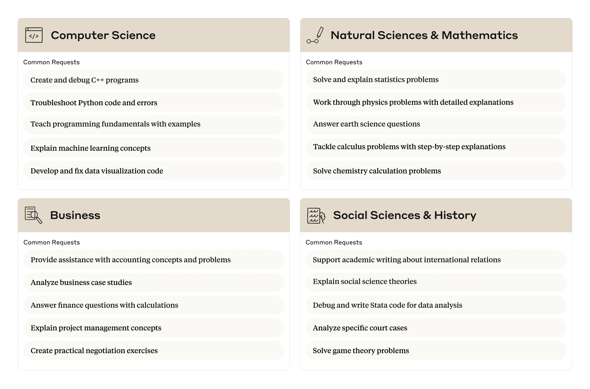
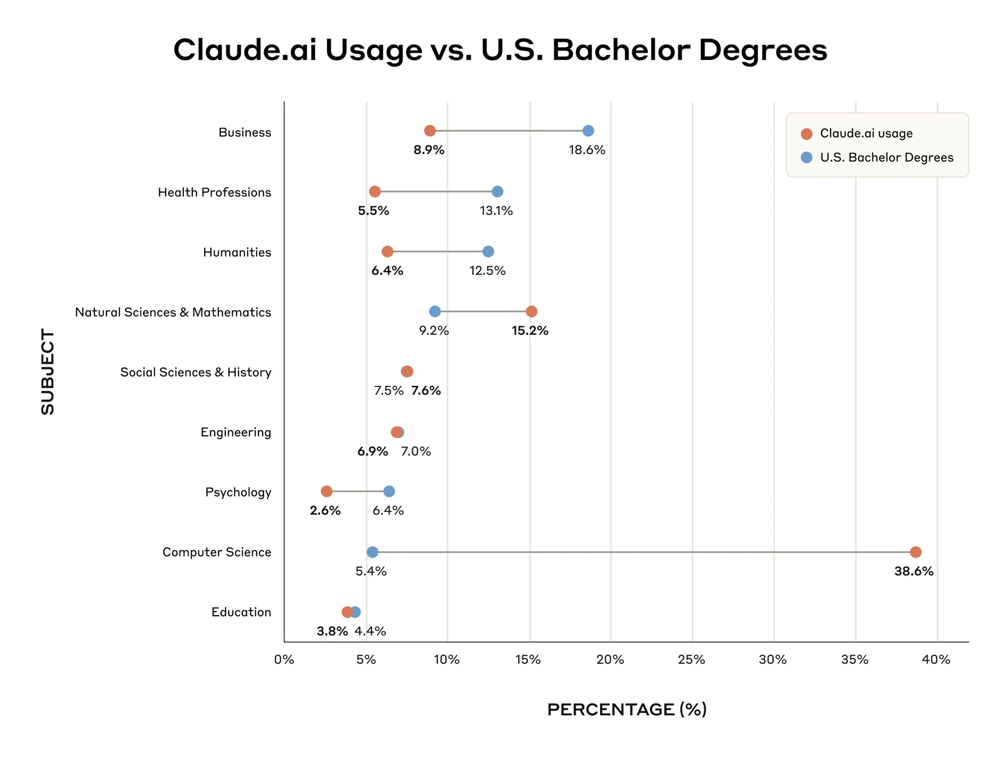
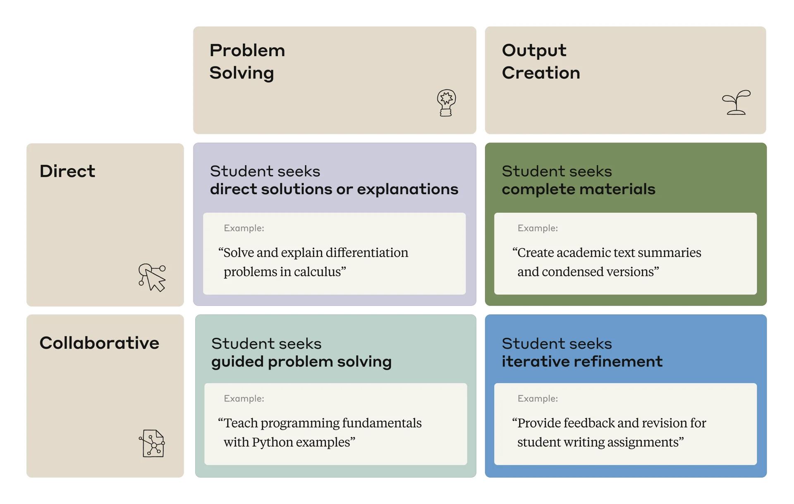
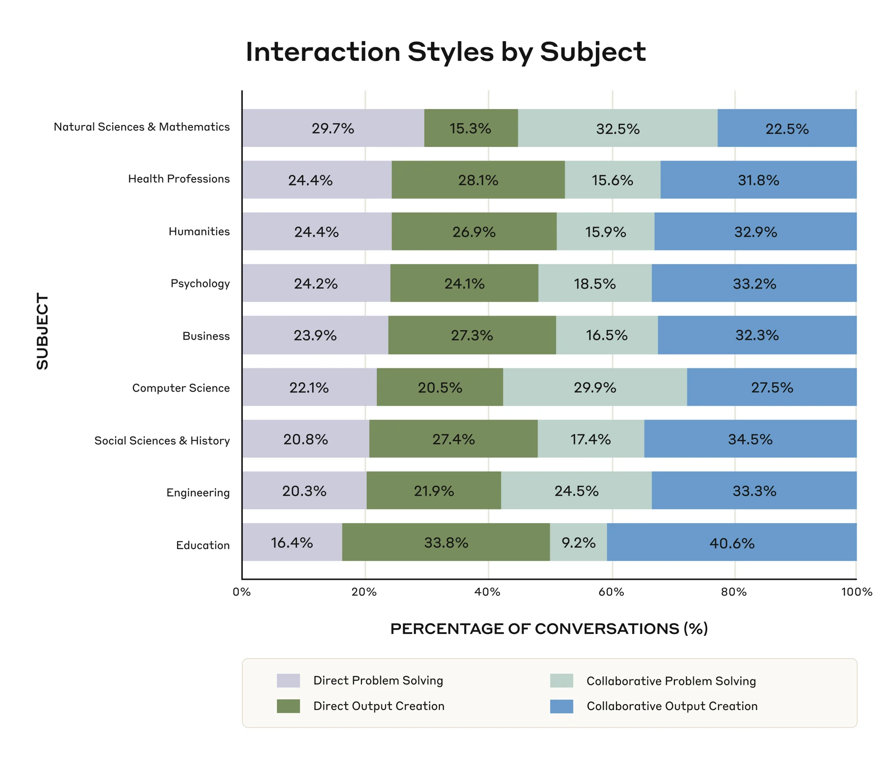
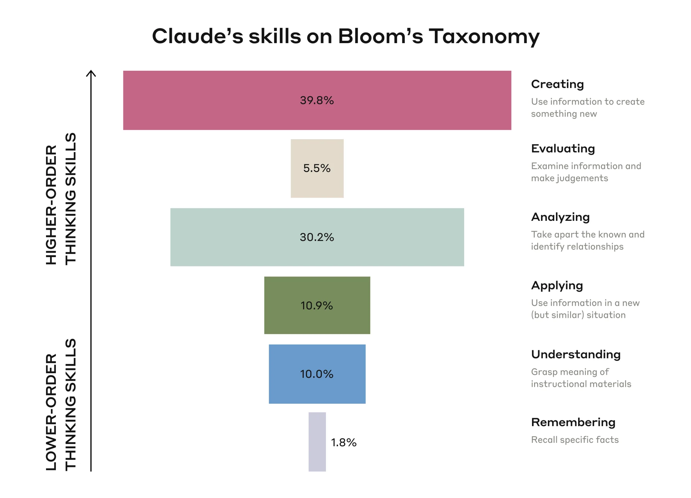

# Anthropic 教育报告：大学生如何使用 Claude

- 英文标题：Anthropic Education Report: How university students use Claude
- 发布日期：2025-04-08
- 官网栏目：社会影响
- 原文：[Anthropic 页面](https://www.anthropic.com/research/anthropic-education-report-how-university-students-use-claude)
- 官网署名：Anthropic

> 中文机器初译，未逐篇人工校对。引用研究结论时请核对英文原文。

人工智能系统不再只是专门的研究工具：它们是日常的学术伙伴。随着人工智能更深入地融入教育环境，我们需要考虑有关学习、评估和技能发展的重要问题。到目前为止，大多数讨论都依赖于调查和对照实验，而不是学生如何将人工智能自然地融入现实环境中的学术工作的直接证据。

为了解决这一差距，我们对高等教育中真实世界的人工智能使用模式进行了首批大规模研究之一，分析了 Claude.ai 上的一百万个匿名学生对话。

我们的教育报告的主要发现是：

- STEM 学生是 Claude 等人工智能工具的早期采用者，其中计算机科学专业的学生比例尤其高（占学生对话的 36.8%，而仅占美国学位的 5.4%）。相比之下，商业、健康和人文学科的学生相对于其入学人数而言，采用率较低。
- 我们确定了学生与人工智能互动的四种模式，每种模式在我们的数据中以大致相同的比例出现（每种模式占对话的 23-29%）：直接问题解决、直接输出创建、协作问题解决和协作输出创建。
- 学生主要使用人工智能系统进行创建（使用信息来学习新东西）和分析（分解已知并识别关系），例如创建编码项目或分析法律概念。这与高阶认知功能相一致 [布鲁姆分类法](https://www.researchgate.net/publication/235465787_A_Taxonomy_for_Learning_Teaching_and_Assessing_A_Revision_of_Bloom's_Taxonomy_of_Educational_Objectives)。这就提出了如何确保学生不会将关键认知任务转移给人工智能系统的问题。

## 识别教育人工智能的使用

在研究人们如何使用人工智能模型时，保护用户隐私至关重要。对于这个项目，我们使用了Claude的见解和观察，或者“[克里奥](https://www.anthropic.com/research/clio)，”我们的自动化分析工具可以深入了解人们如何使用 Claude。Clio 通过将用户对话提炼为高级使用摘要（例如“排除代码问题”或“解释经济概念”），实现自下而上地发现人工智能使用模式。 Clio 使用多层自动化流程从对话中删除私人用户信息。我们构建这个流程是为了最大限度地减少从一层传递到下一层的信息。我们在本文中描述了 Clio 的隐私优先设计 [较早的博客](https://www.anthropic.com/research/clio).

我们使用 Clio 分析了大约 100 万匿名用户[1](https://www.anthropic.com/research/anthropic-education-report-how-university-students-use-claude#footnote-1) 来自与高等教育电子邮件地址相关的 Claude.ai 免费和专业帐户的对话。[2](https://www.anthropic.com/research/anthropic-education-report-how-university-students-use-claude#footnote-2) 然后，我们根据学生和学术相关性筛选这些对话，例如对话是否与课程作业或学术研究有关，最终产生了 574,740 条对话。[3](https://www.anthropic.com/research/anthropic-education-report-how-university-students-use-claude#footnote-3) 然后，克里奥将这些对话进行分组，以得出与教育相关的总体见解：不同的学术科目是如何代表的；学生与人工智能的互动有何不同；以及学生委托给人工智能系统的认知任务类型。

## 学生使用人工智能的目的是什么？

我们发现学生主要使用 Claude 来创建和改进跨学科的教育内容（占对话的 39.3%）。这通常需要设计练习题、编辑论文或总结学术材料。学生还经常使用 Claude 为学术作业提供技术解释或解决方案（33.5%）——使用人工智能来调试和修复编码作业中的错误，实现编程算法和数据结构，以及解释或解决数学问题。其中一些用法也可能是作弊，我们将在下面讨论。学生使用的一小部分但仍然相当大的部分是分析和可视化数据 (11.0%)、支持研究设计和工具开发 (6.5%)、创建技术图表 (3.2%) 以及翻译或校对语言之间的内容 (2.4%)。

以下是跨主题常见请求的更详细细分。

根据 Clio 每个学科中最常见的 15 个请求，来自前四个学科领域的常见学生请求。

## 跨学科的人工智能使用

接下来我们检查了哪些科目显示 *不成比例的* 使用Claude.我们通过将 Claude.ai 的使用模式与美国授予的学士学位数量进行比较来做到这一点。[4](https://www.anthropic.com/research/anthropic-education-report-how-university-students-use-claude#footnote-4) Claude 使用最多的领域是计算机科学：尽管计算机科学仅占美国学士学位的 5.4%，但在 Claude.ai 上的对话中却占到了 38.6%（这可能反映了 Claude 在计算机编码方面的特殊优势）。相对于学生入学率，自然科学和数学在 Claude.ai 中的代表性也较高（15.2% vs.分别为 9.2%）。

相反，尽管商业相关的教育对话占学士学位的 18.6%，但仅占对话的 8.9%，这表明Claude的使用率极低。卫生专业（5.5% vs.13.1%）和人文学科（6.4% vs.12.5%）相对于这些学科的学生入学人数而言也较少。

这些模式表明，STEM 学生，尤其是计算机科学专业的学生，​​可能是 Claude 出于教育目的的早期采用者，而商业、健康和人文学科的学生可能会更缓慢地将这些工具集成到他们的学术工作流程中。这可能反映了计算机科学社区对Claude的更高认识，以及人工智能系统相对于其他学科学生执行的任务更熟练地执行 STEM 学生执行的任务。

比较 Claude.ai 学生对话中与国家教育统计中心相关的百分比（[国家教育科学中心](https://nces.ed.gov/programs/digest/d23/tables/dt23_318.20.asp?current=yes)）学科领域（灰色）与拥有相关专业（橙色）的美国大学生的百分比。请注意，百分比之和并不等于 100%，因为某些对话被归类为 NCES 中的“其他”类别，我们将其排除在分析之外。

## 学生如何与人工智能互动

与人工智能交互的方式有很多种，它们会对学习过程产生不同的影响。在对学生如何与人工智能互动的分析中，我们确定了四种不同的互动模式，并沿着两个不同的轴进行分类，如下图所示。

第一个轴是“交互模式”。这可能涉及：[5](https://www.anthropic.com/research/anthropic-education-report-how-university-students-use-claude#footnote-5) (1) **直接** 对话，用户希望尽快解决他们的查询，以及 (2) **协作性** 对话，用户积极寻求与模型进行对话以实现他们的目标。第二个轴是交互的“期望结果”。这可能涉及：(1) **解决问题**，用户寻求问题的解决方案或解释，以及 (2) **输出创建**，用户寻求生成更长的输出，例如演示文稿或论文。结合这两个轴给我们提供了下面介绍的四种模式。

我们对学生与人工智能对话的分类，以及基于 Clio 提出的示例对话主题。

这四种交互方式的比例相似（每种方式占对话的 23% 到 29%），显示了学生对人工智能的使用范围。传统的网络搜索通常只支持直接答案，而人工智能系统可以实现更广泛的交互，并带来新的教育机会。一些精选的积极学习例子包括：

- 解释和澄清哲学概念和理论
- 创建全面的化学教育资源和学习材料
- 解释学术作业中的肌肉解剖学、生理学和功能概念

与此同时，人工智能系统也带来了新的挑战。一个常见的问题是：“学生使用人工智能作弊的情况有多少？”这很难回答，特别是因为我们不知道Claude的每个回答所使用的具体教育背景。例如，直接解决问题的对话可能是针对带回家的考试作弊……或者是针对学生在练习测试中检查自己的作业。直接输出创建对话可以用于从头开始创建一篇文章……或者用于为其他研究创建知识摘要。协作对话是否构成作弊也可能取决于具体的课程政策。

也就是说，近一半（约 47%）的学生与 AI 对话是直接的，即以最少的参与度寻求答案或内容。尽管其中许多都是出于合法的学习目的（例如提出概念性问题或生成学习指南），但我们确实发现了有关直接对话的示例，包括：

- 提供机器学习多项选择题的答案
- 提供英语语言测试问题的直接答案
- 重写营销和商业文本以避免抄袭检测

这些提出了有关学术诚信、批判性思维能力的发展以及如何最好地评估学生学习的重要问题。即使是协作对话也可能产生值得怀疑的学习结果。例如，“通过解释解决概率和统计作业问题”可能涉及人工智能和学生之间的多次对话，但仍然将重要的思考转移给人工智能。我们将继续研究这些互动，并尝试更好地辨别哪些互动有助于学习和培养批判性思维。

## 特定主题的人工智能使用模式

不同学科的学生以不同的方式接触人工智能：

- **自然科学与数学** 对话倾向于解决问题，例如“通过逐步计算解决特定概率问题”和“通过逐步解释解决学术作业或考试问题”。
- **计算机科学**, **工程**, 和 **自然科学与数学** 倾向于协作对话，而 **人文、商业和健康** 协作对话和直接对话之间的分布更加均匀。
- **教育** 对输出创建表现出最强的偏好，覆盖了 74.4% 的对话。然而，这种用法可能源于我们过滤方法的缺陷。其中许多对话涉及“创建全面的教材和教育资源”和“创建详细的课程计划”，这表明教师也在利用Claude提供教育支持。总的来说，教育占所有对话的 3.8%。

这表明人工智能集成的教育方法可能会受益于特定学科。我们的数据是帮助认识不同学科学生与人工智能互动方式差异的第一步。

每个 NCES 主题的跨交互风格的对话分布。

## 学生将认知任务委托给人工智能

我们还探讨了学生如何将认知责任委托给人工智能系统。我们用过 [布鲁姆分类法](https://www.researchgate.net/publication/235465787_A_Taxonomy_for_Learning_Teaching_and_Assessing_A_Revision_of_Bloom's_Taxonomy_of_Educational_Objectives),[6](https://www.anthropic.com/research/anthropic-education-report-how-university-students-use-claude#footnote-6) 教育中使用的分层框架，用于将认知过程从简单到复杂进行分类。虽然该框架最初是为了学生思考而设计的，但我们对其进行了调整以分析Claude在与学生交谈时的反应。

我们看到人工智能展示了布鲁姆分类法域的倒置模式：

- Claude主要完成高阶认知功能，其中创建（39.8%）和分析（30.2%）是布鲁姆分类法中最常见的操作。
- 低阶认知任务不太常见：应用（10.9%）、理解（10.0%）和记忆（1.8%）。

这种分布也因交互风格而异。正如预期的那样，输出创建任务（例如生成学术文本摘要或论文反馈）涉及更多创建功能。问题解决任务，例如解决微积分问题或解释编程基础知识，涉及更多分析函数。

人工智能系统展示这些技能的事实并不妨碍学生自己参与这些技能——例如，共同创建一个项目或使用人工智能生成的代码在另一个环境中分析数据集——但它确实指出了学生将认知能力外包给人工智能的潜在担忧。人们合理地担心人工智能系统可能会为学生提供拐杖，从而抑制支持高阶思维所需的基础技能的发展。毕竟，倒金字塔可能会倒塌。

Claude在与学生的对话中所展示的认知技能，基于布鲁姆的分类法。技能描述来自 [佛罗里达大学教学技术和培训中心](https://citt.ufl.edu/resources/the-learning-process/designing-the-learning-experience/blooms-taxonomy/).

## 局限性

我们的研究基于真实世界的数据。就我们的研究结果的有效性及其在教育环境中的应用而言，这具有许多优势。然而，它也有一些局限性，可能会影响我们的研究结果范围：

- 我们的数据集可能捕获了早期采用者，但可能无法代表更广泛的学生群体；
- 目前尚不清楚 Claude 的使用相对于教育中的整体 AI 使用情况有何代表性——许多学生使用 Claude.ai 之外的 AI 工具，这意味着我们仅提供他们整体 AI 参与模式的部分视图；
- 对话的分类方式可能同时存在误报和误报。我们依赖于与高等教育电子邮件地址相关的帐户的对话：其中一些被我们的分类器认为与学生相关的对话实际上可能来自工作人员或教职员工。此外，其他学生的对话可能是在与非大学电子邮件地址关联的帐户上进行的；
- 出于隐私考虑，我们仅分析单个 18 天保留窗口内的 Claude.ai 使用情况。由于学生的教育承诺不断变化，他们的使用情况在一年中可能会有所不同；
- 我们只研究学生将哪些任务委托给人工智能，而不是他们最终如何在学术工作中使用人工智能输出，或者这些对话是否有效支持学习成果；
- 将学生与人工智能对话按学科分类可能无法完全捕捉人工智能使用模式可能存在显着差异的跨学科工作；
- 将布鲁姆分类法应用于人工智能（而不是学生）的认知过程是不完美的。在人工智能系统的背景下，像记忆这样的技能更难量化。

有关人工智能在教育中使用的机构政策差异很大，并且可能会以我们无法在该数据集中衡量的方式对我们观察到的模式产生重大影响。

## 结论和展望

我们的分析提供了学生在现实世界中何处以及如何使用人工智能的鸟瞰图。我们认识到，我们才刚刚开始了解人工智能对教育的影响。

在与学生和教育工作者的讨论中，我们发现人工智能可以以非凡的方式增强学习能力。例如，人工智能已被用来支持 [学生的核聚变反应堆项目](https://www.businessinsider.com/student-builds-nuclear-fusion-prototype-using-ai-glowing-plasma-orb-2024-9)，并促进 [课堂上学生和老师之间更好的沟通](https://www.sciencedirect.com/science/article/abs/pii/S0360131524001970?via%3Dihub).

但我们并不抱有任何幻想，这些初步发现完全解决了教育领域正在发生的深刻变化。人工智能正在以各种方式让教育工作者的生活变得更具挑战性，而这项研究并没有完全捕捉到这些挑战。当学生将高阶认知任务委托给人工智能系统时，就会出现一些基本问题：我们如何确保学生仍然发展基础认知和元认知技能？在人工智能驱动的世界中，我们如何重新定义评估和作弊政策？如果人工智能系统能够几乎立即生成精美的论文，或者快速解决需要人花费大量时间工作的复杂问题，那么有意义的学习会是什么样子？随着模型能力的增强以及人工智能越来越融入我们的生活，从作业设计到评估方法的一切都会发生根本性的改变吗？

这些发现促进了教育工作者、管理者和政策制定者之间关于如何确保人工智能加深而不是破坏学习的持续讨论。进一步的研究将帮助我们更好地了解学生和教师如何使用人工智能、与学习成果的联系以及对教育未来的长期影响。

## Anthropic的教育方法

除了这份教育报告外，我们还 [与大学合作](https://www.anthropic.com/news/introducing-claude-for-education) 更好地了解人工智能在教育中的作用。作为早期的一步，我们正在尝试一种学习模式，该模式强调苏格拉底方法和概念理解而不是直接答案。我们期待与大学合作开展未来的研究，更直接地研究人工智能对学习的影响。

## 脚注

01 这些持续了 Claude.ai 上 18 天的时间，以便根据我们的数据继续管理数据 [隐私和保留政策](https://privacy.anthropic.com/en/articles/10023548-how-long-do-you-store-personal-data)。有关 Clio 如何保护隐私的更多信息，请参阅我们的 [研究博客](https://www.anthropic.com/research/clio).

02 特别是，我们将分析限制为具有与全球高等教育机构相关的电子邮件地址的帐户，例如具有 .edu 和 .ac.uk 域的电子邮件。我们认识到并非所有教育电子邮件地址都可能是学生的电子邮件地址。因此，我们将相关对话过滤为可能涉及学生作业的对话。

03 Clio 使用 Claude 以自动方式过滤对话。在这项研究中，克里奥过滤了那些“可能是寻求学术、学校作业、学习、学习新概念、学术研究等方面帮助的学生？”的对话。我们的 [之前关于 Clio 的论文](https://arxiv.org/abs/2412.13678) 详细说明并验证了这种过滤机制。

04 通过 [国家教育统计中心 (NCES)](https://nces.ed.gov/programs/digest/d23/tables/dt23_318.20.asp?current=yes).

05 在我们的实验中，我们使用术语“交易”和“对话”对对话进行分类，因为我们发现这些术语最准确地捕捉了 Clio 呈现的自下而上的交互模式。具体来说，我们使用 Clio 将对话分类为以下之一：事务性问题解决、事务性输出创建、对话式问题解决或对话式输出创建；为 Clio 提供了每种交互模式的相关描述。为了便于理解，我们在本报告中使用术语“直接”和“协作”来代替“交易”和“对话”。

06 特别是，我们使用 [Anderson 和 Krathwohl (2001) 的修订版](https://books.google.com/books/about/A_Taxonomy_for_Learning_Teaching_and_Ass.html?id=JPkXAQAAMAAJ&source=kp_book_description) 布鲁姆分类法及其认知过程分类法。
