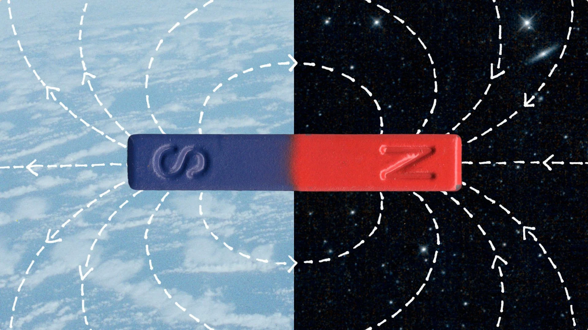
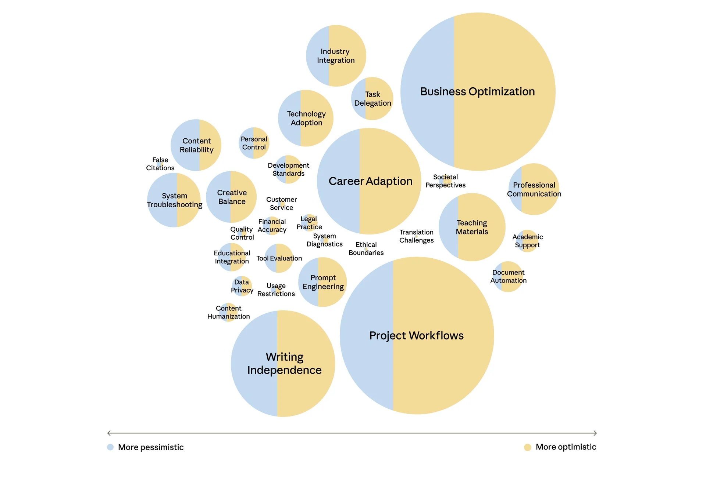
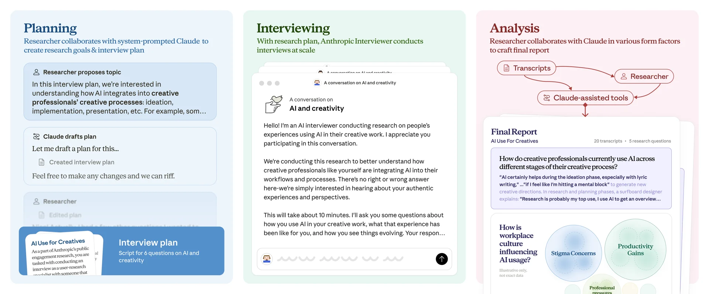
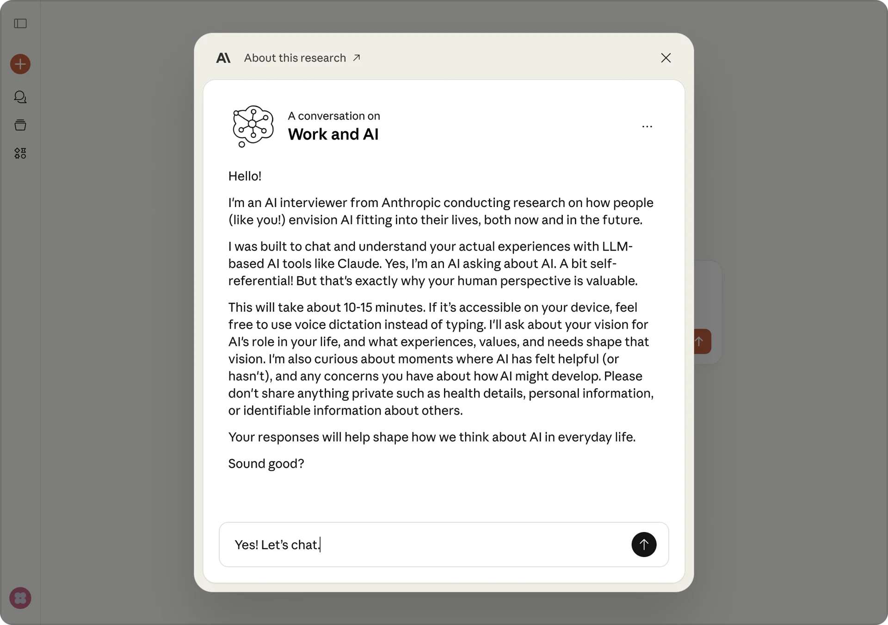
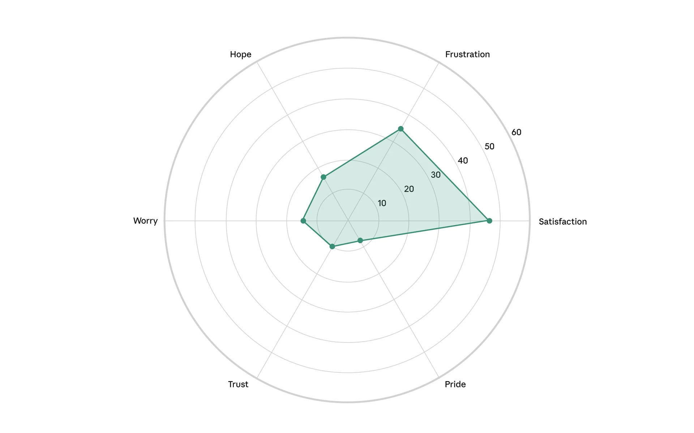
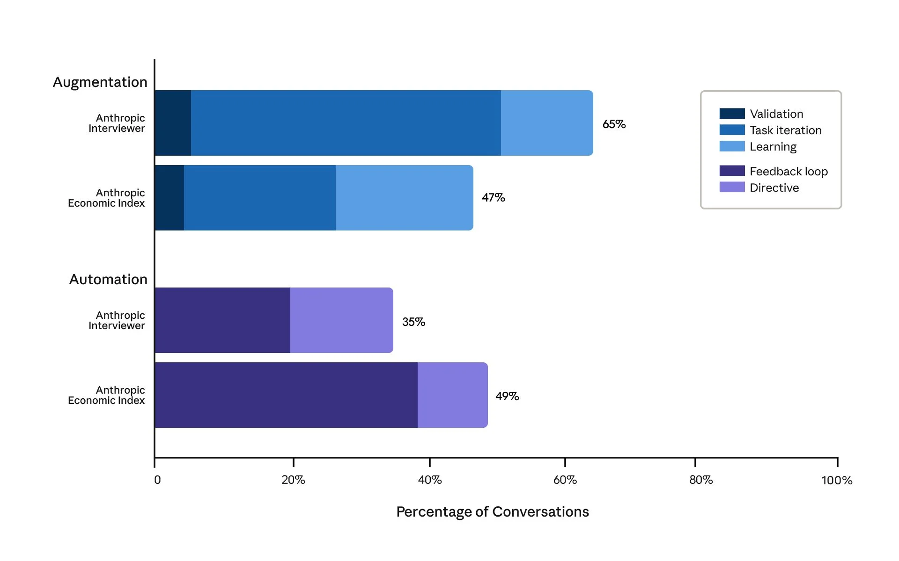
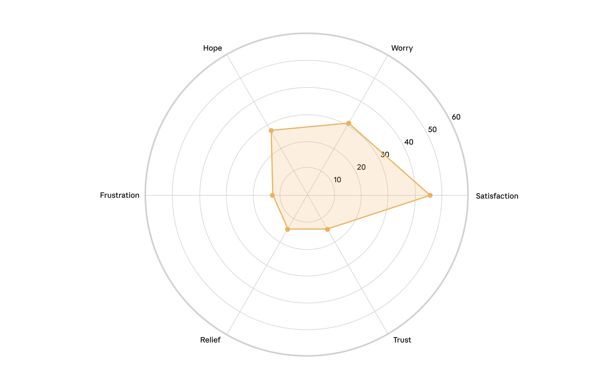
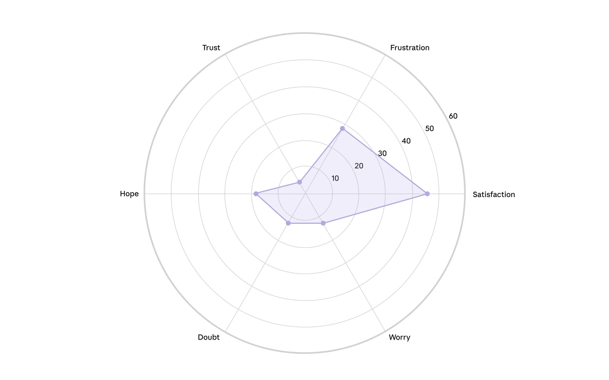

# 介绍 Anthropic Interviewer：1,250 名专业人士如何与 AI 共事

- 英文标题：Introducing Anthropic Interviewer: What 1,250 professionals told us about working with AI
- 发布日期：2025-12-04
- 官网栏目：社会影响
- 原文：[Anthropic 页面](https://www.anthropic.com/research/anthropic-interviewer)
- 官网署名：Anthropic

> 中文机器初译，未逐篇人工校对。引用研究结论时请核对英文原文。

*我们正在推出一个新工具“人择访谈者”（Anthropic Interviewer），以帮助了解人们对人工智能的看法。在这篇研究文章中，我们介绍了该工具，描述了对专业人士样本的测试，并讨论了我们的早期发现。我们还讨论了这个方向的未来工作，我们现在可以通过开发该工具并通过与创意人员、科学家和教师的合作来探索这些工作。*

## 简介

现在每天有数百万人使用人工智能。作为一家开发人工智能系统的公司，我们想知道他们如何以及为何这样做，以及它如何影响他们。部分原因是我们希望利用人们的反馈来开发更好的产品，但也因为理解人们与人工智能的互动是我们这个时代重大的社会学问题之一。

我们最近设计了 [一个工具](https://www.anthropic.com/research/clio) 调查人工智能的使用模式，同时保护用户的隐私。它使我们能够分析不断变化的人工智能使用模式 [整个经济](https://www.anthropic.com/economic-index)。但该工具只能让我们了解与Claude的对话中发生了什么。那之后的事情呢？人们实际上怎么样 *使用* Claude的输出？他们对此有何感想？他们认为人工智能在未来将扮演什么角色？如果我们想要全面了解人工智能在人们生活中不断变化的角色，并以人类为中心来开发模型，我们需要 *直接问人*.

这样的项目需要我们进行数百次采访。在这里，我们聘请了人工智能来帮助我们做到这一点。我们构建了一个名为 Anthropic Interviewer 的采访工具。在 Claude 的支持下，Anthropic Interviewer 以前所未有的规模自动进行详细访谈，并将结果反馈给人类研究人员进行分析。这是了解用户的需求以及收集数据以分析人工智能的社会和经济影响的新一步。

为了测试 Anthropic Interviewer，我们对其进行了 1,250 次采访，采访了专业人士——普通劳动力 (N=1,000)、科学家 (N=125) 和创意人员 (N=125)——了解他们对人工智能的看法。我们是 [公开发布](https://huggingface.co/datasets/Anthropic/AnthropicInterviewer) 来自该初始测试的所有访谈数据（经参与者同意）供研究人员探索；我们在下面提供我们自己的分析。简而言之，以下是我们发现的一些示例：

- **在我们的样本中，人们对人工智能在工作中发挥的作用持乐观态度。** 讨论的大多数主题都表现出积极的情绪。然而，教育融合、艺术家流离失所和安全担忧等少数话题却带来了更为悲观的前景。
- **普通劳动力希望保留定义其职业身份的任务，同时将日常工作委托给人工智能。** 他们设想未来日常任务将实现自动化，他们的角色将转变为监督人工智能系统。
- **尽管同行评判和对未来的焦虑，创意人员仍在使用人工智能来提高生产力。** 他们正在应对人工智能在创意社区中使用的直接耻辱，以及对经济取代和人类创意身份侵蚀的更深层次的担忧。
- **科学家们希望与人工智能合作，但还不能信任它进行核心研究。** 科学家们一致表达了对能够生成假设和设计实验的人工智能的渴望。但目前，他们的实际用途仅限于其他任务，例如撰写手稿或调试分析代码。

人们在接受 Anthropic Interviewer 采访时讨论的不同主题。在我们研究的所有三个样本中——普通劳动力、科学家和创意人员——参与者对人工智能对其专业活动的影响主要表达了积极的看法。某些话题确实引起了停顿，特别是围绕个人控制、工作替代和自主权等问题。在此图中，主题大致按从更悲观到更乐观的顺序排列。

## 一般劳动力

悲观的

乐观

**职业适应。** 卡车运输调度员：“我总是试图找出人类为行业提供的无法自动化的东西，并真正在这方面进行磨练，比如个性化的人机交互。然而，从长远来看，这不是必要的。我仍在尝试找出哪些技能是适合人工智能无法‘接管’的。”

**社会观点**。办公室助理：“对我来说，它是一种工具，就像当时的计算机或打字机一样——计算机并没有摆脱数学家，只是让他们能够做更多的事情，这就是我认为人工智能在最好的未来发展的方向。”

**写作独立。** 销售人员：“我从同事那里听说，他们可以辨别电子邮件何时由人工智能生成，并且他们对发件人有轻微的负面看法。他们觉得发件人“太懒”了，无法向他们发送个人信息并将其推给人工智能来完成，因此他们感到受到了轻视。”

**教育一体化。** 特殊教育老师：“我希望人工智能成为一个更具协作性的合作伙伴，帮助我更好地管理我的时间，帮助我拓展创造力，这样我就可以为我的学生提供各种各样的活动和作业，而这些是我自己可能无法完成的。”

来自一般劳动力中的专业人士的引文示例，按主题组织。这项研究旨在揭示乐观情绪并消除潜在的焦虑，以更好地了解人工智能实际上如何重塑不同专业背景下的工作。

## 创意人员

悲观

乐观

**控制边界。** 游戏书作家：“在这些讲故事的过程中，我想说的是，在大多数情况下，只有合作的幻觉……我很少真正感觉到人工智能正在推动创造性决策。”

**工作流程自动化。** 社交媒体经理：“说实话，我压力减轻了。它为我提高了很多效率，让我可以专注于工作中我最喜欢的方面（拍摄和剪辑）”。

**作家位移。** 创意小说作家：“人工智能写的小说可能情节很棒，技术也很出色。但它不会有只有人类才能在整个故事中编织的更深层次的细微差别。”

**音乐制作。** 音乐制作人：“有时，当需要添加歌词时，我会向 ChatGPT 或 Claude 询问有趣的单词配对列表。只要列一份长长的乐器清单来尝试一下，通常就能找到一个契机，或者至少是一个歌曲创意的种子。”

创意引文示例，按主题组织。

## 科学家

悲观

乐观

**安全问题。** 医学科学家：“目前我们对人工智能的信心还不够高，无法信任它处理我们的数据。我们也是一个商业实体，因此对于我们可能与人工智能系统共享的数据的机密性存在一些担忧。”

**研究援助。** 分子生物学家：“如果人工智能能够将所有这些数据整合并标准化在一个存储库中，这对于生物发现来说可能是一件非常令人兴奋的事情。你可以看到表达动态如何随着细胞模型、组织类型、疾病状态等的变化而变化。”

**内容验证。** 经济学家：“我真正希望人工智能能够准确地获取信息、总结信息并用它来编写资助申请的核心。AI一般都写得很好；现在的问题是，我不能指望它不是幻觉，或者说白了，就是撒谎。”

**代码开发。** 食品科学家： **“**老实说，如果没有人工智能工具，如果出现问题，我将不知道如何帮助我的学生编写代码。”

科学家的引文示例，按主题组织。

## 方法

这项初步测试探讨了员工如何将人工智能融入到他们的专业实践中，以及他们对人工智能在未来的作用有何看法。我们进行访谈以产生定性数据，并用参与者回答有关其行为和职业背景的问题的调查中的定量数据进行补充。我们也有过 [单独的人工智能分析工具](https://www.anthropic.com/research/clio) 阅读访谈记录，并将非结构化数据中出现的总体主题聚集在一起，例如，在访谈中提到特定主题或表达特定观点的参与者的百分比。

### 参加者

我们使用 Anthropic Interviewer 对 1,250 名专业人士进行了采访。我们打算使用该工具来采访一般人 [Claude.ai](http://claude.ai) 但对于这个初步测试，我们寻找跨多种职业的参与者，并通过众包平台吸引他们（所有参与者都有除众包之外的职业，这是他们的主要工作）。

我们从一般职业样本中招募了 1,000 名参与者（也就是说，我们没有从特定工作中选择参与者）。其中，最大的子群体来自教育教学（17%）、计算机和数学职业（16%）以及艺术、设计、娱乐和媒体（14%）。

我们还招募了两个专家样本，每个样本有 125 名参与者。第一类来自创意职业：主要是作家和作家（占样本的 48%）和视觉艺术家（21%），还有较小的群体包括电影制作人、设计师、音乐家和手工艺人。第二个来自科学领域，其中包括物理学家 (9%)、化学家 (9%)、化学工程师 (7%) 和数据科学家 (6%)，涵盖 50 多个其他不同的科学学科。

我们选择添加这两个专业小组，因为它们代表了人工智能的角色仍然存在争议且正在迅速发展的专业领域。我们假设创意人员和科学家将揭示人工智能采用和专业关注的不同模式。

所有参与者均提供知情同意书，以便我们出于研究目的分析他们的访谈数据，并公开发布记录。

### 人择面试官的工作原理

人择访谈分为三个阶段：计划、访谈和分析。下面，我们依次描述它们。

人择访谈过程的三个阶段。

#### 规划

在此阶段，人择访谈者创建了一个访谈标题，使其能够在数百或数千次访谈中关注相同的整体研究问题，但它仍然足够灵活，可以适应个别访谈中可能出现的变化和离题。

我们开发了一个系统提示——一组有关人工智能模型如何工作的总体说明——为 Anthropic Interviewer 提供其方法。我们在这里包含了有关每个样本的假设，以及创建访谈计划的最佳实践（这是与我们的用户研究团队合作制定的）。

在系统提示到位后，人择访谈者利用其对我们研究目标的了解（见下文）来生成具体问题和计划的对话流程。然后是一个审查阶段，人类研究人员与人类采访者合作进行必要的编辑以最终确定计划。

#### 面试

然后，Anthropic Interviewer 按照其采访计划进行实时、自适应采访。在这个阶段，我们添加了一个系统提示来指导 Anthropic Interviewer 如何使用面试的最佳实践。

Anthropic Interviewer 进行的采访出现在 Claude.ai 上，每位参与者持续约 10-15 分钟。

采访是在这样的界面上进行的 [Claude.ai](http://claude.ai) （以上是现在为用户提供的模块）。

#### 分析

访谈完成后，人类研究人员与人类访谈者合作分析笔录。人择访谈者的分析步骤将初始访谈计划作为输入，并输出研究问题的答案以及说明性引文。在这个阶段，我们也使用了我们的 [自动化人工智能分析工具](https://www.anthropic.com/research/clio) 确定新兴主题并量化其在参与者中的流行程度。

### 研究目标

如上所述，Anthropic Interviewer 通过系统提示了解研究目标，并针对这些目标进行采访。请注意，在这项初步研究中，我们的主要目的是对人择面试官进行实际测试；尽管如此，下面的目标还是提供了有趣的数据，我们将在下面进行分析。

以下是每个子样本的主要研究目标：

- **一般劳动力。** “了解个人如何将人工智能工具集成到他们的专业工作流程中，探索使用模式、任务偏好和交互方式，以深入了解工作场所环境中人类与人工智能之间不断变化的关系。”
- **创意人士。** “了解创意专业人士目前如何将人工智能融入到他们的创意过程中，了解人工智能对其工作影响的经验，以及他们对人工智能与人类创造力之间未来关系的愿景。”
- **科学家们。** “了解人工智能系统如何融入科学家的日常研究工作流程，检查其当前的使用模式、感知价值、信任水平以及科学过程不同阶段的采用障碍。”

## 结果

下面我们讨论我们在采访中发现的内容，并提供我们的调查和主题分析的定量数据。

### 人工智能对普通劳动力的影响

总体而言，我们的专业人士总体样本中的成员将人工智能描述为提高了他们的生产力。在调查中，86% 的专业人士表示人工智能节省了他们的时间，65% 的专业人士表示他们对人工智能在工作中发挥的作用感到满意。

出现的一个主题是工作场所动态如何影响人工智能的采用。69% 的专业人士提到在工作中使用人工智能工具可能带来的社会耻辱——一位事实核查员告诉 Anthropic Interviewer：“一位同事最近说他们讨厌人工智能，但我什么也没说。我不会告诉任何人我的过程，因为我知道很多人对人工智能的看法。”

41% 的受访者表示，他们对自己的工作感到安全，并相信人类技能是不可替代的，而 55% 的受访者则对人工智能对他们未来的影响表示焦虑。25% 的表示焦虑的群体表示，他们为人工智能的使用设定了界限（例如，教育者总是自己制定课程计划），而 25% 的人调整了自己的工作场所角色，承担额外的责任或追求更专业的任务。

人工智能的使用方法差异很大。一位数据质量经理故意选择了学习而不是自动化：“我试着把它想象成学习一门外语——仅仅使用翻译应用程序不会教你任何东西，但是拥有一个能够回答问题并根据你的需求进行定制的导师确实会有所帮助。”一位营销人员采取了灵活的方法：“我正在努力实现多元化，同时保持强大的利基市场。”一名口译员已经准备完全离开这个领域：“我相信人工智能最终会取代大多数口译员......所以我已经为职业生涯做好了准备转变，可能是通过获得文凭并进入不同的行业。”值得注意的是，只有 8% 的专业人士表示焦虑，但没有任何明确的补救计划。

在对 O*NET 数据库中六大职业类别的普通劳动力中的专业人士进行采访时，出现了前六种情绪的强度——希望、担忧、满足、沮丧、宽慰和信任。每个轴代表一种情绪，距中心的距离表示参与者表达该情绪的访谈百分比；离中心越远的点反映的患病率越高。我们分析了样本中六个最突出的职业类别的这些情绪。

我们还对专业人士访谈中表现出的不同情绪的强度进行了分类（见上图）。不同的职业表现出非常一致的情感特征，其特点是高满意度。然而，这也带来了挫败感，这表明专业人士在遇到重大实施挑战的同时发现人工智能很有用。

### 增强与自动化

与观察到的Claude在Anthropic 经济指数中的使用情况相比，专业人士向人择访谈者的自我报告中的增强与自动化。专业人士将他们的人工智能使用描述为 65% 增强性和 35% 自动化，而实际的 Claude 对话显示 47% 增强性和 49% 自动化。经济指数百分比之和并不等于 100%，因为某些相互作用未分类。

在一个 [之前的分析](https://arxiv.org/pdf/2503.04761)，我们将人工智能用途分为 *增强* （人工智能与用户协作执行任务），或者 *自动化* （人工智能直接执行任务）。在 Anthropic Interviewer 的数据中，65% 的参与者将 AI 的主要作用描述为增强； 35% 的人将其描述为自动的。值得注意的是，这与我们的不同 [最新分析](https://www.anthropic.com/research/economic-index-geography) 人们如何使用 Claude，结果显示出更均匀的分布：47% 的任务涉及增强，49% 的任务涉及自动化。对于这种差异有多种可能的解释：

- 人择访谈者研究的受访者与我们之前研究中的用户之间可能存在样本差异；
- 人们对Claude的讨论可能 *看看* 比实际情况更加自动化——用户可能会在聊天结束后完善或调整 Claude 的输出；
- 参与者可能会使用不同的人工智能提供商来完成不同的任务；
- 自我报告的交互风格可能与现实世界的使用有所不同；
- 专业人士可能会认为他们的人工智能使用比他们的Claude对话模式所显示的更具协作性。

专业人士设想了一个兼具增强和自动化的未来——日常管理任务的自动化，同时维持人工监督。48% 的受访者考虑将自己的职业生涯转向专注于管理和监督人工智能系统的职位，而不是从事直接的技术工作。

> “...如果我使用人工智能并提高我的技能，它可以节省我在管理方面的大量时间，这将使我能够腾出时间与人们相处。”

一位牧师说：“……如果我使用人工智能并提高我的技能，它可以在管理方面节省我很多时间，这将使我能够腾出时间与人们相处”。他们还强调了“良好界限”的重要性，并避免变得“如此依赖人工智能，以至于我不能没有它而生活或做我被要求做的事情”。

一位通信专业人士表示：“我相信有一天我的大部分工作可能会被人工智能取代。我认为我的角色最终将集中在提示、监督、培训和质量控制模型上，而不是亲自做这些工作。”目前被禁止在工作中使用人工智能的专业人士（例如一些律师、会计师和医护人员）预计政策变化将使他们在未来实现许多任务的自动化。

### 人工智能对创意职业的影响

我们的创意专业人士样本还表示，人工智能使他们的工作效率更高。97% 的人表示人工智能节省了他们的时间，68% 的人表示人工智能提高了他们的工作质量。一位小说家解释说，“我觉得我可以写得更快，因为研究并不那么令人畏惧”，而一位网络内容作家则报告说，他们“已经从每天能够创作 2,000 字的精美专业内容发展到超过 5,000 字。”一位摄影师指出人工智能如何处理日常编辑任务——将周转时间从“12 周减少到大约 3 周”——使他们能够“有意地进行我之前可能错过或没有时间进行的编辑和调整。”

与一般样本类似，70% 的创意人员提到试图管理围绕人工智能使用的同行判断。一位地图艺术家表示：“我不希望我的品牌和商业形象与人工智能及其周围的耻辱如此紧密地联系在一起。”

> “由于人工智能的兴起，配音的某些领域基本上已经消亡。”

经济焦虑贯穿于创意人士的采访中。一位配音演员表示：“由于人工智能的兴起，配音的某些领域基本上已经消亡，比如工业配音。”一位作曲家担心平台可能会“利用人工智能技术及其出版库无限地生成新音乐”，从而让市场充斥着人类制作音乐的廉价替代品。另一位艺术家也表达了类似的担忧：“实际上，我担心我需要继续使用生成人工智能，甚至开始销售生成的内容，只是为了跟上市场的步伐，这样我才能谋生。”一位创意总监表示：“我完全明白，我的收获是另一个创意人员的损失。我以前每天需要支付 2,000 美元的产品摄影师现在不再抢我的生意了。” （请注意，Claude不制作图像、视频或音乐——因此，参与者表达的焦虑主要是对人工智能的担忧，而不是Claude特有的）。

所有 125 名参与者均表示希望继续掌控自己的创意产出。然而，这一界限在实践中被证明是不稳定的：许多参与者承认人工智能推动创造性决策的时刻。一位艺术家承认：“人工智能正在推动大部分概念；我只是试图引导它...... 60% 人工智能，40% 我的想法”。一位音乐家说：“我不愿意承认这一点，但使用这个插件时，插件拥有大部分控制权。”

在对创意专业人士的采访中报告了前六种情绪的强度——希望、担忧、满足、沮丧、宽慰和信任。轴表示参与者表达特定情绪的访谈百分比。我们分析了样本中六个最突出的创意学科的这些情绪。

如上图所示，不同学科表现出不同的情绪特征：游戏开发者和视觉艺术家报告了很高的满意度，但矛盾的是，担忧也随之增加。设计师表现出一种相反的模式，以挫败感为主，满意度明显较低。在所有学科中，信任度始终很低，这表明人工智能对创造性工作的长期影响存在共同的不确定性。满足与担忧之间的紧张关系可能会突显创意专业人士的地位，他们在拥抱人工智能工具的同时，还应对人类创造力未来的担忧。情感范围的广泛分散证实了不同的创意职业通过截然不同的情感视角经历了人工智能整合。

### 人工智能对科学工作的影响

我们对化学、物理、生物学和计算领域的研究人员的采访发现，在许多情况下，人工智能尚无法处理他们研究的核心要素，例如假设生成和实验。科学家们主要报告将人工智能用于其他任务，如文献综述、编码和写作。这是人工智能公司的领域， [包括人择](https://www.anthropic.com/news/claude-for-life-sciences)，正在努力改进他们的工具和能力。

79% 的面试中，信任和可靠性问题是主要障碍； 27% 的受访者指出了当前人工智能系统的技术局限性。一位信息安全研究人员指出：“如果我必须仔细检查并确认 [AI] 代理向我提供的每一个细节以确保没有错误，那么这就违背了让代理完成这项工作的初衷。”一位数学家也表达了这种挫败感：“在我不得不花时间验证人工智能输出之后，结果基本上是相同的[数量]时间。”一位化学工程师注意到了对阿谀奉承的担忧，并解释说：“人工智能倾向于迎合[用户]的情感并改变其答案取决于他们如何表达问题。这种不一致往往让我对人工智能的反应产生怀疑。”

在对科学家的采访中报告了前六种情绪的强度——希望、满足、沮丧、担忧、怀疑和信任。轴表示参与者表达特定情绪的访谈百分比。我们分析了样本中六个最著名的科学学科的这些情绪。

大多数科学领域都表现出很高的满意度，但挫败感模式有所不同：物理学家和数据科学家表现出更高的挫败感，而化学和机械工程师表现出最小的挫败感。这可能反映了计算领域与实验领域如何尝试将人工智能整合到核心研究工作流程中的差异：工作需要现实世界交互的科学家可能尚未尝试将人工智能用于他们的核心科学实验。所有领域的信任度仍然相对较低，这表明无论学科如何，人们普遍对可靠性存在担忧。与对人工智能影响表示高度关注的创意专业人士不同，科学家的担忧程度相对较低。这与他们对人工智能完成假设生成和实验任务的能力表示的失望是一致的。

一般来说，科学家们并不担心人工智能会导致工作岗位被取代。一些人指出隐性知识阻碍了数字化，一位微生物学家解释道：“我研究了一种细菌菌株，当细胞达到特定颜色时，你必须启动各种步骤。颜色的差异必须亲眼所见才能理解，而且[说明]很少写在任何地方。”其他人则强调研究决策的本质人性，一位生物工程师表示：“实验和研究也……本质上取决于我”，并指出“不幸的是，研究过程的某些部分与人工智能不兼容，尽管它们是最方便自动化的部分，比如运行实验”。

外部限制也为人工智能的替代制造了障碍——机密环境中的研究人员指出，“在组织允许我们使用代理框架，甚至是法学硕士之前，必须先落实很多以安全为导向的流程，有很多‘该做和不该做’的事情。”一位管理有限资源的机械工程师解释说，尽管“人工智能擅长提出实验设计”，但实际上“我的大部分研究都有预算/时间/样本限制，因此‘理想’设计并不总是可行。”尽管如此，只有不到 10% 的受访者提到了监管合规限制、对技能萎缩的担忧以及成本障碍。

> “我希望人工智能能够成为一个有价值的研究合作伙伴……能够带来新的东西。”

91% 的科学家表示希望在他们的研究中获得更多人工智能帮助，即使他们认为当今的产品不符合要求。大约三分之一的人设想主要在写作任务方面得到帮助，但大多数人希望在他们的所有研究中得到支持：批评实验设计、访问科学数据库和运行分析。人们普遍的愿望是人工智能能够产生新的科学想法。一位医学科学家说：“我希望人工智能能够……帮助生成或支持假设，或者寻找对人类来说并不立即明显的新颖的相互作用/关系”。另一位网友也表达了同样的观点，他说：“我希望人工智能能够成为一个有价值的研究合作伙伴……能够带来一些新的东西。”

## 展望未来

这项初步测试表明，Anthropic Interviewer 在规模上表现出了良好的前景——我们能够对一系列专业人士进行 1,250 次采访，以了解他们对工作中的人工智能的感受。如果采用传统的“人工”访谈方法，对如此多的参与者进行研究既昂贵又耗时。

但《人择访谈》的意义不仅仅在于方法论：它从根本上改变了我们可以提出和回答有关人工智能在社会中的作用的问题，以及如何在这种新的规模上进行任何主题的采访。我们与 Anthropic Interviewer 一起进行大规模有意义的研究的努力才刚刚开始。此前，我们仅了解人们如何在聊天窗口中使用 Claude。我们不知道人们如何 *毛毡* 关于使用人工智能，他们做什么 *想要改变* 关于他们与技术的互动，或者他们如何 *设想人工智能的未来角色* 在他们的生活中。

这项初步调查的结果为我们提供了经济指数工作之外的新见解，以了解人们如何在工作场所使用人工智能。我们正在分享这些初步发现，以便与我们的讨论 [经济顾问委员会](https://www.anthropic.com/news/introducing-the-anthropic-economic-advisory-council) 和 [高等教育顾问委员会](https://www.anthropic.com/news/anthropic-higher-education-initiatives).当我们继续这项研究时，我们将公开分享我们的试点结果，以及这些结果如何为我们未来的工作提供信息。

Anthropic Interviewer 是我们将人类声音集中在有关 AI 模型开发的对话中的最新举措——这是我们从我们的工作开始的 [集体宪法人工智能](https://www.anthropic.com/research/collective-constitutional-ai-aligning-a-language-model-with-public-input)，它收集了公众的观点来塑造Claude的行为。这些对话可以帮助我们改善Claude本身的性格和训练过程，并为人类倡导和采用的未来政策提供信息。以下是我们为探索与特定社区的合作伙伴关系而采取的一些实际步骤，帮助我们根据他们的专业知识开发人工智能：

- **创意人士。** 我们支持举办展览、研讨会和活动，以了解人工智能如何增强创造力。我们与领先的文化机构建立了合作伙伴关系，包括 [LAS艺术基金会](https://www.las-art.foundation/programme/pierre-huyghe), [森美术馆](https://www.mori.art.museum/jp/index.html), 和 [泰特美术馆](https://www.tate.org.uk/whats-on/tate-modern/electric-dreams)，以及创意社区，例如 [根茎](https://rhizome.org/events/rhizome-presents-vibe-shift/) 和 [苏格拉底](https://www.socratica.info/)。此外，我们正在与流行创意工具背后的公司合作，探索 Claude 如何通过 [模型上下文协议](https://www.anthropic.com/news/model-context-protocol).
- **科学家们。** 我们正在与我们的合作 [科学人工智能受资助者](https://www.anthropic.com/news/ai-for-science-program) 了解人工智能如何最好地服务于他们的研究。使用 Anthropic Interviewer，我们正在收集科学家对人工智能的看法以及他们对该计划的希望（我们还将使用我们的隐私保护分析工具来评估他们的 Claude 对话是否符合这些期望）。结合定量和定性数据将有助于我们提高科学家的Claude水平并衡量我们的资助的影响。
- **老师们。** 我们已经 [最近合作过](https://www.aft.org/press-release/aft-launch-national-academy-ai-instruction-microsoft-openai-anthropic-and-united) 与美国教师联合会 (AFT) 合作，在人工智能能力日益增强的时代重塑教师培训。该计划旨在支持 40 万名人工智能教育教师，并介绍他们对人工智能系统开发的看法。此外，我们还预览了 Anthropic Interviewer 的一些关于人工智能如何改变 Anthropic 软件工程的发现。分享有关我们自己的工作场所转型的定性故事使我们在软件工程师和教师之间找到了许多共同点，将每个人聚集在同一张桌子上，集思广益，讨论我们真正想要什么样的人工智能引发的工作转型。

使用 Anthropic Interviewer，我们可以进行有针对性的研究，为具体政策提供信息，参与性研究，让不同社区参与有关人工智能的对话，以及定期研究跟踪人类与人工智能之间不断变化的关系。

### 参加

我们将继续使用 Anthropic Interviewer 来更好地了解人们如何看待人工智能在生活和工作中的作用。为此，我们正在发起一次公开试点访谈，探索哪些经验、价值观和需求推动了人们对人工智能未来在生活中的作用的愿景。

**准备好分享您的观点了吗？** 您可以参加 10-15 分钟的面试： [这个链接](http://claude.ai/interviewer) 参与这项研究。作为我们社会影响研究的一部分，我们计划分析这项研究的匿名见解，并发布一份关于这些数据见解的报告。有关这项研究的更多信息，请参阅下面的常见问题解答部分。

## 结论和局限性

我们对 1,250 名专业人士的采访显示，员工队伍正在积极协商与人工智能的关系。我们的参与者通常会保留对其职业身份至关重要的任务，同时委派日常工作以提高生产力。尽管存在同行的耻辱和经济上的焦虑，创意人员仍然接受人工智能的效率，而科学家们仍然对他们委托给人工智能的研究任务进行选择性。

我们进行这项研究是为了了解人工智能对人们生活的影响，而不仅仅是聊天窗口中发生的事情。与所有定性分析一样，我们对这些访谈的解释反映了我们选择提出的问题以及我们在数据中寻找的模式。通过公开这一大规模采访记录数据集，我们希望增进对人类与人工智能关系如何演变的集体理解。通过大规模部署 Anthropic Interviewer，我们可以在人们对 AI 的体验和我们如何开发 AI 之间创建反馈循环，目标是构建反映公众观点和需求的 AI 系统。

### 局限性

我们最初使用人择访谈法有一些重要的局限性，影响了我们研究结果的范围和普遍性。我们的研究结果应被解释为人工智能对工作影响的早期信号，而不是关于其对专业实践和身份的长期影响的明确结论。

- *选择偏差。* 由于他们是通过众包平台参与的，因此我们研究中的参与者的经历可能与一般劳动力的经历有很大不同，从而使人们对这个主题的反应偏向于更积极或更有经验的观点。
- *需求特征。* 参与者知道他们正在接受人工智能系统的采访，了解他们的人工智能使用情况，这可能会改变他们参与的意愿，或者与接受人类采访相比改变他们给出的回答类型。
- *静态分析。* 我们捕捉了专业人士当前人工智能使用和态度的快照，但通过这些数据，我们无法跟踪这些关系如何随着时间的推移而发展，或者最初的热情如何随着长期使用而变化。
- *情绪分析。* 由于人择访谈仅包含文本，无法解读语气、面部表情或肢体语言，因此它可能会错过影响受访者陈述含义的情感线索。
- *自我报告与客观措施。* 我们在上面注意到，参与者对其人工智能使用的描述可能与他们的实际做法不同（正如已发现的那样） [案件](https://www.sciencedirect.com/science/article/pii/S277250302300021X) 为了 [智能手机的使用](https://www.sciencedirect.com/science/article/pii/S2451958824002021)）。这可能是由于社会期望偏差、不完美的回忆或围绕人工智能披露不断变化的工作场所规范造成的。
  - 事实上，我们的采访数据与实际使用数据相比存在重大差异。认知和实践之间的这种差距强化了自我报告中固有的模糊性：例如，访谈回答可能会捕捉到理想的使用或社会期望的影响。理解这些差异对于解释此类研究的结果至关重要。
- *研究员解读。* 与所有定性研究一样，我们的分析反映了我们作为研究人员的兴趣和观点。尽管我们使用系统方法来识别模式，但不同的研究人员可能会强调这些访谈的不同方面或得出不同的结论。
- *全球普遍适用性*。我们的样本主要反映了西方工人，在全球背景下，对人工智能、工作场所动态和职业身份的文化态度可能存在很大差异。
- *非实验研究。* 尽管许多参与者报告了生产力的提高和质量的提高，但我们无法确定人工智能的使用是否直接 *造成的* 这些结果或其他因素的贡献程度。

## 贡献和致谢

Kunal Handa 领导了该项目，设计了 Anthropic Interviewer 并制作了原型，执行了调查、访谈和数据分析，绘制了图表，并撰写了博客文章。迈克尔·斯特恩 (Michael Stern) 领导实施了人择访谈法 (Anthropic Interviewer) [Claude.ai](http://claude.ai)，管理项目时间表，并在整个过程中提供反馈。Saffron Huang 领导了《人择访谈者》的公共试点。Jerry Hong 领导了 Anthropic Interviewer 的视觉设计并为技术数据做出了贡献。Esin Durmus 为实验设计做出了贡献并提供了关键反馈。Miles McCain 共同领导了 Anthropic Interviewer 原型基础技术基础设施的实施。Grace Yun、AJ Alt 和 Thomas Millar 在 [Claude.ai](http://claude.ai) 并为公共飞行员提供了必要的技术基础设施。Alex Tamkin 提供了有关项目早期迭代的重要反馈。Jane Leibrock 为 Anthropic Interviewer 的所有方法论做出了贡献。Stuart Ritchie 为博客文章的框架和撰写做出了贡献。Deep Ganguli 提供了重要的研究指导、反馈和组织支持。所有作者自始至终都提供了详细的指导和反馈。

此外，我们还要感谢 Sally Aldous、Drew Bent、Shan Carter、Jack Clark、Miriam Chaum、Jake Eaton、Matt Galivan、Savina Hawkins、Sarah Heck、Hanah Ho、Mo Julapalli、Matthew Kearney、Mike Krieger、Chelsea Larsson、Joel Lewenstein、Jennifer Martinez、Wes Mitchell、Jared Mueller、Christopher Nulty、Adam Pearce、Sarah Pollack、Ankur Rathi、Drew Roper、David Saunders、Kevin Troy、Molly Villagra、Brett Wittmershaus 和 Casey Yamaguma 感谢他们提供的有用的想法、讨论、反馈和支持。我们也感谢 Matthew Conlen、Deb Roy 和 Diyi Yang 的评论、讨论和反馈。

## 附录

### 人性访谈者的参与者体验

访谈结束后，我们对参与者的访谈经历进行了调查。我们问：（1） *您对这次谈话的满意度如何？*, (2) *这次对话在多大程度上体现了您对{thedomain}的想法？* （均采用 1-7 李克特量表），以及 (3) *您会向其他人推荐这种面试形式吗？* （是/否）。

我们发现参与者对人择访谈者的态度非常积极。97.6%的参与者将满意度评为5分或更高，其中49.6%的参与者给出了最高评分。同样，96.96% 的人认为对话很好地表达了他们的想法（5-7 分）。99.12%的受访者表示会向其他人推荐这种面试形式。

## 分享您的观点：常见问题解答

**1.我们如何访问该研究？**

从今天开始，如果您是两周前注册的免费版、专业版或 Max Claude.ai 订阅者，您可能会注意到 Claude.ai 中会弹出一个窗口，要求您参与。您可以通过以下地址访问它： <https://claude.ai/interviewer>。该研究将开放一周。

**2.这项研究会问我什么？**

我们将使用人择面试官来询问您对人工智能在您生活中的作用的愿景，哪些经历、价值观和需求塑造了这一愿景，以及什么可能有助于或阻碍这一愿景。

**3.您将如何使用这些数据？**

作为社会影响研究的一部分，我们将分析这项研究的见解，发布我们的研究结果，并利用它来改进我们的模型和服务，以反映我们所学到的知识。我们通过本研究收集的数据将被视为反馈，并将根据我们的规定进行处理 [隐私政策](https://www.anthropic.com/legal/privacy)。我们还可能在已发表的调查结果中包含匿名回复。 [**了解更多。**](https://privacy.claude.com/en/articles/12996960-how-does-anthropic-interviewer-collect-and-use-my-data)

**4.为什么我在 中没有看到 Anthropic Interviewer 邀请 [Claude.ai](http://claude.ai)?**

面试仅适用于现有的 [Claude.ai](http://claude.ai) 两周前注册的免费版、专业版和最大版用户。

*如果您有疑问，请通过我们的右下角的消息图标联系我们 [帮助中心](https://links.email.claude.com/s/c/cGkT1SXSNgcdo1m1Jg5ubLKEl9K6sdfmpEYqg1hKZUyGgcl4dwPfeO18GyKSSqXjh6VJYoL1jUZK6AD2BWJz4p6OxoEug7KO9W2Yl7UuTqBou7dHkuDUR9lSrGIwoWBHBu-wkEktomJDbUAT2u8a6E6foGoE2H3RIurvO9epWQ7AJsKe_0FNVxLk4ygbQL3j7y1jjTEiC2qM5p0y1YCjCVAFED8I6wYqldfi9BKBYq993W-nOs45JbAMQkT6sZUFTHhEwJTV__gENvsItJqLkEOWFL9lrz48UJTC33i6n3SqYgI6stnpAsjLF66P_qtdOX888L-0h2qzKpxlrtGvrvuqEtl5pLNkPQUulHsITd7MyVL3tf-Ubi3dJVc1h9rB7v04z5j16n5-Kbp-iwCpz3RIbNot86fAZNPdfMqyBxFRDZlAUH-iEQ7h8wY1x6k8mnegW7y77GhLsqTJiZxqIi9o511wHl1Ltu-XLpeOVd80/ql5MQfX8py3XUgI4Usb8PWvj6gyGGxly/16).*
