# 首期 Anthropic 公开记录的结果

- 英文标题：Results from the first Anthropic Public Record
- 发布日期：2026-06-12
- 官网栏目：社会影响
- 原文：[Anthropic 页面](https://www.anthropic.com/research/anthropic-public-record)
- 官网署名：Anthropic

> 中文机器初译，未逐篇人工校对。引用研究结论时请核对英文原文。

我们正在进行一项新的调查系列“人类公共记录”，以了解公众对人工智能的看法和感受，并展示第一波调查结果的快照，该调查于 2025 年 11 月和 12 月进行，涉及近 52,000 名美国人。

**我们发现：**

- 近一半（48%）的美国人将治愈癌症或阿尔茨海默氏症等疾病列为他们对人工智能的三大希望之一，其次是帮助残疾人（36%），然后是技术进步和让生活变得更轻松（并列为 23%）。
- 人工智能导致的失业是每个州最常见的担忧，64% 的美国人对此表示担忧。第二个最突出的恐惧是认知依赖（56%），其次是错误信息（52%）。
- 对政府干预人工智能的支持度很高：我们调查的超过 70% 的美国人认为政府应该在监管人工智能方面发挥作用，而且这种支持是来自两党的。人们最希望看到政府在隐私（56%）、儿童安全（52%）和伤害责任（49%）等领域对人工智能采取行动。
- 当被问及什么最能确保人工智能造福人类时，美国人将追究人工智能公司的损害法律责任（47%）和将安全置于增长之上（44%）列为影响力最高的行动。
- 只有 15% 的美国人表示，他们相信人工智能公司能够就如何开发和使用人工智能做出决定。

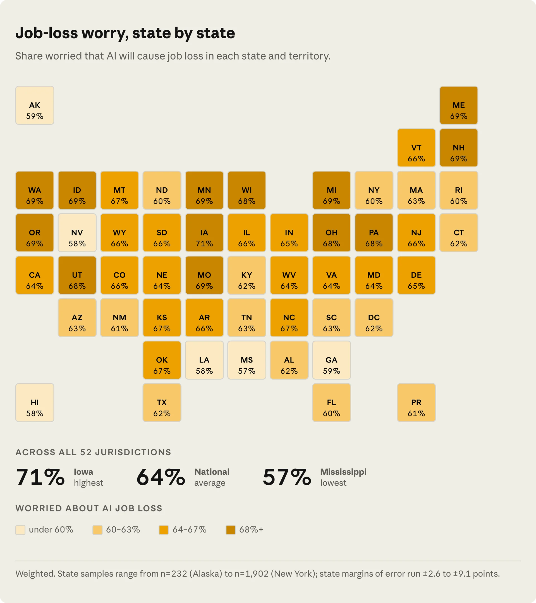

引人注目的是，在大多数问题上，人工智能并没有按照典型的党派、地理或教育界限严重分裂美国人。总体而言，各个主题达成了广泛共识：美国人渴望实现人工智能所承诺的好处，但担心它可能带来的破坏，并且他们希望构建人工智能的公司承担责任。就我们所看到的分歧而言，很大程度上只是人们观点的强度而已。

这项研究建立在 Anthropic 正在进行的其他工作的基础上，旨在了解人们如何使用 Claude 并思考人工智能的开发。我们最近进行了一次全球 [对 81,000 名 Claude 用户的定性研究](https://www.anthropic.com/features/81k-interviews) 通过 [人性采访者](https://www.anthropic.com/news/anthropic-interviewer)，我们用于进行大规模深度访谈的工具。我们还定期发布来自 [人为经济指数](https://www.anthropic.com/economic-index)，它利用匿名的Claude使用数据来展示世界各地的人们如何使用人工智能。人类公共记录调查标志着我们第一次与公众对话，使我们能够接触到人工智能的非用户，并更好地了解不同人口群体的态度有何不同。

人择公共记录将定期重复，随着新主题变得更加突出，其范围也会不断变化，并使我们能够跟踪公众对人工智能的态度如何随着模型能力的进步和采用的加深而变化。未来，我们计划扩展到美国以外的地区。

## 方法简述

我们于 2025 年 11 月和 12 月对 51,993 名美国人进行了一项具有全国代表性的在线调查，调查数据来自 YouGov，并根据美国人口普查基准进行加权。州样本范围从 n=232（阿拉斯加）到 n=1,902（纽约），州级误差范围在 ±2.6 到 ±9.1 个百分点之间。有关该方法的更多详细信息请参阅附录。

## 美国人希望人工智能能带来什么

我们要求美国人从 17 个愿望清单中选出他们对人工智能的三大希望。治愈疾病位居榜首，48% 的受访者将其排在前三名，比第二个最常选择的项目（帮助残疾人）（36%）领先 12 个百分点。诸如治疗和减少孤独感之类的项目——或者希望人工智能可以取代人类接触——是所提出的选项中排名最低的。

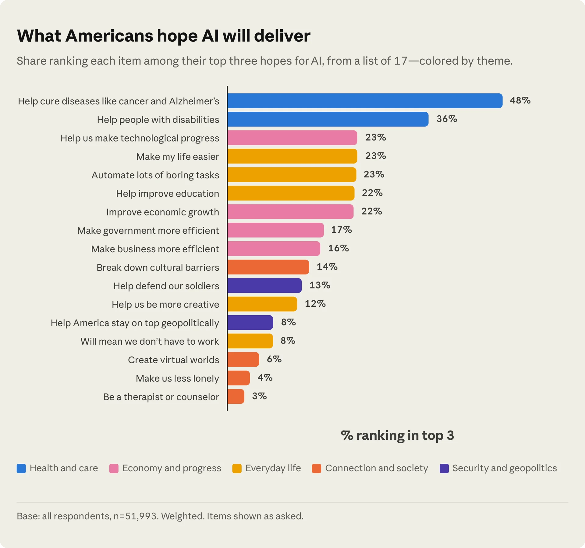

## 美国人害怕什么

我们向受访者提供了人工智能可能造成的 20 种危害的清单，要求他们标记出他们个人担心的每一种危害，然后按五分制对他们的担心程度进行评分。我们认为任何 2（有些担心）或更高的回答都属于担心。 （这种方法与上面的问题不同，在上面的问题中，我们要求参与者对 *仅* 他们的三个希望；这些数字没有可比性。）

失业是迄今为止最普遍的担忧，近三分之二（64%）的美国人对此表示担忧。其次是认知依赖（其中人工智能集成使人们无法独立思考）（56%）和错误信息（52%）。失业和认知依赖也是我们最担心的问题之一。 [使用 Claude 对 81,000 人进行的定性研究。](https://www.anthropic.com/features/81k-interviews)

最常见的危害往往是近期和具体的：失业、认知依赖、错误信息、犯罪利用和监视。这些担忧都早于人工智能出现，在早期技术中已有先例，例如，自动化导致失业、智能手机助长依赖性以及社交媒体传播错误信息。总体而言，美国人往往更关心人工智能的滥用，而不是人工智能的错位，他们更频繁地提到犯罪使用、监视和恐怖主义，而不是人工智能“失控”等。

对于我们提到的除三种危害之外的所有危害，大多数受访者都表示自己“不担心”，但没有任何潜在危害，只有不到 1/4 的美国人至少有一些担心。

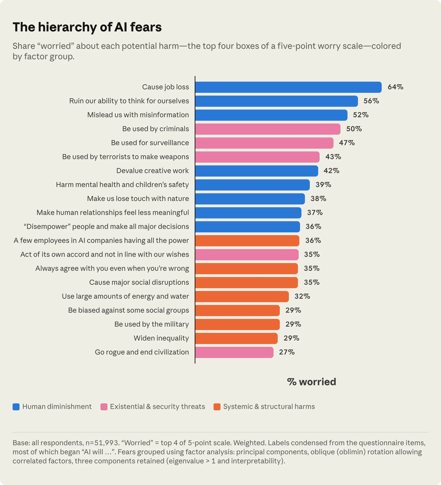

## 失业模式

百分之六十四的美国人担心人工智能会取代工作。人们的担忧分布非常均匀。在民主党（67%）和共和党（62%）、有孩子的家庭（59%）和没有孩子的家庭（66%）以及从高端的爱荷华州（71%）到低端的密西西比州（57%）的每个州中，这是最担心的。

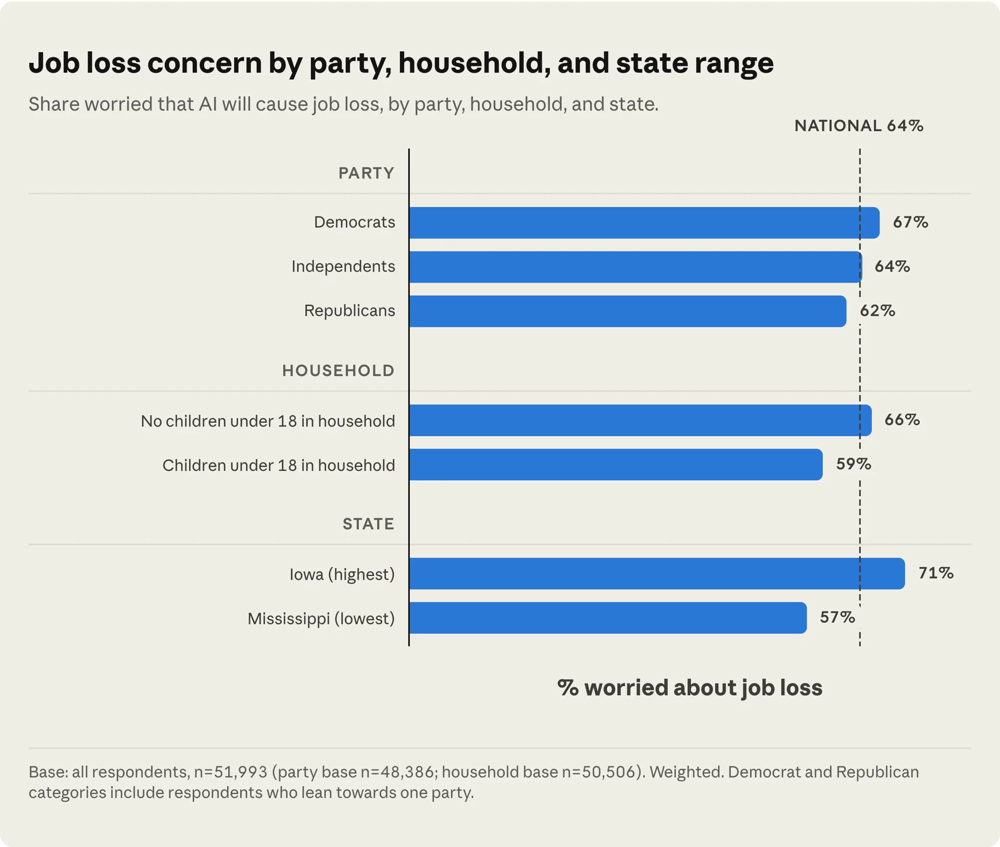

### 受教育程度较高的美国人对失业的担忧更高

随着受访者受教育程度的提高，对工作流失的担忧也随之增加。拥有研究生学位的美国人对失业的担忧比高中或以下学历的美国人高出近 10 个百分点。换句话说，最担心失业的工人是那些工作已经与人工智能被要求做的事情有更紧密重叠的人——这一发现 [反映](https://www.anthropic.com/research/81k-economics) 在我们的经济研究团队对全球人择访谈研究的分析中。

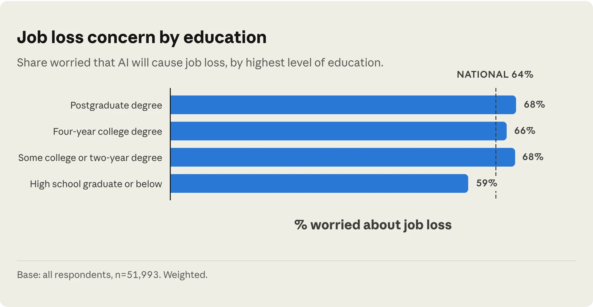

### 使用人工智能最少的人对失业的恐惧加剧

与此同时，每天在工作中使用人工智能的人明显 *少* 与完全不使用人工智能的人相比，他们担心失业：54% 对 70%。

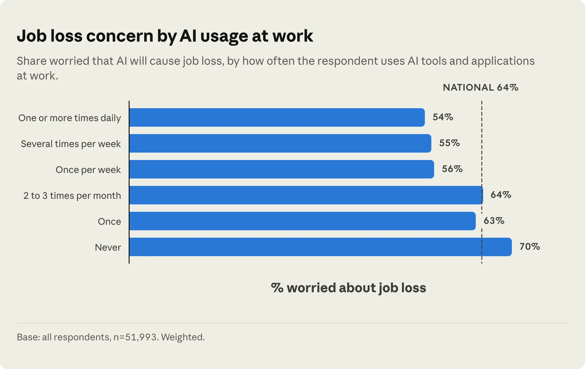

对于这一趋势有很多可能的解释。人工智能的实践经验可能有助于人们发展技能和流畅性，使他们能够增强而不是自动化部分工作，从而使失业看起来不再是迫在眉睫的威胁。实践经验也可能揭示人工智能的局限性。很可能是这些因素和其他因素的结合。

### 工作中人工智能的感知能力和接受度

我们向受访者提供了 14 项工作场所任务的列表，并针对每项任务提出了两个问题：“您认为 AI 工具或应用程序目前执行此任务的能力如何？” “想想你自己的工作，对于以下每项工作任务/目的，你希望人工智能参与多少？”

对AI能力的总体评价相当高。在高端方面，75% 的美国人表示人工智能在研究方面与人类一样好或更好。在低端，44% 的人表示人工智能在服务和支持方面同样好或更好。

在大多数任务中，大多数美国人不希望人工智能参与其中在他们的工作中，甚至在他们认为人工智能最有能力的任务上——比如研究和数据分析——近一半的受访者表示，他们不希望人工智能参与自己的工作。然而，工作场所对人工智能参与的接受程度似乎与人们感知到的能力是一致的：在特定领域中，人工智能被认为越有能力，人们就越有可能愿意使用它。

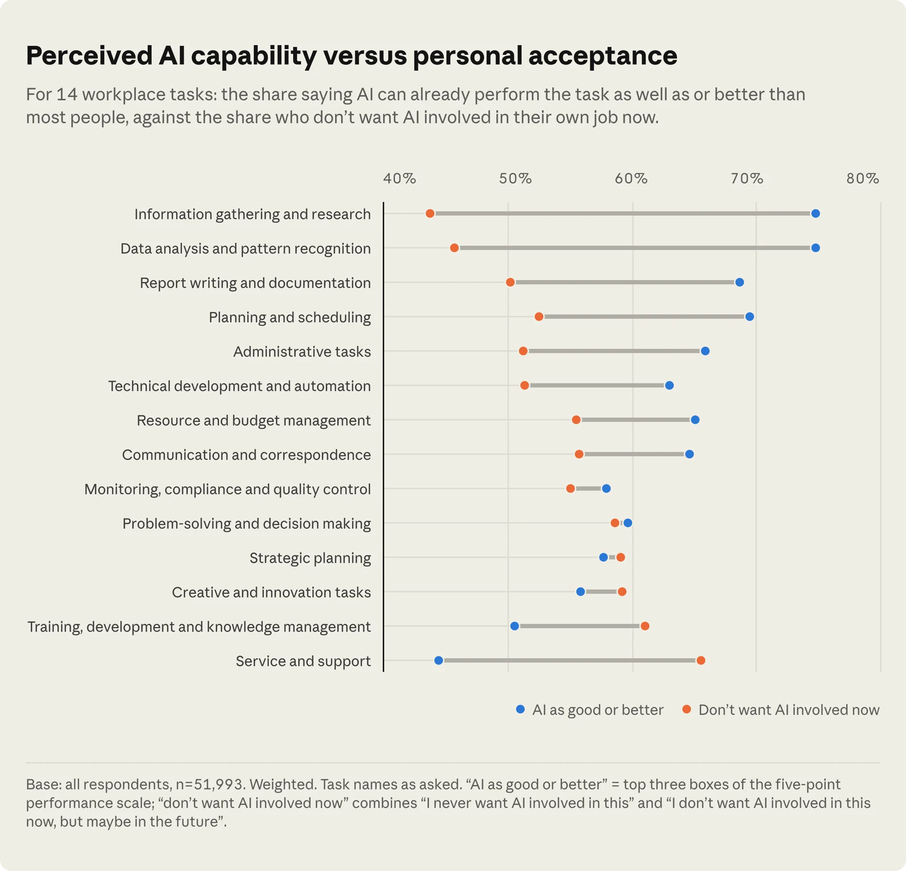

### 认知依赖是一种预期的恐惧

我们的调查中第二个最常见的恐惧是对人工智能的认知依赖。为了更好地了解人们是否真的会经历依赖性，我们询问受访者，如果人工智能明天无法使用，他们会感受到多大的干扰，然后将那些担心依赖性的人和那些不关心依赖性的人的答案进行比较。

到目前为止，认知依赖似乎是一种主要的预期恐惧：在 56% 的美国人中，对依赖表示担忧，但如果人工智能无法使用，只有大约 1/5 的人会感到严重干扰。相反，在 44% 不担心依赖的人中，更高的比例（大约 1/3）*会* 感到明显的干扰。

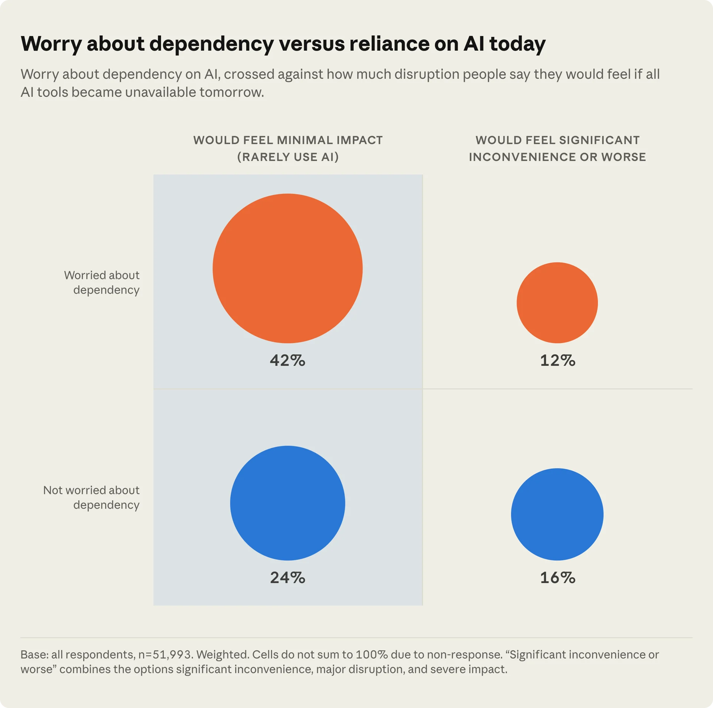

我们的定性研究 [81,000 Claude用户](https://www.anthropic.com/features/81k-interviews) 研究发现，教育工作者亲眼目睹认知萎缩的可能性比平均水平高出 2.5 至 3 倍，而认知萎缩可能就发生在他们的学生身上。在人类公共记录中，教育工作者同样是最担心依赖性的职业之一，仅次于艺术和设计人员。

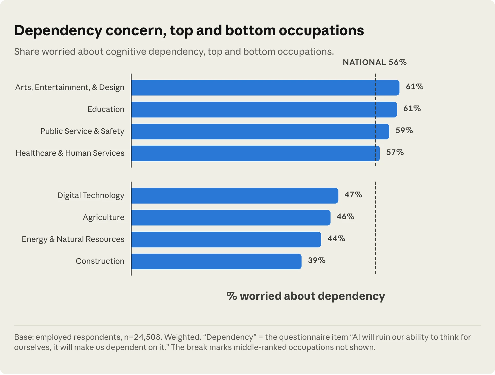

与失业一样，依赖恐惧随着使用量的增加而稳步下降。每天在工作中使用人工智能的美国人 (46%) 比从不使用人工智能的美国人 (62%) 少 16 个百分点。

## 最重的人工智能用户告诉我们什么

截至 2025 年底，约 6% 的美国人每天都使用人工智能工作和个人生活。这些 *综合用户* 预览了人工智能的更广泛采用是什么样子，以及随着采用的增长，主流观点可能走向何方。

综合用户主要是年轻人、男性、城市、就业者和受过大学教育的用户。近三分之二的人将自己描述为先于大多数人尝试新技术或在看到新技术潜力后就尽早采用新技术的人，而普通公众的这一比例为 30%。

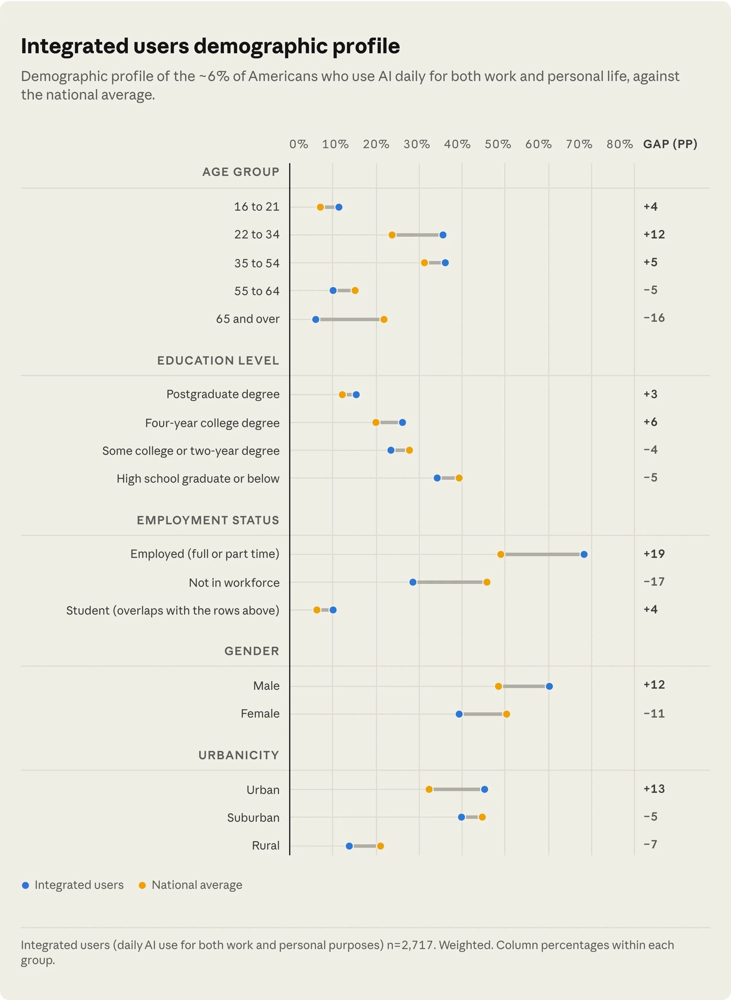

对于我们列出的每种危害，综合用户比普通公众更担心，尽管这可能反映了早期采用者的前景差异。

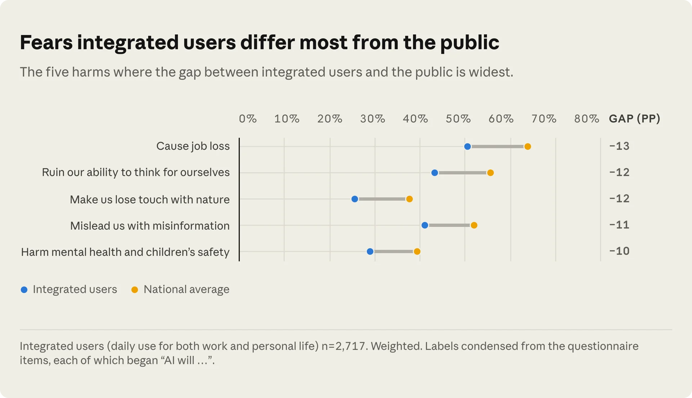

## 美国人希望从人工智能治理中得到什么

71%的美国人表示政府应该参与人工智能的开发和监管。民主党人的这一比例为 79%，共和党人为 68%，独立人士为 69%，这是两党的绝对多数。我们调查的每个州和地区的大多数人都支持政府参与人工智能，从哥伦比亚特区的 81% 到夏威夷的 63%。

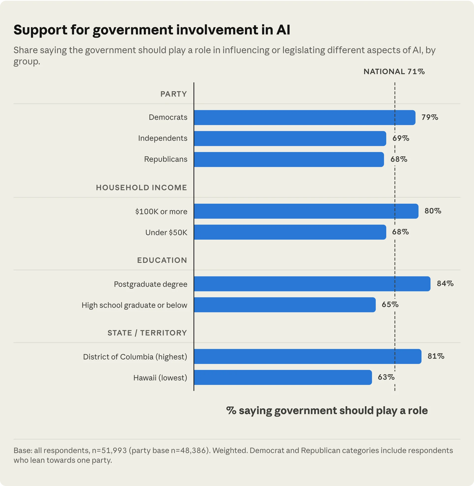

### 美国人希望政府在哪里采取行动

然后我们询问了八个具体领域，以及政府在每个领域的参与程度。只有两个——隐私和儿童安全——获得了大多数人的绝对支持，而不是起码的作用。与此同时，国家安全领域的党派差距是所有领域中最小的，民主党和共和党之间仅相差三分。

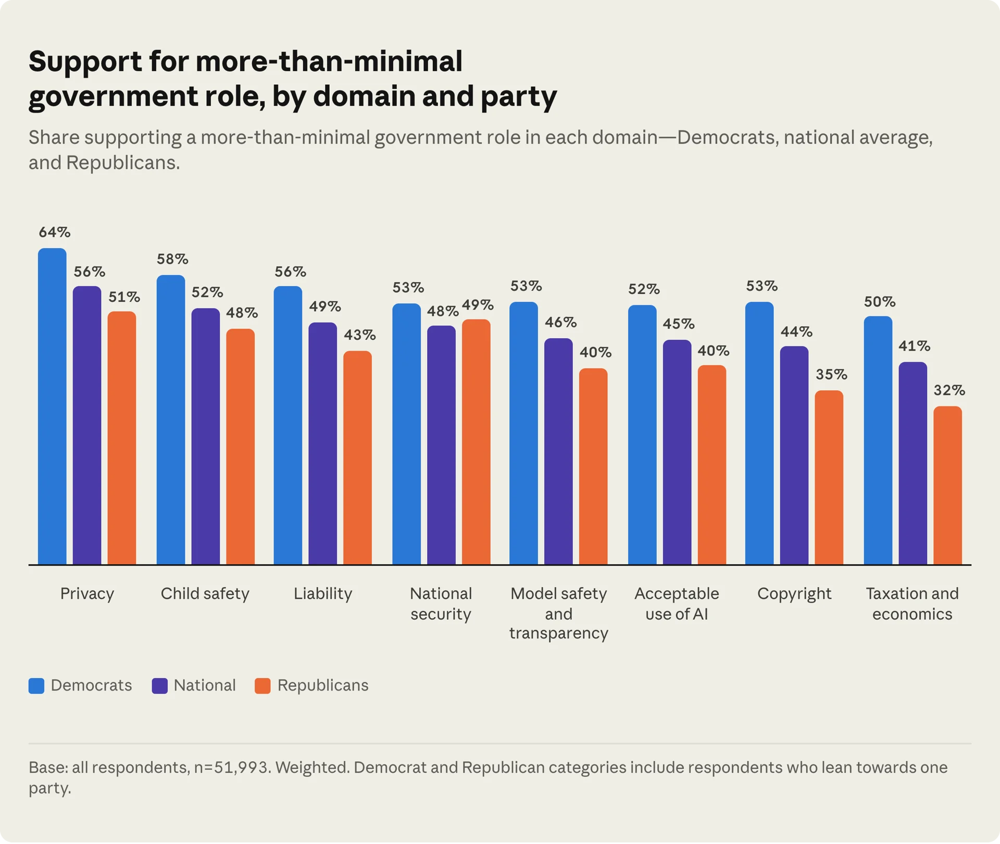

### 美国人想从这个行业得到什么

当我们问应该采取什么措施来确保人工智能的发展符合人类利益时，美国人集中在两个答案上：让人工智能公司对伤害承担法律责任（47％的人将其列为前三名），并将安全性置于增长之上（44％）。其次是拥有实际权力的独立监管机构（29%）和为了安全而放慢人工智能开发速度的机构（27%）。

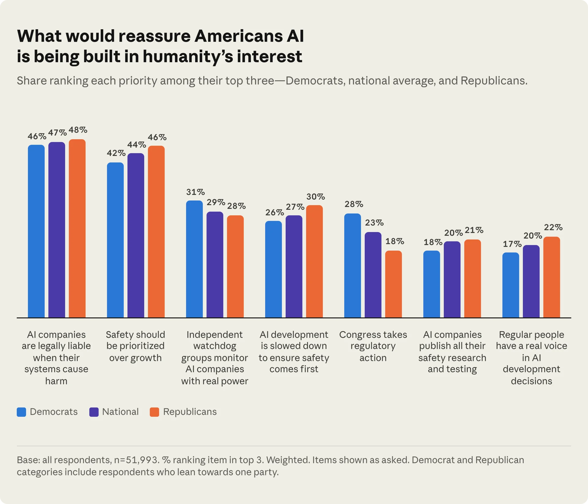

### 信任赤字

只有 15% 的美国人表示，他们相信人工智能公司能够就如何开发和使用该技术做出决定。这是我们测试的所有机构中最低的数字，低于联邦政府（20%）、州和地方政府（19%）以及国际机构（20%），也远低于独立专家（43%）。

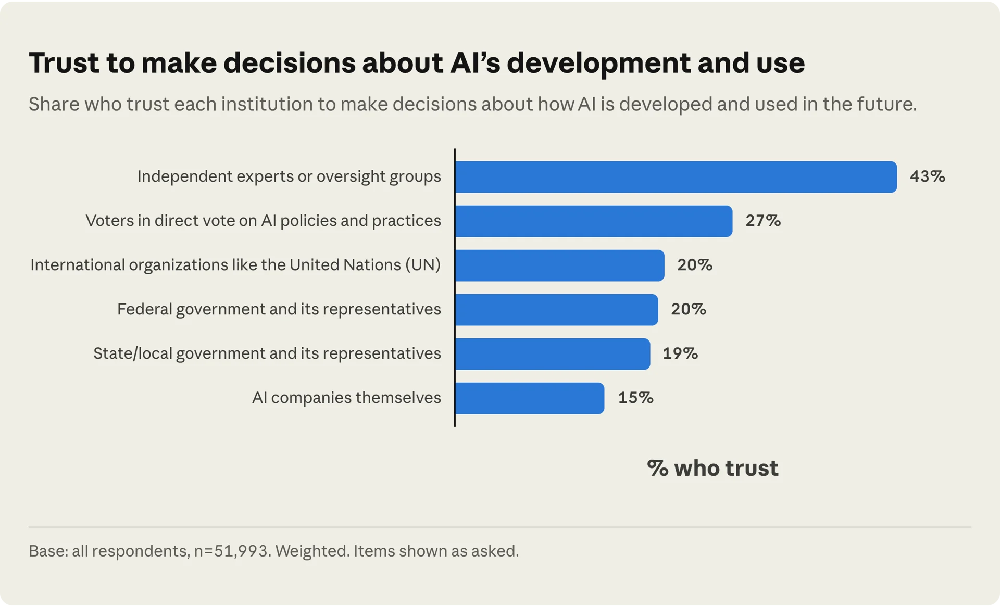

### 综合用户对监管和监督有着同样的兴趣

综合用户对我们询问的每个机构（包括人工智能公司）都更加信任，并且明显不太愿意说人工智能的发展应该放慢或停止。然而，他们也支持政府以全国范围内的比例参与人工智能（74% 对 71%），并且在我们测试的八个具体治理领域中，他们的偏好与公众的偏好几乎没有区别。

## 人为举措以及接下来会发生什么

公众意见对于确保强大的人工智能服务于人类利益至关重要。人类公共记录、人类采访者、人类经济指数以及我们的许多其他研究项目都是为了获得公众对如何使人工智能转型顺利进行的更多理解和意见。

我们最近宣布了几项 [政策框架](https://www.anthropic.com/policy-on-the-ai-exponential) 与这些发现相关。我们的高级人工智能框架提出了对前沿模型的强制性独立安全测试、透明度要求以及阻止或召回危险人工智能部署的政府权力。我们的经济政策框架阐述了政府如何为人工智能的经济影响做好准备——尽可能减少工作岗位流失，并支持工人，使人工智能的好处得到广泛分享。

人工智能的发展方向不应仅由构建人工智能的公司来决定。公众的希望和担忧衡量得越清楚，我们和其他公司就越能满足这些需求。

## 附录：方法论

**人口及模式：** Anthropic Public Record 是一项针对美国 50 个州、哥伦比亚特区或波多黎各 16 岁及以上青少年和成人互联网人口的在线调查。实地调查由 YouGov 于 2025 年 11 月 1 日至 12 月 11 日期间通过其在线小组进行。

**样品设计：** 该研究设计为 52 个平行州和领地样本，目标是每个州完成约 1,000 份（蒙大拿州、北达科他州、南达科他州、怀俄明州、佛蒙特州和波多黎各约 500 份）。每个州都根据年龄、性别、教育程度和种族/民族设定了配额。完成的样本数量为 51,993 个，各州样本大小范围从 232 个（阿拉斯加）到 1,902 个（纽约）。

**权重：** 数据经过加权以代表 16 岁及以上美国居民人口的州、年龄、性别、教育程度和种族/民族。权重根据所达到的样本量进行归一化（平均值 1.00，总和 51,993）。

**误差范围：** 对于 50% 的比例，在 95% 置信水平下，全国抽样误差幅度为 ±0.6 个百分点。州级误差范围从 ±2.6 点（加利福尼亚州、纽约州、德克萨斯州）到 ±9.1 点（怀俄明州）。子组的误差幅度更大。

**报告惯例：** 本报告中的所有百分比均经过加权。除非另有说明，否则百分比使用完整部分作为分母（回答“不知道”或跳过的受访者仍保留在基数中）。恐惧组中的“担心”是五点担忧量表中的前四个方框。能力电池上的“一样好或更好”是五点性能量表中的前三个框。“综合用户”是指每天一次或多次用于工作、每天一次或多次用于个人目的的受访者（未加权 n=2,717）。党派团体包括学习者。

**限制：** Anthropic Public Record 记录了 2025 年底美国人对人工智能的看法。我们将其视为基线。
