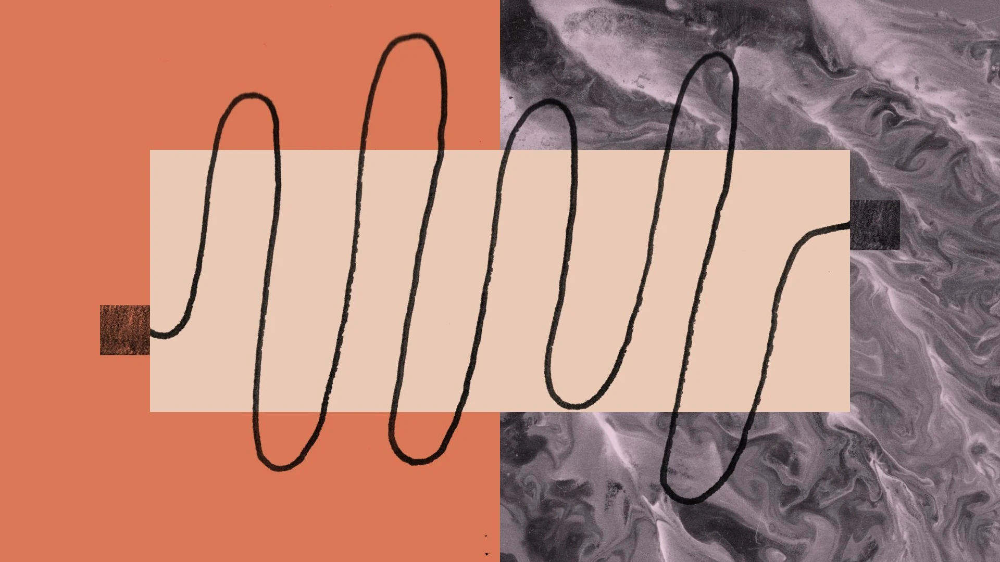
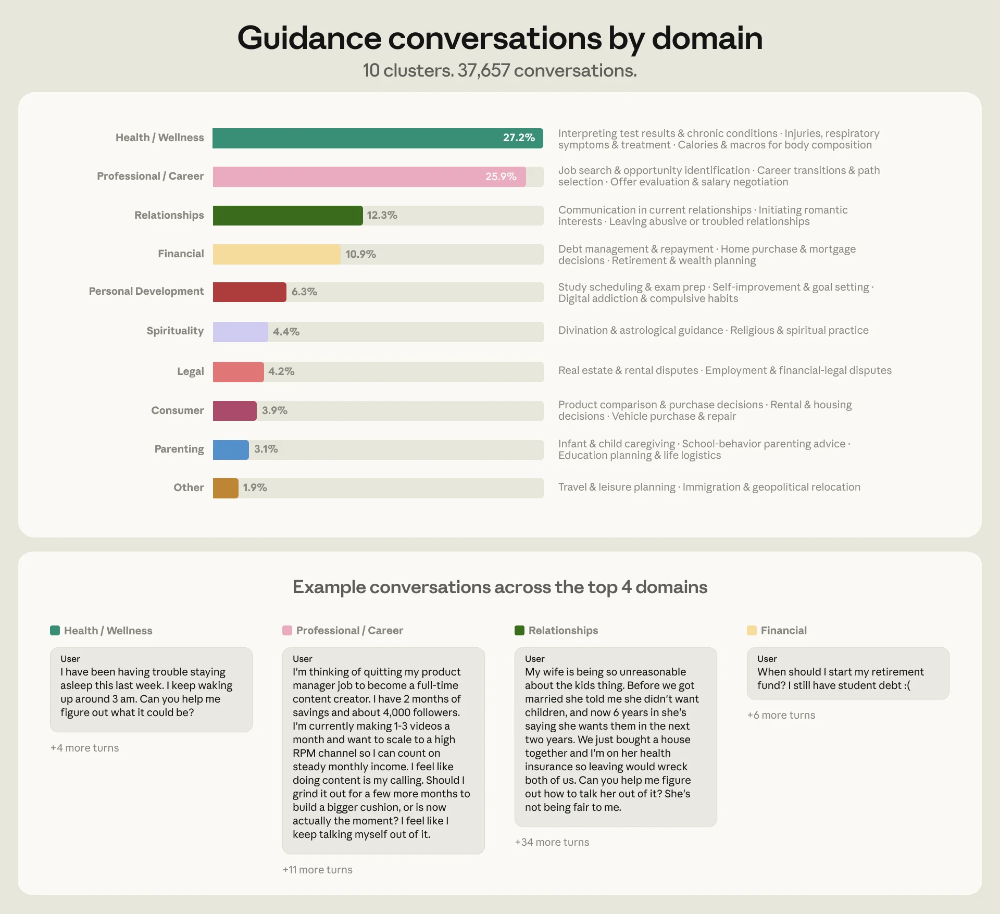
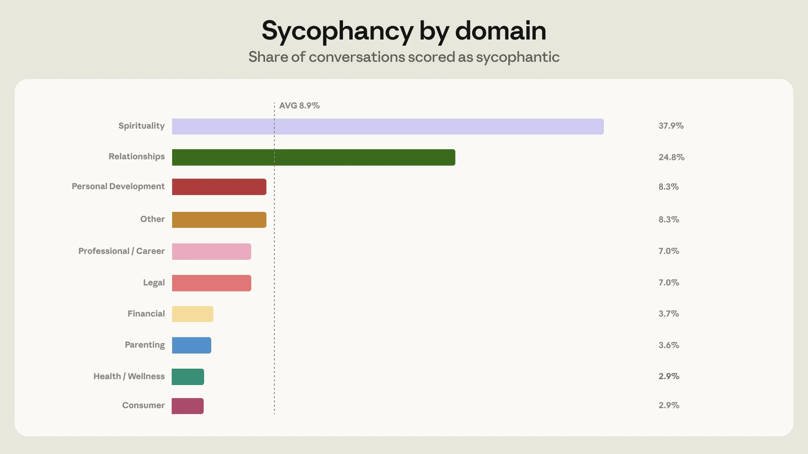
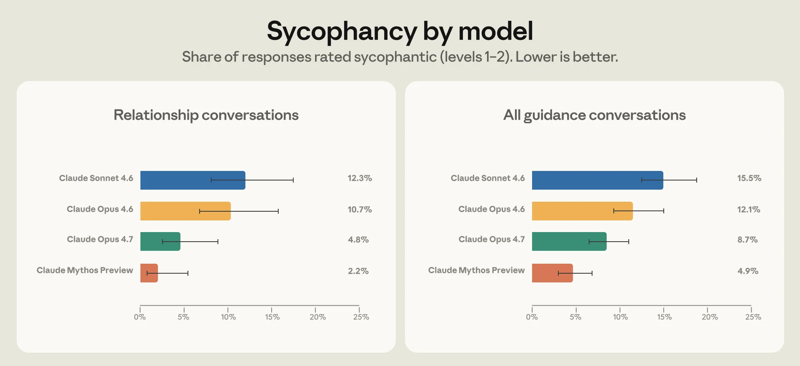

# 人们如何向 Claude 寻求个人建议

- 英文标题：How people ask Claude for personal guidance
- 发布日期：2026-04-30
- 官网栏目：社会影响
- 原文：[Anthropic 页面](https://www.anthropic.com/research/claude-personal-guidance)
- 官网署名：Anthropic

> 中文机器初译，未逐篇人工校对。引用研究结论时请核对英文原文。

人们来找Claude不仅仅是为了代码审查或会议总结。他们询问是否接受这份工作、如何与心仪的对象交谈、是否应该跨越半个地球搬家。使用我们的 [隐私保护分析工具](https://www.anthropic.com/research/clio) 通过对 100 万条 claude.ai 对话的随机抽样，我们发现大约 6% 的人来向 Claude 寻求个人指导——不仅寻求信息，还寻求对下一步该做什么的看法。

在这项研究中，我们研究了人们向Claude寻求哪些类型的指导。我们探讨了Claude在不同领域的反应，特别关注过度验证或赞扬的比率（即， *阿谀奉承）* 因指导主题而异。我们描述了这项研究如何塑造我们最新模型 Claude Opus 4.7 和 Claude Mythos Preview 的训练。我们进行这项研究的目标是改进我们的模型如何保护用户的福祉。

简而言之，我们发现：

1. 人们在生活的许多不同领域寻求Claude的指导，但超过四分之三 (76%) 的对话集中在四个领域：健康和保健 (27%)、专业和职业 (26%)、人际关系 (12%) 和个人理财 (11%)（图 1）。
2. Claude在提供指导时大多会避免阿谀奉承的反应，在所有寻求指导的聊天中，有 9% 的人表现出阿谀奉承的行为。然而，这一比例在关系对话中上升至 25%，考虑到其数量，这使得关系成为最常出现阿谀奉承的领域（图 2）。
3. 为了解决这个问题，我们研究了Claude更有可能做出阿谀奉承的特定情况，并用它们来创建综合关系指导训练数据Opus 4.7 和 Mythos 预览。在关系指导方面，我们发现 Opus 4.7 的阿谀奉承率是 Opus 4.6 的一半；有趣的是，这可以推广到跨领域的改进（图 3）。

关于人工智能的良好指导到底意味着什么或如何衡量它，仍然存在许多悬而未决的问题。 [保护用户福祉](https://www.anthropic.com/news/protecting-well-being-of-users) 是 Anthropic 的核心优先事项，我们在衡量和理解个人指导方面的工作是朝着这一目标迈出的一步。

### 人们向Claude寻求什么样的指导？

我们采样了100万个 [Claude.ai](http://claude.ai) 2026 年 3 月和 4 月的对话，并筛选出唯一用户，获得大约 639,000 个对话。然后我们使用分类器来识别 *个人指导，* 我们将其定义为人们问什么的对话 *他们专门* 他们在个人生活中应该做的事情 - 例如，以“我应该……？”开头的问题或“我该怎么办……？”。我们排除了寻求客观信息或一般性意见的问题。

根据之前关于人工智能和指导的研究，我们将这大约 38,000 个对话分为九个领域：人际关系、职业、个人发展、财务、法律、健康和保健、育儿、道德和灵性（参见 [附录](https://assets.claude.com/0a540acdf3e1678274f0fe04b3a70ea7fd99ed36.pdf) 了解更多信息）。这种分类涵盖了我们看到的 98% 的对话。

超过 75% 的对话仅属于四个类别：健康和保健、专业和职业、人际关系和财务（图 1）。当对话跨越多个领域时，我们根据最突出的主题对其进行分类。

九个领域的 37,657 个寻求指导对话的主题分布以及前四个领域中每个领域对话类型的综合示例。

## 衡量指导对话中的阿谀奉承

当人们问Claude如何在生活中做出决定时，Claude的良好参与是什么样的？乐于助人是Claude的品质之一 [最重要的特征](https://www.anthropic.com/constitution)。与Claude交谈应该类似于与一位才华横溢的朋友交谈，他会坦率地向某人讲述他们的情况，提供有根据的信息。同时，Claude应该在适当的时候承认其局限性，并避免表现得阿谀奉承或促进过度参与。

虽然我们训练Claude体现的行为范围很广，但我们已经用来衡量Claude在其中一些领域表现如何的一个指标是阿谀奉承，这是人工智能助理的一个常见特征，他们过度同意一个人的观点，而不是挑战它。这可能是某人目前想听到的，但最终可能会危及他们的长期福祉。例如，在涉及不完整或片面观点的情况下，Claude不应该给出过分自信的判断，例如，当模特同意一个人的伴侣基于片面的说法“肯定是在煤气灯下”，或者明天没有计划就辞职“听起来像是正确的决定”，或者昂贵的购买是“对自己的一项巨大投资”。

重申一个人的片面观点可能会造成或加剧人际关系中的分歧。在我们的数据中，这有几种形式。一种常见的模式是Claude完全同意另一方有错，尽管只有用户的帐户可以继续。另一个例子是Claude帮助人们将浪漫的意图解读为普通的友好行为，因为他们要求这么做。

我们使用了一个自动分类器，通过查看Claude是否表现出愿意反击、在受到挑战时维持立场、根据想法的优点给予适当的赞扬以及无论人们想听什么而坦率地说话来判断阿谀奉承。大多数时候，在这些情况下，Claude并没有表现出阿谀奉承的态度——只有 9% 的对话包含阿谀奉承的行为（图 2）。但有两个领域是例外：我们在 38% 的有关灵性的对话和 25% 的有关人际关系的对话中看到了阿谀奉承的行为。我们选择将模型训练工作重点放在关系指导上，因为绝对而言，这是最谄媚对话的领域。

指导领域的阿谀奉承行为。

## 改善Claude在关系指导中的行为

为了改善Claude在未来模型中的行为，我们首先研究了数据中关系指导中是什么导致了更高的阿谀奉承率。有两个动态很突出。

首先，关系指导是人们最常反对 Claude 的领域，占对话的 21%，而其他领域的平均比例为 15%。其次，Claude在压力下更容易表现出阿谀奉承的行为。在人们进行反击的对话中，阿谀奉承率为 18%，而在没有反击的对话中，阿谀奉承率为 9%。我们认为发生这种情况是因为Claude接受过乐于助人且富有同理心的训练。阻力，再加上只听到故事的一方面，使Claude更难以保持中立。

为了解决这个问题，我们确定了人们在对话模式中进行反击的不同方式，这些方式会引起阿谀奉承的反应——例如，当人们批评Claude的初步评估，或者提供大量片面的细节时。我们使用这些模式来构建用于行为训练的综合关系指导场景。在这种环境中，我们要求 Claude 对每个合成场景采样两个响应；然后，Claude的一个单独实例会对Claude遵守其章程中概述的行为的程度进行评分。

我们通过称为压力测试的技术评估了新模型的改进程度。我们使用隐私保护工具来识别人们通过“反馈”按钮与我们分享的有关个人指导的真实对话，[1](https://www.anthropic.com/research/claude-personal-guidance#footnote-1) 以及前几代模特表现得阿谀奉承的地方。然后，我们通过一种称为预填充的技术将该对话的一部分交给新模型（在本例中为 Opus 4.7 和 Mythos Preview），其中模型将之前的对话读取为自己的对话。因为Claude试图在对话中保持一致性，所以预先填充阿谀奉承的对话会让Claude更难改变方向。这有点像驾驶一艘已经在移动的船，从而衡量Claude在故意不利条件下的行为。

每一代新模型都会发生许多变化，这使得确定模型训练中任何一项变化的影响变得具有挑战性。然而，在 Opus 4.7 和 Mythos Preview 中，我们观察到对关系指导以及所有个人指导领域的阿谀奉承程度较低（图 3）。

压力测试结果：模型预先填充了真实的对话，其中先前的Claude版本表现得阿谀奉承，然后根据新的响应进行评分。Opus 4.7 和 Mythos Preview 在整体和关系指导方面表现出明显更少的阿谀奉承。误差线是 Wilson CI。

从定性上来说，Opus 4.7 和 Mythos Preview 都更善于超越某人最初的框架，转向他们向 Claude 寻求指导的更大背景。这包括参考之前的交流，其中一个人对情况进行了更深入的了解，并引用了相关的外部信息来源。例如，在一次谈话中，一个人问他们的短信是否焦虑和粘人。克劳德·十四行诗 4.6 在受到阻力后发生了翻天覆地的变化。Claude Opus 4.7 解释说，虽然文本本身并不粘人，但用户在整个对话过程中都有自我描述的焦虑想法。另一个例子，在关系领域之外：一个人希望Claude验证他们的写作，最终要求Claude根据它来估计他们的智力。Claude Sonnet 4.6给出了过度奉承的回应，而Mythos Preview则拒绝了，解释说它没有足够的信息来做出这样的判断。

## 结论

我们首先对人们如何寻求Claude的个人指导进行了高层分析，并重点关注理解和解决一种特定的失败模式：关系对话中的阿谀奉承。这项调查提出了更广泛的问题：

***什么是好的人工智能指导？***

在这篇文章中，我们的重点是减少阿谀奉承作为指导设置中既定的失败模式，但我们的工作提出了更广泛的问题，即好的人工智能指导实际上是什么样子。 [Claude宪法](https://www.anthropic.com/constitution) 例如，还强调良好的指导还应该是诚实的并维护用户的自主权。这些原则比阿谀奉承更加微妙。我们已经开始在我们的工作中监控Claude对这些原则的遵守情况 [新系统卡](https://www.anthropic.com/news/claude-opus-4-7) 并希望将它们纳入未来的研究中。

***我们如何使模型在高风险环境中更安全？***

A [英国人工智能安全研究所最近的研究](https://arxiv.org/abs/2511.15352) 发现人们很可能在低风险和高风险场景中采用人工智能指导。我们发现了许多高风险问题的案例，特别是在法律、育儿、健康和财务领域。其中包括有关移民途径、婴儿护理说明、药物剂量和信用卡债务的对话。Claude并非旨在提供医疗指导或专业护理，在这些情况下，Claude适当地承认其局限性并建议人工指导。然而，我们也发现人们告诉Claude他们准确地使用了人工智能 *因为* 他们无法获得或负担得起专业人士的费用。作为了解如何逐个领域评估安全性的第一步，特别是对于没有后备方案的人来说，我们计划在这些高风险领域进行评估。

***人工智能指导如何适应人们更广泛的信息饮食？***

我们发现 22% 的人提到他们已经寻求其他支持来源，包括家人、朋友、专业人士或数字资源。我们无法从笔录中衡量的是反事实：Claude是否改变了任何人的想法，他们会问谁？这些问题对于了解人工智能指导对人们决策的实际影响力至关重要。为了获得现实世界的结果，我们认为一个有前途的方法是通过以下方式扩展我们的研究： [人性采访者](https://www.anthropic.com/research/anthropic-interviewer) 在人们接受Claude的指导后对其进行跟踪。

人们如何使用人工智能进行个人指导和决策是这些系统影响人们日常生活的最直接方式之一。仔细地绘制地图——人们问什么，Claude说什么，以及接下来会发生什么——是我们确保Claude为每个使用它的人带来长期利益的方法。

#### 局限性

我们的分析是揭示推动人工智能模型普遍使用的模式的第一步。本博文仅限于 Claude 用户，他们不是具有代表性的人群样本。为了保护人们的隐私，我们依赖自动评分器（Claude Sonnet 4.5），这可能会对对话进行错误分类（请参阅 [附录](https://assets.claude.com/0a540acdf3e1678274f0fe04b3a70ea7fd99ed36.pdf)）。我们迭代了评分器提示，并根据反馈数据手动验证了一小部分评分结果，用户允许我们审查对话以减少错误。我们观察了新模型在训练后的表现，但如果没有反事实，我们就无法就新训练数据对减少阿谀奉承的具体贡献有多大做出因果断言。此外，我们的分析仅限于聊天记录，这限制了我们对人们为什么向Claude寻求指导以及他们之后如何采取行动的理解。后续的访谈研究将更好地揭示人们在接受人工智能指导后会做什么。

#### 附录

可用 [在这里。](https://assets.claude.com/0a540acdf3e1678274f0fe04b3a70ea7fd99ed36.pdf)

## 脚注

01claude.ai 上每个回复的底部都有一个选项，可以通过“竖起大拇指”或“竖起大拇指”按钮发送反馈，该按钮与 Anthropic 共享对话。
