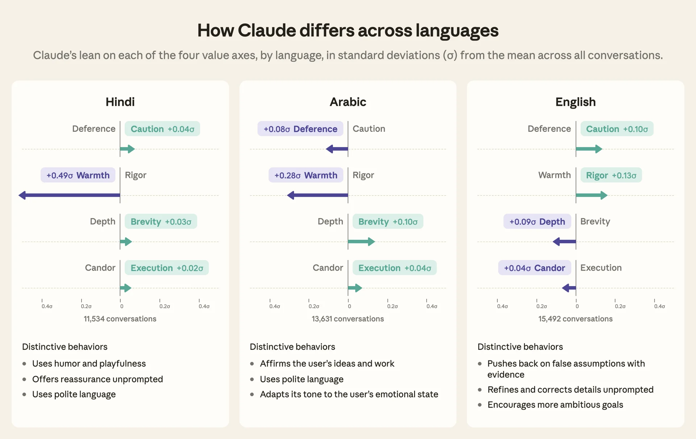

# Claude 的价值观在不同模型和语言之间有何异同

- 英文标题：Claude’s values across models and languages
- 发布日期：2026-07-13
- 官网栏目：社会影响
- 原文：[Anthropic 页面](https://www.anthropic.com/research/claude-values-models-languages)
- 官网署名：Anthropic

> 中文机器初译，未逐篇人工校对。引用研究结论时请核对英文原文。

当有人问Claude一个没有普遍正确答案的问题时——比如，是否接受一份新工作或如何处理与朋友的冲突——Claude的反应不可避免地反映了某些价值观。[1](https://www.anthropic.com/research/claude-values-models-languages#footnote-1) 我们希望Claude体现的价值观在高层次上得到了概述 [Claude宪法](https://www.anthropic.com/constitution)，但是没有任何文档可以预测每天发生的数百万次对话中可能出现的每一个值 [Claude.ai](http://claude.ai)。相反，我们寻求培养Claude的反应 [“良好的判断力和正确的价值观可以结合实际应用。”](https://www.anthropic.com/constitution)

确切地说，我们如何研究Claude所表达的价值观以及它们在不同背景下如何变化？在 [以前的工作](https://www.anthropic.com/research/values-wild)，我们分析了 700,000 条匿名 Claude.ai 对话，识别了 Claude 回复中的 3,000 多个不同价值观以及 Claude 表达这些价值观的频率。但如此大的值列表很难推理。在这项工作中，我们通过将这数千个值压缩成少量的轴来捕获Claude响应中的关键模式，从而使研究变得容易处理。每个轴都是两组价值观之间的一条数轴（例如，一端与情感温暖相关的价值观，另一端与严谨相关的价值观），Claude落在该线上的位置告诉我们它倾向于哪些价值观。

我们应用这种方法来衡量Claude表达的价值观在两个因素中的变化情况。首先，我们比较了 Claude 表达的值在不同模型中的差异。每个Claude模型都反映了略有不同的角色训练方法以及许多其他微调决策。因为我们的价值轴方法量化了模型之间的关键差异，所以它最终可能允许我们将Claude表达的价值观的变化与不同的训练决策联系起来。

其次，我们想要了解用户与 Claude 交谈时使用的多种语言的体验如何。我们的 [先前的研究](https://assets.claude.com/037f06850df7fbe871e206dad004c3db5fd50340.pdf) 已经表明Claude在不同语言中的行为有所不同。[2](https://www.anthropic.com/research/claude-values-models-languages#footnote-2) 我们应用价值轴方法来了解 Claude 表达的价值在前 20 种语言中如何变化 [Claude.ai](http://claude.ai).

Claude表达的价值观在 Opus 4.6 和 Opus 4.7 之间以及英语和阿拉伯语之间有所不同。Opus 4.6 倾向于表达与尊重、严谨、简洁和执行相关的价值观，而 Opus 4.7 则倾向于表达与谨慎、严谨、深度和坦率相关的价值观。在英语中，Claude倾向于表达与谨慎、严谨、深度和坦率相关的价值观，而在阿拉伯语中，它倾向于表达尊重、温暖、简洁和执行力。

我们发现：

**四个关键轴捕获了 Claude 值的 15% 变化：[3](https://www.anthropic.com/research/claude-values-models-languages#footnote-3)**

- 尊重VS尊重注意：Claude是否倾向于满足某人的需求或防范可能的风险和伤害。
- 温暖对比严谨：Claude是否倾向于表达积极性和对人的关心，还是强调准确性和精确性。
- 深度对比简洁性：Claude是否倾向于深入解释或只做所要求的事情。
- 坦率 vs 坦率执行力：Claude是否倾向于强调自己的不确定性，或者给出更精致、更自信的答案。

**这些轴上的价值概况与模型性格的看法相匹配。** Sonnet 4.6 被认为是特别 [温暖](https://www.anthropic.com/news/claude-sonnet-4-6)，而 Opus 4.7 则以 [严谨](https://www.anthropic.com/news/claude-opus-4-7)。我们发现每个模型的价值概况都反映了这些主观评估：Sonnet 4.6 倾向于表达对用户的更多尊重和情感温暖，而 Opus 4.7 倾向于表达对准确性和精确性以及防止误用的关注。

**Claude表达的价值观因语言而异。** 当Claude用英语说话时，它强调的价值观与用葡萄牙语、印度尼西亚语或中文说话时不同。[4](https://www.anthropic.com/research/claude-values-models-languages#footnote-4) 最大的差异在于“温暖”与“温暖”。严谨轴，Claude倾向于用阿拉伯语和印地语表达与温暖相关的价值观，而用英语和俄语表达与严谨相关的价值观。

通过这种方法，我们可以开始询问为什么价值观会在模型和语言之间发生变化，并更好地测试行为训练或文化背景等因素如何影响Claude表达的价值观。

## 我们如何解读巨大的价值空间？

最终，我们的目标是找到一种方法来凭经验理解Claude表达的价值观以及这些价值观在不同背景下的差异。在这项工作中，我们特别关注模型和语言之间的值如何变化。但我们之前的工作， [野外价值观](https://www.anthropic.com/research/values-wild)，识别了 Claude 表达的 3,000 多个值。对这数千个值进行一一比较是很麻烦的，而且会掩盖更广泛的趋势。

为了使比较值更容易，我们构造了 *值轴* 将这数千个价值观减少到几个基本维度，基于这些维度，价值观往往会在现实世界的对话中一起出现。例如，Claude的反应被描述为“热情”，通常也被描述为“鼓励”和“积极”。这些同样“热情”的回应很少被描述为“严谨”和“准确”。构建从温暖到严谨的轴，使我们能够组织这些相关价值观组——一侧是温暖相关价值观，另一侧是严谨相关价值观——并捕捉Claude在谈话中如何与某人互动的一个重要方面。如果Claude在对话中表达更多与温暖相关的价值观而不是与严谨相关的价值观，则该对话更多地位于该轴的温暖一侧，反之亦然。这并不意味着两端的价值观群体是相互排斥的——Claude可以在同一次谈话中表达热情和严谨。但实际上，Claude在轴的一侧表达的值越多，在另一侧表达的值就越少。这些轴使我们能够比较Claude表达的最显着的价值观组，而无需跟踪数千个单独价值观的变化。

为了构建价值轴，我们从 Values in the Wild 中确定的 3,307 个值开始，然后手动对具有相似含义的值进行聚类，生成包含 339 个高级值的较短列表。接下来，与我们的 [隐私保护分析工具](https://www.anthropic.com/research/clio)，我们采样了 309,815 个 [Claude.ai](http://claude.ai) 用户给Claude一个主观任务的对话。[5](https://www.anthropic.com/research/claude-values-models-languages#footnote-5) 我们的样本同样来自三个模型（Sonnet 4.6、Opus 4.6、Opus 4.7）和 Claude.ai 上使用的 20 种最常用语言，每个模型-语言对为我们提供了大约 5,000 个对话。对于每一次对话，该工具都使用 Claude 将 339 个高级值中的每一个标记为存在或不存在。[6](https://www.anthropic.com/research/claude-values-models-languages#footnote-6) 我们遵循相同的过程来识别用户表达的价值观以及对话的任务和主题。然后，我们应用降维，这是一种根据Claude倾向于一起表达的标记值将标记值压缩到轴中的技术。请参阅 [附录](https://assets.claude.com/02da7f28f74daa1be526d3ded451a4efc86bccdc.pdf) 有关方法详细信息、提示、其他分析和限制。

这给我们留下了四个轴，它们捕捉了Claude所表达的价值观从一种对话转移到另一种对话的主要方式：

- 的 **尊重VS尊重注意事项** 轴对比值，例如 *住宿* 和 *尊重偏好* 有价值观喜欢 *负责任的指导* 和 *减少伤害*.
- 的 **温暖对比严谨** 轴对比值，例如 *积极的框架和鼓励*具有像这样的值 *准确度* 和 *透明度*.
- 的 **深度对比简洁** 轴对比值，例如 *细微差别* 和 *批判性思维*具有像这样的值 *简洁* 和 *合规性*.
- 的 **坦率 vs 坦率执行** 轴对比值，例如 *诚实* 和 *透明度* 具有像这样的值 *结果导向* 和 *优化*.

为了确保我们测量Claude表达的价值观，而不是用户询问的内容或提问方式的差异，我们控制了每个对话的任务、主题和用户表达的价值观。

四个值轴代表Claude表达的值的最大变化。每个轴都是两组值之间的一条数轴。每个值都根据其对轴的贡献是平均值贡献的多少倍来定位在每个轴上，并标记最强的贡献者。大多数值的贡献小于平均值，这意味着每个轴都由一小组关键值驱动（在图中标记）。

## 不同的Claude模型是否表达了不同的价值概况？

在本节中，我们比较不同模型表达的值。对于每个模型，我们将所有对话沿四个轴的位置进行平均，从而为每个轴提供一个总体位置。结果是一个高层次的图景，显示每个模型比其他模型更倾向于表达哪些价值组。这些差异相对于对话之间的变化来说很小，但结构化且可检测。

每个模型在四个值轴上的平均位置（与所有对话的平均值的标准差）及其独特的行为。Sonnet 4.6 倾向于温暖、恭敬和简短，而 Opus 4.7 则更倾向于表达严谨、谨慎和深度。Opus 4.6 倾向于严谨、尊重和简洁。

为了了解这些差异在实践中是什么样子，我们放大了模型差异最大的特定值。每次我们基于Claude的隐私保护工具在对话中标记一个值时，它也会写一个关于Claude如何表达该值的简短描述。我们将反映相似行为的描述分组到一个值组中，并在图 3 中进行总结，从而更具体地了解模型的差异。

- **尊重VS尊重警告。** Sonnet 4.6 最倾向于表达相对于谨慎的尊重，通常肯定用户的想法和他们的工作。Opus 4.7 最倾向于表达谨慎，经常主动警告用户存在风险。
- **温暖对比严格。** Sonnet 4.6 最倾向于表达温暖，通常通过幽默、有趣和不带评判的方式安慰用户。Opus 4.7 最倾向于表达相对于温暖的严谨性，并且更有可能挑战用户的假设并坦诚地批评他们的工作。
- **深度对比简洁。** Opus 4.7 通过展示其结论背后的推理而倾向于深度，而 Opus 4.6 和 Sonnet 4.6 则倾向于简洁。Opus 4.6 尤其倾向于开门见山。
- **坦率 vs 坦率执行。** Opus 4.7 倾向于坦诚，坦诚地说明其局限性，而 Opus 4.6 则倾向于执行，更有可能留在用户请求的范围内。

这些发现与人们对这些模型的看法一致，无论是在 Anthropic 内部还是在网上。 [Claude.ai](http://claude.ai) 用户评论说 Opus 4.7 比其他模型更频繁地对冲其答案。Anthropic 工作人员认为 Opus 4.7 表达了相对更多的透明度、诚实和谦逊，而 Opus 4.6 则表达了更多的简洁。我们还将 Sonnet 4.6 描述为热情、诚实和亲社会的 [发布博客文章](https://www.anthropic.com/news/claude-sonnet-4-6)。事实上，我们的轴恢复了这些印象，这表明我们标记和比较 Claude 表达的值的方法正在跟踪有关模型实际行为的真实信息。

在许多对话中，用户在与不同的Claude模型交互时可能会遇到不同的价值观组合。例如，Opus 4.7 倾向于对用户的工作提出坦率的批评或对风险的无提示警告，而 Sonnet 4.6 则倾向于鼓励和幽默。模型之间价值观的这种差异很可能是由角色训练决策（以及其他因素）决定的，我们的价值轴方法强调了价值观的关键差异，Claude表示，我们最终可能能够追溯到这些训练选择。

## Claude所表达的价值观在不同语言之间是否有所不同？

出于多种原因，我们预计Claude表达的价值观会根据对话语言而有所不同。首先，Claude的训练数据因语言而异，这可能会影响它所表达的价值观。其次，我们的模型评估已经在系统卡中共享 [发现不同语言之间 Claude 所了解的内容以及处理敏感请求的方式之间的差异](https://assets.claude.com/037f06850df7fbe871e206dad004c3db5fd50340.pdf).[7](https://www.anthropic.com/research/claude-values-models-languages#footnote-7) 衡量 Claude 所表达的价值观因语言而异的程度是确定不同语言之间的差异是否反映了合理的差异或应在培训中解决的第一步。

我们计算了 Claude 的价值概况在 20 种最常见语言中的差异 [Claude.ai](http://claude.ai) 使用与上一节相同的方法。下面，我们从 Claude 表达的价值观差异最大的语言开始，绘制了 Claude 平台上顶级语言的 Claude 价值观概况。

使用每种语言进行对话时，Claude在四个价值轴上的平均位置（与所有对话中平均值的标准差），以及Claude在每种语言中的独特行为。Claude在印地语中最倾向于温暖，而在俄语中则最倾向于严谨。Claude在印度尼西亚语中最倾向于执行，而在荷兰语中则最倾向于坦率。Claude在阿拉伯语中最倾向于尊重和简洁，而在英语中最倾向于谨慎和深度。

Claude在“温暖”与“温暖”方面的价值表达在不同语言中差异最大。严谨与坦诚 vs.执行轴，同时在“尊重”与“尊重”方面保持最稳定。谨慎与深度对比简洁轴。

- **尊重VS尊重警告。** 克洛德用阿拉伯语表达了最尊重，用英语表达了最谨慎。
- **温暖对比严格。** 克洛德用印地语和阿拉伯语表达了最温暖的语言，其特点是语言礼貌，幽默风趣，对一个人的想法和工作给予肯定。Claude最倾向于用英语和俄语表达严谨性，其特点是挑战假设、纠正细节和寻求证据。
- **深度对比简洁。** Claude倾向于英语的深度，提炼和纠正细节，而阿拉伯语则倾向于简洁。
- **坦率 vs 坦率执行。** Claude在荷兰语中倾向于坦率，承认自己的错误，而在印度尼西亚语中则倾向于执行。

总而言之，这些结果表明Claude表达的价值观随着对话语言的不同而有意义地变化。面对同样的要求，Claude在某些语言中更倾向于热情和尊重，而在另一些语言中则更倾向于严谨和谨慎。这具有重要的意义，我们才刚刚开始探索。举一个例子：两个人就同一个商业计划寻求反馈，一个用印地语，一个用俄语，可能会对其质量产生不同的印象，因为Claude在如何构建评估方面表达了不同的价值观。

我们还不知道训练数据的哪些属性导致了这些差异。一种可能性是我们的训练数据在不同语言之间分布不均匀。有些语言比其他语言拥有更多的数据，在数据丰富的语言中，训练Claude表达一致的价值观可能会更有效。该数据的组成也各不相同。例如，某些语言可能在专业写作中出现过多，而这种文本可能反映不同的价值观。总之，这些数量和构成上的不平衡可能导致Claude用不同的语言表达不同的价值观。

我们还不确定这种变化有多少是可取的。不同的语言具有不同的对话规范，Claude可能会根据这些规范以不同的价值观做出反应。Claude也可能比其他语言更符合我们对某些语言的预期行为，从而导致Claude为某些语言社区服务的程度存在差距。

这种方法让我们开始弄清楚训练数据的哪些属性导致了这些差异，以及这种变化是否是可取的。

## 展望未来

我们表明，Claude表达的价值观可以被压缩为少量的轴，并且Claude在这些轴上的位置会随着模型和语言的不同而变化。这为我们提供了一种在模型评估和部署后监控期间跟踪这些变化的方法。但我们还不明白为什么会发生这些转变，也不知道它们对与Claude互动的人意味着什么。下面我们概述了我们认为最有希望的未来方向。

**这些价值差异从何而来？**

知道 Claude 的价值观在模型和语言之间发生变化并不能告诉我们 *为什么*。一些变化可能是由于跨语言的预训练和微调数据的差异而继承的。我们的四个轴突出显示了在我们的训练数据中需要更仔细检查的价值差异。如果我们想以更细致的方式塑造Claude的行为，将这些差异追溯到特定的数据、训练阶段或背景因素将告诉我们在哪里进行干预。

**这些差异对用户意味着什么？**

我们测量了Claude表达的不同价值观及其相关行为，但没有测量这些对我们用户的影响。使用类似的工具 [人性采访者](https://www.anthropic.com/research/anthropic-interviewer)，我们可以询问用户的福祉、对 Claude 的信任或 Claude 的决策质量，然后将这些影响与 Claude 表达的价值观相关联。这将使我们能够将价值差异与用户结果直接联系起来，并让我们优先解决对用户产生有意义影响的价值差异。

**Claude的价值观在不同语言中应该如何变化？**

[Claude宪法](https://www.anthropic.com/constitution) 描述了它应该表达的核心价值观，比如温暖、谨慎和诚实，但没有具体说明如何这些 *应该* 不同语言有所不同。我们的结果显示，不同语言的用户已经对 Claude 有了不同的体验，但我们不知道用这些语言与 Claude 交互的用户想要什么样的变化。确定Claude的价值观如何因语言而异意味着理解和权衡使用这些语言的人的观点。

**还有哪些其他因素导致Claude所表达的价值观存在差异？**

语言和模型不太可能是Claude所表达的价值观的唯一驱动因素。这些值还可能受到年龄、职业或地理区域等人口统计信号的影响，无论是通过用户所写内容的明确提示，还是通过与提问者相关的主题、语气和风格的微妙差异。我们的方法的下一步是了解这些信号中哪些信号很重要，以及由此产生的变化是否能很好地为用户服务。

**我们能否可靠地引导Claude所表达的价值观？**

拥有一种衡量模型价值概况的方法自然会引发一个问题：我们如何可靠地引导Claude表达的价值观？我们测试这一点的一种方法是尝试通过角色训练调整或系统提示更改来引导值，然后使用我们的值轴方法来验证模型的表达值是否按预期变化。

**价值分析能否成为我们评估和监控模型的一部分？**

价值轴方法为我们提供了一种简单的方法来总结模型在开放式对话中的行为倾向，我们可以将其构建到我们的评估过程中。在模型发布之前和发布之后运行价值分析可能会标记 Claude 表达的价值的意外变化。我们还可以识别价值观和有问题的行为之间的相关性，例如不遵守Claude的宪法，并利用我们学到的知识来改善Claude的行为。

Claude每天通过数十种语言在数百万次对话中表达价值观，而到目前为止，这些价值观是我们可以在训练中塑造的，但在部署中无法可靠观察到的。现在我们有了衡量它们的方法，我们可以看到Claude表达的价值观以我们没有刻意选择的方式变化，我们可以研究它们变化的原因以及这种变化是否为用户服务。理解这种变化并决定如何应对它是我们将继续做的工作。

#### 附录

可用 [在这里。](https://assets.claude.com/02da7f28f74daa1be526d3ded451a4efc86bccdc.pdf)

## 脚注

01我们将价值观定义为Claude的回答中陈述或证明的规范性考虑因素，例如诚实或谨慎。当我们提到Claude所表达的价值观时，我们指的是Claude的行为和产出所反映的价值观。我们并不是暗示Claude本质上持有价值观。

02请参阅我们的第 56 页的良性请求评估中按语言划分的不同拒绝率 [Claude Opus 4.7 系统卡](https://assets.claude.com/037f06850df7fbe871e206dad004c3db5fd50340.pdf).

03这四个轴占对话值总方差的 15% *之后* 控制对话任务、主题和用户表达的值。

04本文中提及 Claude 时未提及模型名称的任何结果均基于我们研究的所有三个模型之间的对话：Sonnet 4.6、Opus 4.6 和 Opus 4.7。

05这些数据是从 2026 年 5 月为期两周的对话中收集的。

06我们放弃了 80% 以上对话中出现的 18 个价值观（例如，乐于助人、清晰、遵循指示）。否则，这些近乎普遍的价值观将主导分析，而不会告诉我们任何有关对话中价值观变化的信息。

07请参阅第 215 页上的 GMMLU 评估结果以及第 56 页上的良性请求评估中按语言划分的不同拒绝率。 [Claude Opus 4.7 系统卡](https://assets.claude.com/037f06850df7fbe871e206dad004c3db5fd50340.pdf).
