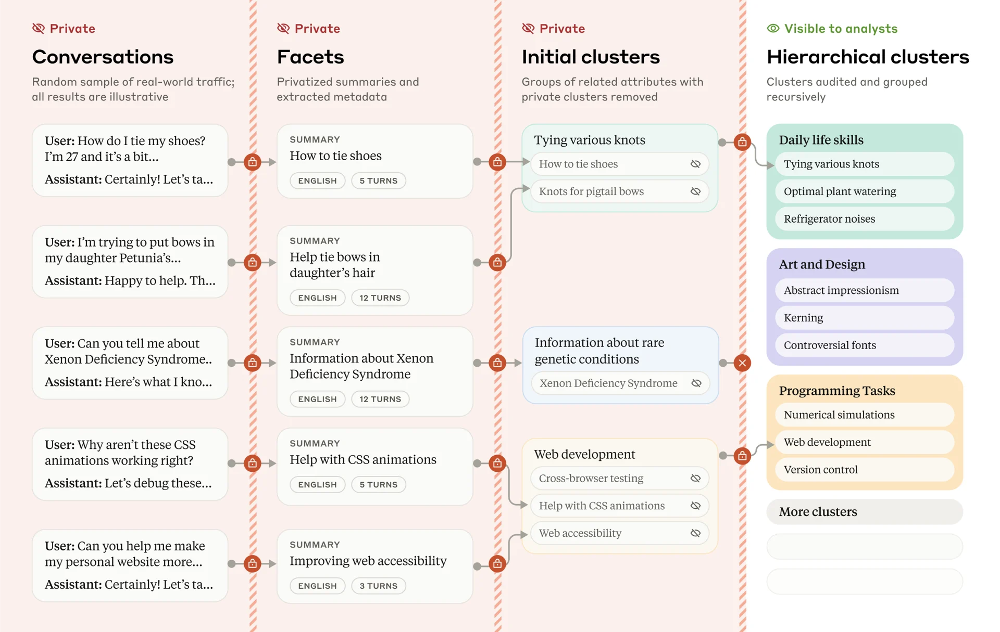
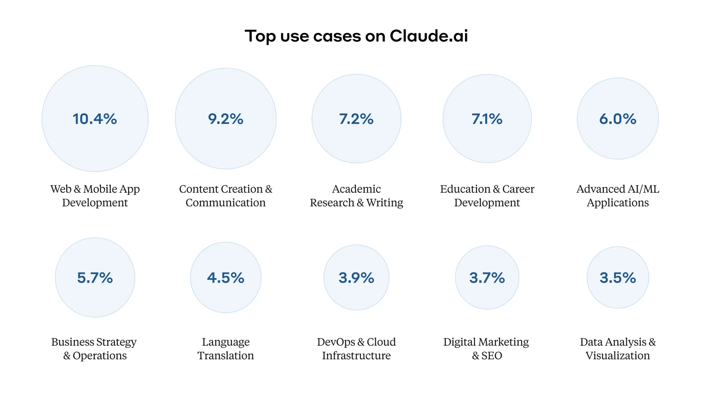
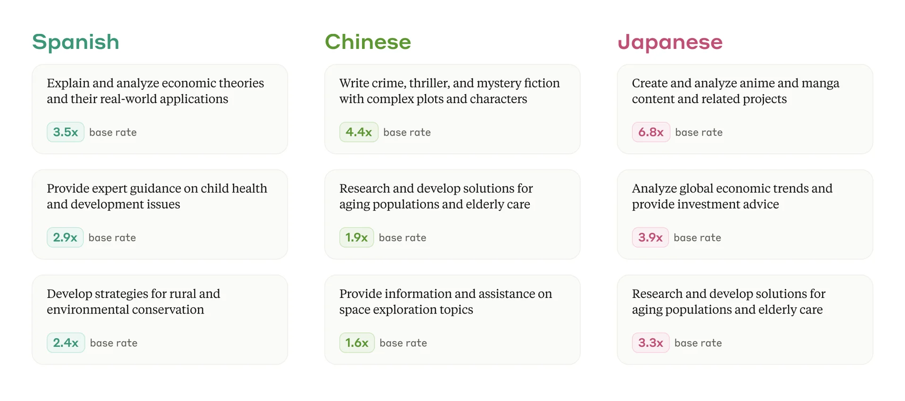
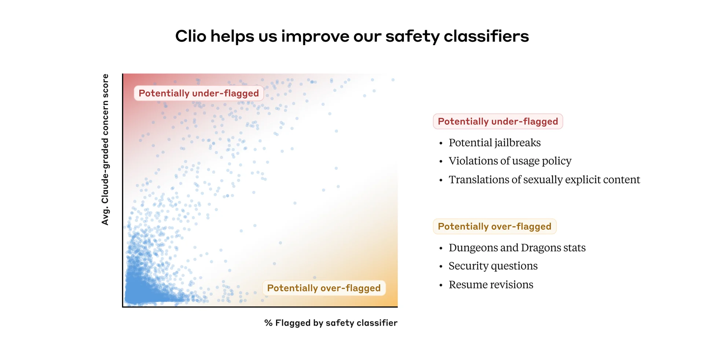
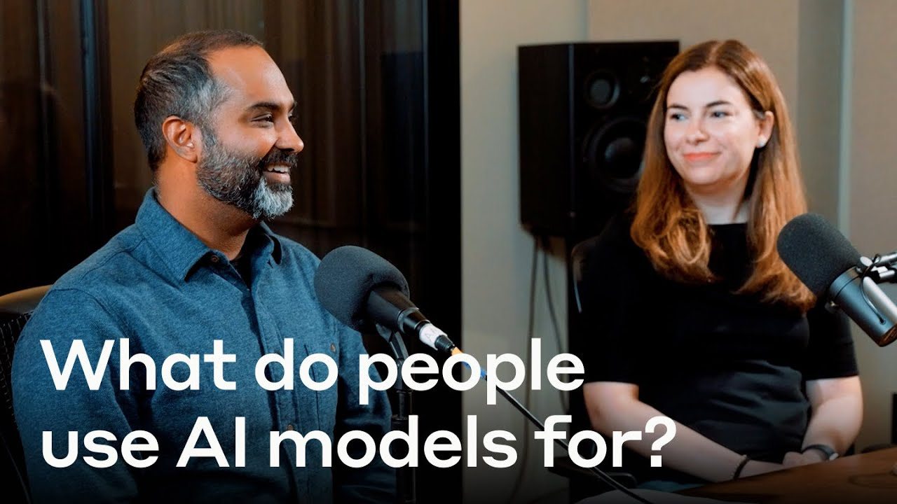

# Clio：在保护隐私的前提下洞察现实中的 AI 使用

- 英文标题：Clio: A system for privacy-preserving insights into real-world AI use
- 发布日期：2024-12-12
- 官网栏目：社会影响
- 原文：[Anthropic 页面](https://www.anthropic.com/research/clio)
- 官网署名：Anthropic
- 官网推荐阅读：[阅读论文](https://arxiv.org/abs/2412.13678)

> 中文机器初译，未逐篇人工校对。引用研究结论时请核对英文原文。

- 更新2026 年 8 月 24 日

  ### 该系统和研究工具现在称为 Anthropic Insights
- 更新2025 年 8 月 28 日

  ### 消费者条款和隐私政策

---

人们使用人工智能模型做什么？尽管大型语言模型迅速普及，但到目前为止我们对它们的具体使用方式还知之甚少。

这不仅仅是好奇心的问题，甚至不是社会学研究的问题。出于安全原因，了解人们实际如何使用语言模型非常重要：提供商在部署前测试上投入了大量精力，并使用信任和安全系统来防止滥用。但语言模型的规模和多样性使得理解它们的用途非常困难，更不用说任何类型的全面安全监控了。

还有一个至关重要的因素阻碍了对人工智能模型使用的清晰理解：隐私。在 Anthropic，我们非常重视保护用户数据。那么，我们如何研究和观察我们的系统如何使用，同时严格维护用户隐私呢？

**氯**奥德 **i**观点和 **o**观察，或“Clio”，是我们试图回答这个问题的尝试。Clio 是一种自动化分析工具，可以对现实世界语言模型的使用进行隐私保护分析。它让我们深入了解日常使用 [Claude.ai](http://claude.ai) 在某种程度上类似于谷歌趋势等工具。它还已经在帮助我们改进安全措施。在这篇文章中——伴随着 [完整的研究论文](https://arxiv.org/abs/2412.13678)——我们描述了 Clio 及其一些初步结果。

## Clio 的工作原理：大规模隐私保护分析

传统的自上而下的安全方法（例如评估和红队）依赖于提前了解要寻找的内容。Clio 采用了不同的方法，通过将对话提炼成抽象的、可理解的主题集群，实现自下而上的模式发现。它在这样做的同时保护了用户隐私：数据自动匿名和聚合，并且只有更高级别的集群对人类分析师可见。

总结 Clio 的分析步骤，用想象中的对话例子进行说明。

以下是 Clio 多阶段流程的简要总结：

1. **提取面**：对于每个对话，Clio 都会提取多个“方面”——特定属性或元数据，例如对话主题、对话中来回的次数或使用的语言。
2. **语义聚类**：类似的对话会自动按主题或一般主题分组在一起。
3. **集群描述**：每个集群都会收到一个描述性标题和摘要，从原始数据中捕获共同主题，同时排除私人信息。
4. **建立层次结构**：集群被组织成多级层次结构，以便于探索。然后，它们可以呈现在一个交互式界面中，Anthropic 的分析师可以使用该界面来探索不同维度（主题、语言等）的模式。

这四个步骤完全由Claude推动，而不是由人类分析师推动。这是我们隐私优先的 Clio 设计的一部分，通过多层来创建“纵深防御”。例如，Claude被指示从对话中提取相关信息，同时省略私人详细信息。我们还对唯一用户或对话的数量设定了最低阈值，以便低频主题（可能特定于个人）不会无意中暴露。作为最后的检查，Claude在向人类用户显示集群摘要之前验证其是否不包含任何过于具体或识别的信息。

我们所有的隐私保护措施都经过了广泛的测试，正如我们在 [研究论文](https://arxiv.org/abs/2412.13678).

## 人们如何使用 Claude：Clio 的见解

使用 Clio，我们能够收集有关人们如何使用的高级见解 [Claude.ai](https://claude.ai/) 在实践中。虽然公共数据集如 [野聊](https://arxiv.org/abs/2405.01470) 和 [LMSYS-Chat-1M](https://arxiv.org/abs/2309.11998) 提供有关人们如何使用语言模型的有用信息，它们仅捕获特定的上下文和用例。Clio 使我们能够全面了解现实世界中的使用情况 [Claude.ai](https://claude.ai/) （由于用户群和模型类型的差异，这可能看起来与其他人工智能系统的使用不同）。

### Claude.ai 上的热门用例

我们使用 Clio 分析了与 Claude 的 100 万次对话 [Claude.ai](https://claude.ai/) （免费层和专业层）来确定人们使用 Claude 执行的首要任务。这揭示了对与编码相关的任务的特别重视：“Web 和移动应用程序开发”类别占所有对话的 10% 以上。软件开发人员使用 Claude 执行从调试代码到解释 Git 操作和概念等各种任务。

用户与 Claude 进行的最常见的对话类型（跨所有语言）。圆圈的面积对应于对话的百分比；这些标题是 Clio 在分析 100 万个随机选择的对话后生成的摘要。

教育用途构成了另一个重要类别，超过 7% 的对话集中在教学和学习上。很大一部分对话（近 6%）涉及业务战略和运营（包括起草专业通信和分析业务数据等任务）。

Clio 还识别了数千个较小的对话集群，显示了 Claude 的丰富用途。其中一些可能令人惊讶，包括：

- 解梦；
- 足球比赛分析；
- 备灾；
- 填字游戏的“提示”；
- *龙与地下城* 游戏；
- 数一下“草莓”这个词中的 r。

### Claude的用法因语言而异

Claude的用法在不同语言中差异很大，反映了不同的文化背景和需求。我们计算了每种语言在总体对话中出现频率的基本比率，并从那里我们可以识别给定语言比平时出现频率更高的主题。下图显示了西班牙语、中文和日语的一些示例。

Clio 透露，三种选定语言中出现频率更高的对话主题（与该语言的基本频率相比）。

## 我们如何通过 Clio 改进我们的安全系统

除了训练我们的语言模型拒绝有害请求外，我们还使用专门的信任和安全执行系统来检测、阻止可能违反我们的要求的活动并采取行动 [使用政策](https://www.anthropic.com/legal/aup)。Clio 对这项工作进行了补充，以帮助我们了解哪些地方可能有机会改进和加强这些系统。

对于谁可以使用 Clio 来进一步执行我们的政策，我们实施严格的隐私访问控制，因为这可能需要审查个人帐户。我们的信任和安全团队能够审查主题集群，以查找可能违反我们的使用政策的区域。例如，标题为“为竞选筹款电子邮件生成误导性内容”或“煽动仇恨行为”的集群描述了我们禁止的活动。我们的信任和安全团队可以使用这种自下而上的审查方法来识别个人帐户以进行进一步审查，并在适当的情况下根据我们的条款和政策采取行动。我们严格限制此类审查仅限于具有合法信任和安全需求的人员。我们的 [研究论文](https://arxiv.org/abs/2412.13678) 包括有关这些过程的更多信息。

我们仍在所有执法系统中推广 Clio，但到目前为止，它已被证明是我们安全工具包中有用的一部分，可以帮助我们发现需要加强的保护措施领域。

### 识别并阻止协调滥用

事实证明，Clio 能够有效识别协调、复杂的滥用模式，否则这些模式在查看个人对话时是不可见的，并且可能会逃避更简单的检测方法。例如，在九月下旬，我们发现了一个自动帐户网络，使用类似的提示结构来生成垃圾邮件以优化搜索引擎。虽然个人谈话没有违反我们的规定 [使用政策](https://www.anthropic.com/legal/aup)，跨帐户的行为模式揭示了我们在政策中明确禁止的一种协调平台滥用形式，并且我们删除了帐户网络。我们还使用 Clio 来识别我们禁止的其他活动 [使用政策](https://www.anthropic.com/legal/aup)，例如试图转售未经授权的 Claude 访问权限。

### 加强对高风险事件的监控

Clio 还帮助我们在不确定或高风险事件期间监控新用途和风险。例如，虽然我们在推出新产品之前进行了广泛的安全测试 [电脑使用](https://www.anthropic.com/news/developing-computer-use) 功能，我们使用 Clio 来筛选我们可能错过的紧急功能和危害[1](https://www.anthropic.com/research/clio#footnote-1)。Clio 在这里提供了额外的保障，以及帮助我们在整个系统部署和未来版本中不断改进安全措施的见解。

Clio 还帮助我们监控选举或重大国际活动等重要公共活动之前的未知风险。在 2024 年美国大选前的几个月，我们 [二手克里奥](https://www.anthropic.com/news/elections-ai-2024) 识别与美国政治、投票和相关问题相关的活动集群，并防范任何潜在风险或滥用。通过 Clio 实现检测“未知的未知”的能力，补充了我们主动的安全措施，并帮助我们快速应对新的挑战。

### 减少误报和误报

总的来说，Clio 和我们预先存在的信任和安全分类器之间就会话集群被认为涉及的问题达成了一致。然而，对于一些集群存在一些分歧。改进的一个机会是漏报（当系统没有将特定对话标记为潜在有害时，而实际上它是有害的）。例如，当用户要求Claude从一种语言翻译成另一种语言时，我们的系统有时无法标记违规内容。然而，克里奥发现了这些对话。

对话集群的散点图（一个点=一个集群）以及根据我们的信任和安全分类器（x 轴）和 Clio（y 轴）将它们标记为相关的程度。左上角是我们的信任和安全分类器可能未标记的集群：包含不一定标记的内容的误报。右下角是可能被过度标记的集群：可能不包含相关内容的误报。信任与安全与 Clio 分类之间的总体相关性为 r = 0.71，表明两个系统之间存在广泛的总体一致性。

我们还使用 Clio 来调查误报，这是开发信任和安全分类器时的另一个常见挑战，分类器无意中将良性内容标记为有害内容。例如，求职者就自己的简历寻求建议的对话有时会被我们的分类器错误地标记（由于存在个人信息）。与安全、网络或网络抓取相关的编程问题有时会被误认为是潜在的黑客攻击。甚至上述中有关战斗统计的对话 *龙与地下城* 对话有时会触发我们的伤害检测系统。我们使用 Clio 来突出显示这些错误的决定，帮助我们的安全系统仅针对确实违反我们政策的内容触发，否则会妨碍我们的用户。

## 道德考虑和缓解措施

Clio 为提高已部署语言模型的安全性提供了宝贵的见解。然而，它也确实提出了我们在开发系统时考虑和解决的一些重要的道德考虑因素：

- **误报：** 在信任和安全方面，我们针对潜在的误报实施了关键保障措施。例如，目前我们不使用 Clio 的输出进行自动执行操作，而是广泛验证其在不同数据分布上的性能，包括跨多种语言的测试，正如我们在论文中详细介绍的那样。
- **滥用克里奥：** 像 Clio 这样的系统可能会被滥用来进行不适当的监控。除了严格的访问控制和隐私技术之外，我们还通过实施严格的数据最小化和保留政策来降低这种风险：我们仅收集和保留 Clio 所需的最少量数据。
- **用户隐私：** 尽管 Clio 在我们的隐私评估中表现出色，但与任何现实世界的隐私系统一样，我们的系统可能无法捕获某些类型的私人信息。为了减轻这种潜在风险，我们定期对 Clio 的隐私保护和评估进行审核，以确保我们的保护措施按预期发挥作用。随着时间的推移，我们还计划在 Clio 中使用最新的 Claude 模型，以便我们能够不断提高这些防护措施的性能。
- **用户信任：** 尽管我们提供广泛的隐私保护，但一些用户可能会认为像 Clio 这样的系统具有侵入性或干扰他们对 Claude 的使用。我们选择对 Clio 的目的、能力、局限性以及我们从中学到的见解保持透明。正如我们上面提到的，在某些情况下，Clio 在我们的标准安全分类器中发现了误报（似乎存在违反我们的使用政策的活动，而实际上并没有），这可能使我们能够进行干预 *少* 模型的合法使用。

## 结论

Clio 是朝着基于经验的人工智能安全和治理迈出的重要一步。通过对现实世界的人工智能使用情况进行隐私保护分析，我们可以更好地了解这些系统的实际使用方式。最终，我们可以使用 Clio 使人工智能系统更安全。

人工智能提供商承担双重责任：维护系统安全，同时保护用户隐私。Clio 证明这些目标并不相互排斥——通过精心设计和实施，我们可以实现这两个目标。通过公开讨论 Clio，我们的目标是为负责任地开发和使用此类工具的积极规范做出贡献。

我们正在继续开发和改进 Clio，我们希望其他人能够在这项工作的基础上继续发展。有关 Clio 的其他技术详细信息，包括我们的隐私验证和评估方法，请参阅 [完整的研究论文](https://arxiv.org/abs/2412.13678).

*我们目前正在招聘社会影响团队。如果您有兴趣从事 Clio 或相关研究问题，我们很乐意收到您的申请。您可以找到有关该角色的更多信息 [在这个链接](https://boards.greenhouse.io/anthropic/jobs/4251453008).*

**2025 年 1 月 14 日编辑：** 本文中 Clio 论文的链接已更新为指向 *arXiv* 版本。

## 脚注

01 对于安全调查，我们还在第一方 API 流量的子集上运行 Clio，将结果仅限于授权人员。某些帐户被排除在分析之外，包括具有零保留协议的受信任组织。有关我们政策的更多信息，请参阅研究论文中的附录 F。
