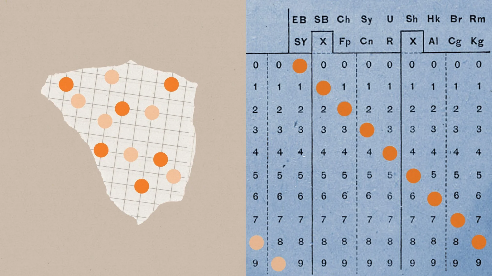
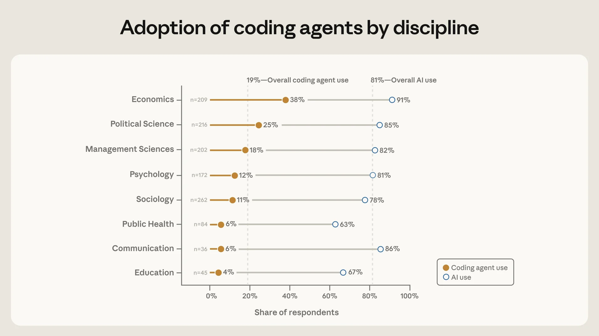
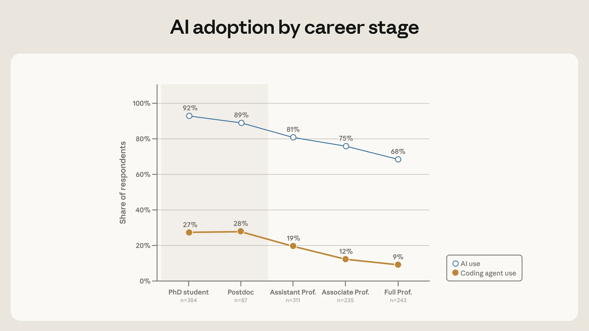
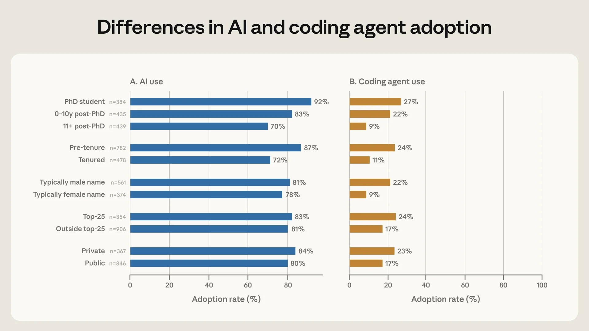
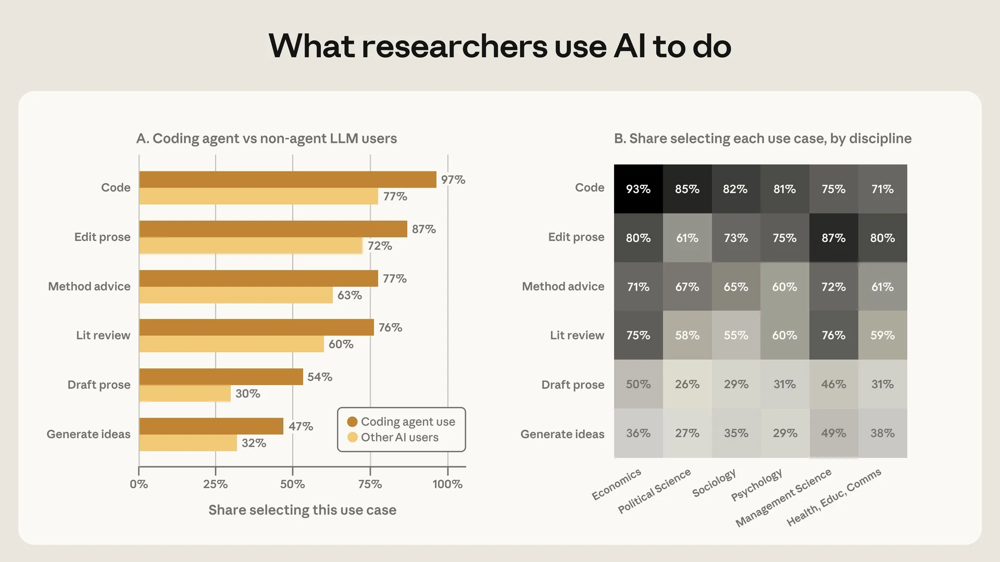
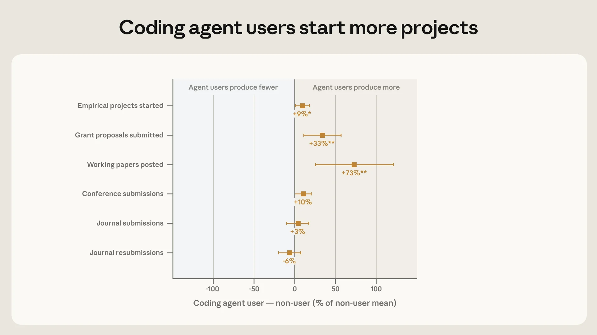
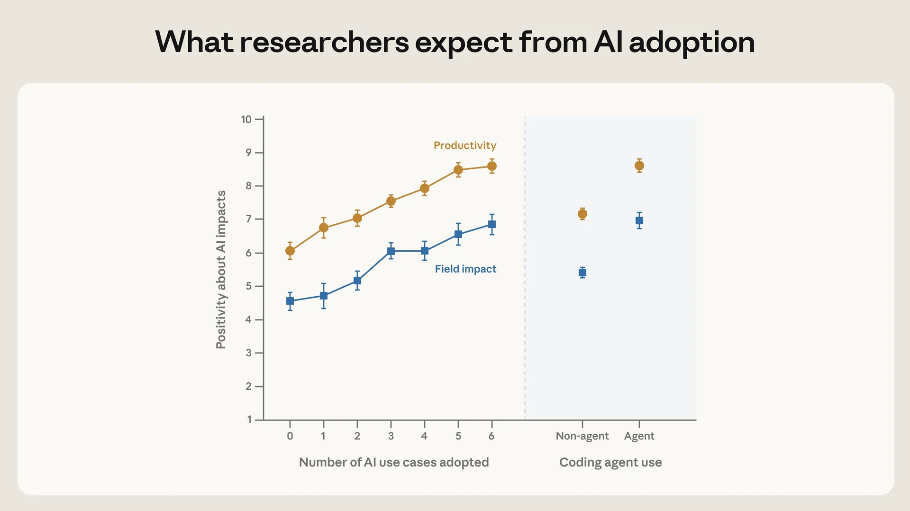

# 社会科学中的编程智能体

- 英文标题：Coding agents in the social sciences
- 发布日期：2026-05-27
- 官网栏目：社会影响
- 原文：[Anthropic 页面](https://www.anthropic.com/research/coding-agents-social-sciences)
- 官网署名：Thomas Lyttelton、Maxim Massenkoff、Nathan Wilmers

> 中文机器初译，未逐篇人工校对。引用研究结论时请核对英文原文。

### 总结

- *我们展示了 2026 年 2 月和 3 月对 1,260 名社会科学家进行的有关人工智能和编码代理使用情况的调查结果。*
- *绝大多数受访者 (81%) 尝试过在研究中使用人工智能聊天机器人，特别是在编写代码和编辑散文方面。但只有 20% 的人在工作中采用了编码代理（例如 Claude Code 等能够自主编写和执行分析代码的工具）。*
- *编码剂的使用存在明显差异。使用编码剂的通常是男性名字的研究人员是女性名字的研究人员的两倍。顶尖大学的研究人员使用编码代理的可能性比其他人高 40%。*
- *编码代理的用户比同一学科和职业阶段的其他人发布更多的工作论文和资助提案，但这可能反映了早期采用者之间预先存在的差异。*
- *研究人员对人工智能帮助撰写可发表的论文更加乐观，而不是人工智能对整个社会科学的影响。*

## 人工智能编码代理如何改变我们研究经济和社会的方式？

人文科学正在发生转变：核心研究任务第一次可以交给机器。人工智能聊天机器人越来越多地为科学研究做出贡献，包括在大多数领域 [著名出版物](https://www.nature.com/articles/s41562-025-02273-8) 并在 [社会科学](https://sociologicalscience.com/articles-v13-3-45/)。这激发了人们对人工智能可以提高研究生产力的乐观情绪，同时也引发了人们对超载同行评审和大量人工智能学术废品的担忧。

但是，虽然轮流人工智能聊天机器人主要用于 [写作协助](https://sociologicalscience.com/articles-v13-3-45/)，编码代理可以从根本上重组社会科学研究。像 Claude Code 和 Codex 这样的代理编码平台可以采用研究想法和数据集，编写并运行分析，解释输出并自主迭代。实证研究中人类不可简化的步骤第一次可以被 [自动化的](https://www.nber.org/papers/w34202)。在极端情况下，研究人员建立了多代理管道来实现自动化 [计算机科学研究](https://www.nature.com/articles/s41586-026-10265-5) 并自主执行社会 [科学研究思路](https://osf.io/preprints/socarxiv/24xfq_v1).

这些工具可以加速科学发展并使其更加大胆：快速的研究执行应该意味着廉价且丰富的发现。它们还可能扩大研究资源的差距并加剧学术记录的拥挤。更深入地说，随着人工智能处理越来越广泛的研究任务，其独特的分析选择可能会加深我们对经济、社会和我们自己的集体理解。

在这篇文章中，我们根据 2026 年初对 1,260 名定量社会科学家进行的调查，初步了解了这一情况。该调查是正在进行的一项关于编码剂如何影响研究生产力的更大规模研究的基线波，其中包括一项为研究人员提供Claude代码访问权限的随机实验。我们将在未来公布该实验的结果。目前，我们报告基线调查揭示了谁在使用这些工具以及用途；用户和非用户之间的输出有何不同；以及研究人员对日益普及的影响的期望。

## 关于定量社会科学家使用人工智能编码代理的新调查

我们于 2026 年 2 月下旬和 2026 年 3 月开展了这项调查，针对活跃的定量社会科学家。这不是一个具有代表性的样本——受访者被招募来参加一项提供 Claude Max 帐户访问权限的研究，因此样本的选择可能会倾向于对人工智能工具感兴趣的研究人员。然而，受访者与收到更通用邀请的早期样本非常相似（参见表 A2） [附录](https://assets.claude.com/403415e54964751190003985896630e56829e797.pdf)).

受访者在经济学、政治学和社会学之间各占一半，各占样本的五分之一，管理科学和心理学紧随其后（见表 A1）。我们还收到了少量来自公共卫生、教育和传播研究人员的回复。大约40%是正教授或副教授，25%是助理教授，约30%是博士生。

## 大多数社会科学家还没有接触到编码代理

我们通过两种方式衡量人工智能的总体使用情况。首先，我们问“您之前是否使用过 genAI 模型来帮助您的研究过程？” 81%的受访者表示愿意。

但是那些实际上在工作流程中采用了能力越来越强的编码代理的人呢？在这里，我们询问“您是否经常（每周一次以上）使用集成到命令行中的人工智能编码助手（例如 Codex、Cursor 或 Claude Code）？”在后续问题中，我们验证了他们使用了其中一种工具（或 Google Antigravity）。[1](https://www.anthropic.com/research/coding-agents-social-sciences#footnote-1)

只有 20% 的受访者使用编码代理。我们的调查是在 2025 年 12 月下旬开始的有关 Claude Code 和 Opus 4.6 的一系列讨论大约两个月后进行的。然而，即使在自行选择参与我们调查的感兴趣的受访者中，也只有 ⅕ 在他们的工作流程中采用了代理。Claude Code 是最常见的编码代理工具，86% 的用户报告使用 Claude Code（31% 的用户报告使用 Codex，第二个最常用的工具）。

**经济学家和政治学家报告说，编码代理的使用最多。** 对于“您是否经常（每周一次以上）使用集成到命令行中的 AI 编码助手（例如 Codex、Cursor 或 Claude Code）？”，编码代理的使用是肯定的。以及验证这些工具之一或 Google Antigravity 的使用的后续问题。学科类别在附录中描述。

## 采用率极不平衡

图 1 显示整体采用率存在很大差异，从经济学家的 39% 和政治学家的 25% 到公共卫生 (6%)、教育 (4%) 和传播 (6%) 的个位数。这个梯度大致追踪了人工智能整体使用中跨领域的差异，但平均而言，编码代理采用的差异更大。

超过四分之一的博士生和博士后至少每周使用一次编码剂；在终身教授中，这一比例下降了一半以上。采用编码代理的研究人员都是初级人员，他们技术更熟练，更有可能直接使用代码和数据，并且面临着更大的职业压力来进行研究。

**早期职业研究人员的采用率最高。** 蓝色系列显示按职业阶段报告人工智能用于辅助研究的百分比。下面的橙色系列显示了报告常规编码剂用于研究的百分比。

采用差异超出了纪律和职业阶段。我们根据性别对研究人员的姓名进行分类，发现那些具有典型男性姓名的受访者采用编码剂的比例是具有典型女性姓名的受访者的两倍多。地位较高的私立大学的使用率也明显更高。所有这些差异在 p<0.05 水平上都很显着。这些差异比整体人工智能使用的差异更加明显，并表明不平等程度更高，至少在编码代理采用的早期阶段是这样。

编码代理使用中的性别差距不仅仅反映了尝试人工智能的比率的差距。在尝试使用人工智能进行研究的受访者中，常规编码代理使用方面的性别差距甚至比整体样本中稍大。在同一学科和职业阶段的不同性别之间进行比较时，这些差异也依然存在。

**编码剂的采用显示出巨大的差异。** 按职业阶段、性别和大学属性划分的使用人工智能（左图）和编码代理（右图）的研究人员百分比差异。男性和女性类别通过姓名分类来衡量。前 25 名大学是根据自然指数领先机构确定的。组间采用率的所有差异均具有统计显着性，p < 0.05。

## 研究人员主要使用人工智能来编码和编辑，而不是写作

在使用人工智能的研究人员中，无论是通过编码代理还是聊天机器人，他们实际上用它来做什么？学术研究中关于人工智能的争论主要集中在写作上：幻觉的文献综述、“不是 X，是 Y”散布在公式化的介绍中，以及完全自动化论文写作的可能性。

但图 4 显示，对于编码代理用户和其他人来说，最常见的用途是对定量数据进行编码分析：97% 的编码代理用户和 77% 的其他人工智能用户报告使用它来生成代码。其次最常见的是编辑散文，然后询问方法建议和先前研究的背景。将编码代理用户和其他用户汇总起来，只有三分之一的人工智能用户使用它来起草散文。这些模式通常适用于跨学科，只有经济学家和管理研究人员普遍使用人工智能来起草散文。

**最常见的用例是代码和编辑。** 左侧面板显示了指出每个特定用例的用户比例，按他们是否使用编码代理或仅使用 genAI 进行研究进行划分。受访者可以指出多个类别（问题仅限于研究用例）。右侧面板显示了按学科划分的相同回答。

## 编码代理用户发布了更多的工作论文并发出了更多的资助提案，但没有向期刊提交更多的内容

编码剂是否可以提高研究人员的工作效率？这正是本次调查启动更广泛研究的动力所在。我们针对这个问题进行的实验仍在进行中。但基线调查让我们可以在研究过程中的一系列检查点上将编码代理用户与其他用户进行比较。这种比较纯粹是描述性的：我们将选择使用编码剂的研究人员与未使用编码剂的研究人员进行比较，并预计这两组在许多方面存在我们无法调整的差异。差异不应被解释为因果关系，而应被视为使用编码剂的研究人员与未使用编码剂的研究人员之间的初步比较。

**普通人工智能编码代理用户和其他研究人员之间研究成果的生产力差异。** 结果由受访者自行报告。发表的工作论文、期刊提交和期刊重新提交是相互排斥的类别。模型在附录中描述。胡须显示 95% 置信区间，使用按结果平均值缩放的稳健标准误差计算。 * p < 0.05，** p < 0.01。

图 5 显示了调查前六个月内研究过程不同阶段（从项目启动到论文提交）的自我报告产出。调整后的估计将编码代理用户与其他人进行比较，并控制了职业阶段、纪律以及完成调查的周数。编码代理用户正在启动更多的项目，发布更多的工作论文，提交更多的资助，并可能发送更多的会议提交材料。

那么编码代理用户写的论文是否更多了？首先，考虑编码代理用户和其他人之间早期管道输出的差异。与非代理用户相比，编码代理用户启动项目的速度大约多四分之一篇论文，发布的工作论文多大约一半。从百分比来看，编码代理用户在其学科和职业阶段比其他人的生产力高出 10%（已启动的实证项目）到 75%（已发布的工作论文）。

然而，这种生产力差异仅出现在这些早期的管道措施中。我们没有发现任何证据表明编码代理用户向期刊提交了更多新论文或更快地重新提交论文。这可以反映论文提交的时间表，因为编码剂的使用是最近才出现的现象。但这也可能反映出，编码代理在启动和运行项目方面比在完善期刊提交论文的最后一英里方面更有用。

## 研究人员期望人工智能工具能够提高生产力，但对它们能否整体改善社会科学信心不足

我们还询问了研究人员对人工智能工具的期望。就撰写可发表论文而言，人工智能是否能让社会科学家变得更有生产力？他们认为人工智能会让社会科学变得更好还是更糟？

研究人员对人工智能提高论文写作效率持乐观态度。按照 1 到 10 的评分标准，88% 的受访者得分高于 5 分，一半的受访者得分高于 8 分。图 6 显示这些评级随着人工智能的使用而变化很大。该图的左侧显示，使用人工智能执行更多类型任务的研究人员更加乐观。右侧显示编码代理用户比其他人更乐观。

**与人工智能将如何影响整个研究领域的信念相比，研究人员对人工智能将如何影响生产力的信念较小。** 信念是通过 10 点滑块来衡量的。生产力是：“就撰写可发表的论文而言，您认为人工智能会降低还是提高社会科学家的生产力”，滑块标记为“生产力降低到生产力提高”。现场影响是：“你认为人工智能会让社会科学变得更糟还是更好”，滑块标记为“从更糟到更好”。采用的人工智能用例数量汇总了图 4 中列出的类别。

这项调查的对象是有兴趣尝试这些工具的人，因此看到人们对生产力持乐观态度也就不足为奇了。但即使在这些乐观主义者中，关于人工智能对可发表论文的狭隘帮助和对社会科学的广泛影响的观点之间也存在着真正的差距。70% 的受访者对纸张生产率比对更广泛的领域影响更加乐观。很少有研究人员对现场影响比对纸张生产率更加乐观，而且许多研究人员更加悲观。

## 讨论

使用编码代理的社会科学家正在发布更多的工作论文并申请更多的资助。相对于其他处于学科和职业阶段的人来说，他们也开始了更多的项目。但截至 2026 年 3 月，它们尚未带动期刊投稿量激增。项目启动数量的增加可能是生产力提高的早期证据。它还可能表明早期采用者已经是更有生产力的研究人员。

总体而言，编码代理的早期采用倾向于早期职业研究人员、男性和地位较高的大学的研究人员。目前，与法学硕士的使用范围相比，编码代理的使用在这些类别中的分布更加不均匀。我们还发现了一些暗示性证据，表明研究人员担心纸张生产率提高的直接好处可能会伴随着现场成本。也许更多的论文意味着拥挤和注意力的竞争；也许受访者担心一些研究人员会以加剧社会科学现有问题的方式使用人工智能工具，例如选择性报告和规避风险的增量研究。

本报告的研究结果有几个警告。这里提供的数据基于对定量社会科学家的电子邮件调查，这些科学家被明确招募来参与工作流程和人工智能使用的研究。我们预计受访者比不受访者都是更重的用户，并且对法学硕士更加乐观。我们看到的早期生产力差异应该进行描述性解释。编码代理的早期采用者可能会更有生产力，并且在许多方面与非采用者有所不同，而我们无法在调查中直接衡量。最后，我们只关注研究人员报告的项目数量，而不报告其质量。在这项研究的未来更新中，我们将展示将编码代理用户与干净对照组进行比较的结果，并评估编码代理增强工作的内容（而不仅仅是数量）是否看起来不同。

尽管存在这些限制，我们表明编码代理正在扩散到社会科学领域。例如，我们研究经济和政治的方式越来越多地通过人工智能编码代理做出的分析决策。我们计划在未来的报告中提供更多关于这种自动化的潜力和风险的证据。

### 附录

可用 [这里](https://assets.claude.com/403415e54964751190003985896630e56829e797.pdf).

### 参考文献

阿尔韦罗，A.J.、斯托尔茨、D.S.、Stuhler，O. 和泰勒，M.答：（2026）。社会学研究中的生成人工智能：学科现状。 *社会学*, *13*, 45-62.

科里内克，A.（2025）。 *用于经济研究的AI 智能体* （编号：w34202）。国家经济研究局。NBER 工作论文系列。

梁文、张勇、吴志、Lepp H.、季文、赵X.、……& 邹静 (2025)。量化科学论文中大型语言模型的使用。 *自然人类行为*, 1-11.

卢，C.，卢，C.，兰格，R.T.、Yamada, Y.、Hu, S.、Foerster, J.、... & Clune, J. (2026)。迈向人工智能研究的端到端自动化。 *自然*, *651*(8107), 914-919.

Wilmers, N. 和 Engzell, P. (2026)。造纸厂。SocArXiv 预印本。

## 脚注

01我们在 Claude Cowork 发布一个月后、OpenAI 的 Codex 应用程序发布之前启动了这项调查，因此我们将这个问题集中在用于与编码代理交互的命令行界面工具上。这意味着我们不计算仅通过更通用的桌面应用程序使用AI 智能体的研究人员。
