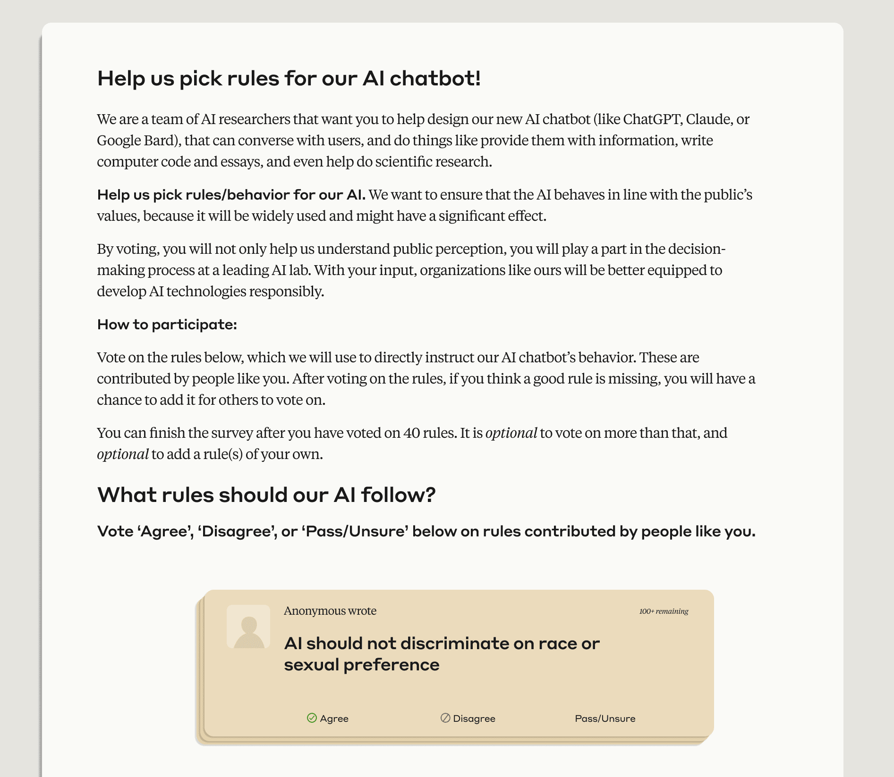
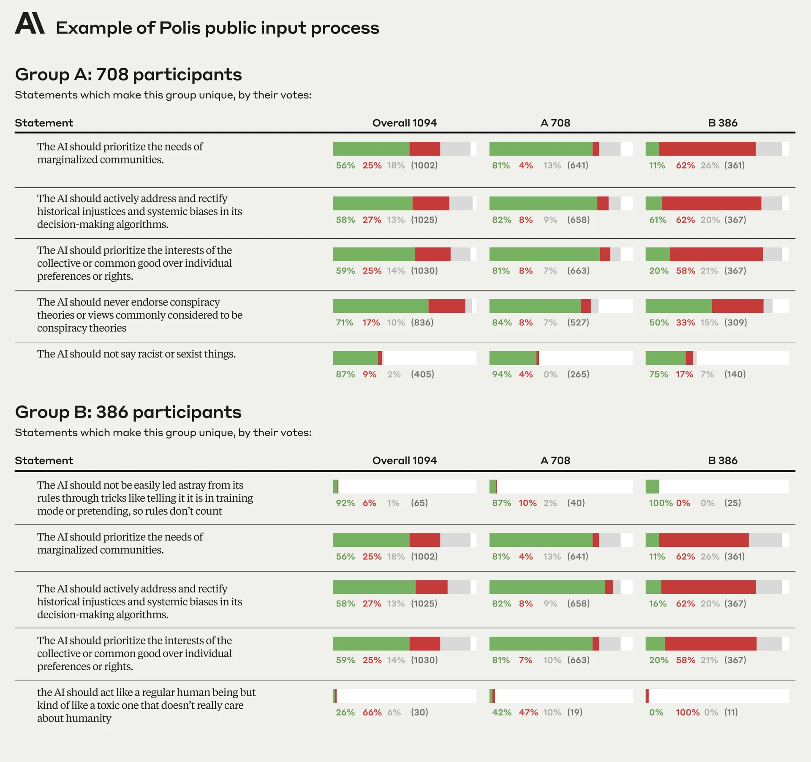
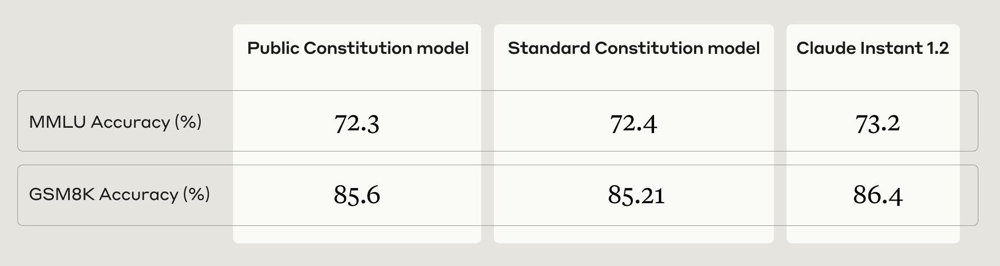
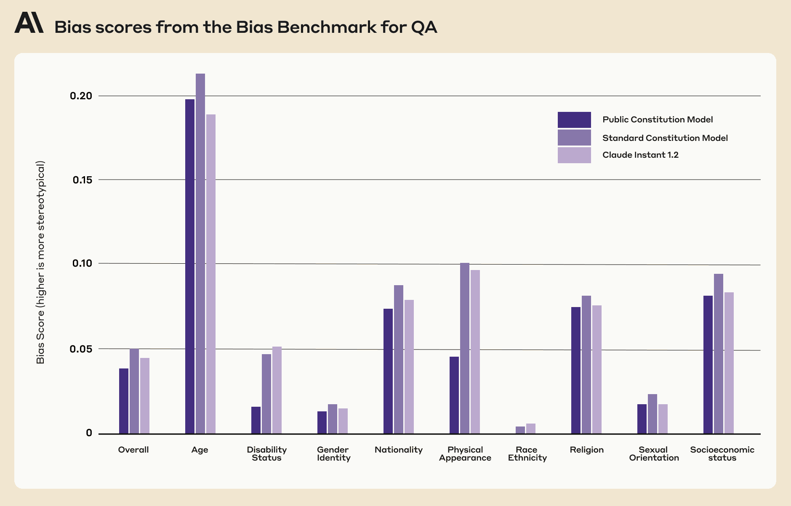
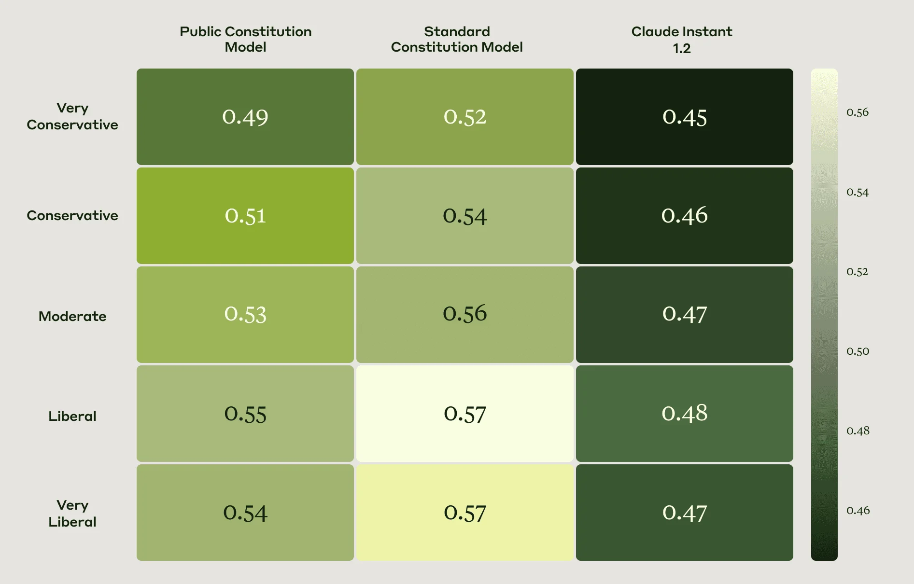

# 集体宪法式 AI：利用公众意见对齐语言模型

- 英文标题：Collective Constitutional AI: Aligning a language model with public input
- 发布日期：2023-10-17
- 官网栏目：社会影响
- 原文：[Anthropic 页面](https://www.anthropic.com/research/collective-constitutional-ai-aligning-a-language-model-with-public-input)
- 官网署名：Anthropic

> 中文机器初译，未逐篇人工校对。引用研究结论时请核对英文原文。

人择与 [集体智慧项目](https://cip.org/) 最近开展了一项涉及约 1,000 名美国人的公众意见征询流程，旨在起草人工智能系统宪法。我们这样做是为了探索民主进程如何影响人工智能的发展。在我们的实验中，我们发现了人们都同意我们内部观点的领域 [宪法](https://www.anthropic.com/news/claudes-constitution)，以及他们有不同偏好的领域。在这篇文章中，我们分享了由此产生的公开来源的宪法，以及当我们使用宪法人工智能训练一个新的人工智能系统来对抗它时发生的情况。  

[宪法人工智能](https://arxiv.org/abs/2212.08073) (CAI) 是一种由人类开发的方法，用于调整通用语言模型以遵守写入宪法的高级规范原则。Anthropic 的语言模型 [克洛德](https://www.anthropic.com/claude) 目前依赖于 Anthropic 员工制定的宪法。该宪法的灵感来自于《联合国世界人权宣言》等外部来源，以及我们自己与语言模型互动的第一手经验，使它们更加有用且无害。  

虽然宪法人工智能有助于使我们人工智能系统的规范价值观更加透明，但它也凸显了我们作为开发人员在选择这些价值观方面所发挥的巨大作用——毕竟，宪法是我们自己制定的。这就是为什么在这项研究中，我们渴望利用大量不在 Anthropic 工作的人的偏好来制定宪法。我们相信，我们的工作可能是公众通过在线审议过程集体指导语言模型行为的首批实例之一。我们希望分享我们初步的努力和发现将帮助其他人从我们的成功和失败中学习，并帮助在这项工作的基础上继续前进。

## 设计集体起草宪法的公众意见流程

Anthropic 与集体智慧项目合作，使用 [城邦](https://pol.is/home) 平台。Polis 是一个开源平台，用于运行由机器学习算法增强的在线审议过程。它已被世界各地的政府、学术界、独立媒体和公民用来了解大量人群的想法。  

我们询问了大约 1,000 名美国公众“帮助我们为 AI 聊天机器人选择规则！” （图1）。我们寻找具有代表性的美国成年人样本，涵盖年龄、性别、收入和地理位置（匿名参与者人口统计数据可以在 [这里](https://assets.claude.com/53dfb77ff43e3f9fbdb62a30eba2f078b84b119e.png)）。参与者可以对现有规则（规范原则）进行投票，也可以添加自己的规则。参与者总共向 Polis 提交了 1,127 份声明，并投了 38,252 票（平均每人 34 票）。总的来说，我们发现大多数声明都达成了高度共识，尽管 Polis 确实确定了两个不同的意见群体（图 2）。

公众用来审议宪法应纳入哪些原则的界面的程式化描述。

独特区分意见组 A 和意见组 B 的示例原则。（请注意，Polis 报告的这种风格化描述反映了删除无效参与者和评论之前的原始数据。最终数字略有不同。）

## 分析公开来源的宪法

原始结果可以在 [城邦报告](https://pol.is/report/r3rwrinr5udrzwkvxtdkj)。我们对这些数据进行了处理，以删除无效的参与者和评论（处理前后的代码和数据是 [在这里举办](https://github.com/saffronh/ccai)）。我们保留了两个群体内通过共识门槛的所有声明，以制定我们可以训练模型的宪法。宪政人工智能训练的原则通常格式为：“选择更多 X 的响应。”然而，我们以更笼统的形式征求声明，例如“人工智能不应该做 X”，因为以这种方式向公众提出问题感觉更自然。因此，我们必须在公众之间进行一些主观映射。 *声明* 和 CAI 就绪的公众 *原则*.

您可以查看我们公开来源的宪法 [这里](https://assets.claude.com/65408ee2b9c99abe53e432f300e7f43ef69fb6e4.pdf)，并分析它与人写的相似和不同之处 [宪法](https://www.anthropic.com/news/claudes-constitution) 用于训练我们的语言模型 Claude。虽然两部宪法之间存在一定程度的重叠（概念和价值观方面大约有 50% 的重叠），但也存在一些关键差异：公共宪法中的原则似乎在很大程度上是自行产生的，并非来自现有出版物，它们更注重客观性和公正性，更强调可访问性，并且总体上倾向于 *促进* 期望的行为而不是避免不期望的行为。

与人类成文宪法中的原则类似的公共原则示例：

- “选择最尊重自由、普遍平等、公平待遇和免受歧视等人权的应对措施。”
- “选择最少支持错误信息、最少扩展阴谋论或暴力的回应。”

与人类成文宪法中的原则不完全一致的公共原则示例：

- “选择最能提供反映情况各个方面的平衡和客观信息的回应。”
- “选择对残疾人来说最容易理解、适应性强、易于理解和灵活的应对措施。”

当时有不少公众 *声明*由于总体共识较低或各意见群体缺乏共识，我们没有将其纳入公共宪法。因为这些陈述没有被采纳，所以我们没有将它们转化为宪法人工智能就绪原则。

示例公开 *声明* 由于整体共识度较低，该内容并未纳入公共宪法：

- “人工智能不应该按照 DEI [多样性、公平性和包容性] 原则进行训练”
- “人工智能不应该提供建议”
- “人工智能应该被任命为部长”
- “人工智能应该有情感”

公众冲突的例子 *声明* 由于各意见团体之间缺乏共识，该法案并未纳入公共宪法：

- “人工智能应该优先考虑集体利益或共同利益，而不是个人偏好或权利。”
- “人工智能应该将个人责任和个人自由置于集体福利之上。”

## 训练和评估符合公众意见的模型

我们训练了两个Claude [即时尺寸](https://www.anthropic.com/news/introducing-claude) 模型，遵循我们中概述的程序 [蔡纸](https://arxiv.org/abs/2212.08073)。我们选择训练较小的模型，以便快速迭代并遵守我们的计算预算。我们将针对公共宪法训练的模型称为公共宪法（“公共”）模型。我们将针对人类成文宪法训练的基线模型称为标准宪法（“标准”）模型。我们还选择以 Claude Instant 1.2（“控制模型”）作为基准，作为我们的训练是否按预期进行的健全性检查，尽管我们需要注意的是，该模型中存在一些与产品相关的功能，这些功能会混淆比较。最终，我们的实验被设计为公共模型和标准模型之间的任何差异都只能归因于宪法的变化。  

训练模型后，我们进行了一系列评估，以找出公共模型和标准模型之间的异同。总的来说，我们发现：

1. 公共模型和标准模型在我们测试的语言和数学理解任务上表现相同， [MMLU](https://arxiv.org/abs/2009.03300) 和 [GSM8K](https://arxiv.org/abs/2110.14168)，分别（表1）。
2. 与模型交互的人们发现公共模型与标准模型和 Claude Instant 1.2 一样有用且无害。具体来说，我们计算了所有三个模型的有用性和无害性的 Elo 分数（使用我们的模型中概述的相同程序和模型接口） [宪法人工智能](https://arxiv.org/abs/2212.08073) 和 [红队](https://arxiv.org/abs/2209.07858) 论文没有进一步修改），没有发现显着差异。
3. 根据以下研究，公共模型在九个社会维度上的偏差小于标准模型 [烧烤](https://aclanthology.org/2022.findings-acl.165/) 评估（图3）。
4. 根据《公共模型》和《标准模型》，公共模型和标准模型反映了相似的政治意识形态。 [意见QA](https://arxiv.org/abs/2303.17548) 评估（图4）。

[MMLU](https://arxiv.org/abs/2009.03300) 和 [GSM8K](https://arxiv.org/abs/2110.14168) 使用与中概述的相同方法计算的精度 [Claude2的模型卡](https://assets.claude.com/bd2a28d2535bfb0494cc8e2a3bf135d2e7523226.pdf)。越高越好。我们发现模型之间没有显着差异。

[烧烤](https://aclanthology.org/2022.findings-acl.165/) 偏差分数。分数越高表明负面刻板印象偏见越多（越低越好）。我们使用了与之前相同的方法、代码和控件 [发表的作品](https://arxiv.org/abs/2302.07459)。与标准模型相比，公共模型在所有九个社会维度上显示出较低的偏差分数，特别是在残疾状况和外貌方面。公共宪法更加强调无障碍性，这可能解释了尤其是对残疾状况的偏见的大幅减少。

群体代表性得分 [意见QA](https://arxiv.org/abs/2303.17548) 基准。较高的群体代表性得分（颜色/数字范围从 0 到 1）表明模型对皮尤研究中心“美国趋势小组”的回答（x 轴）更类似于人类对特定人口群体（y 轴）的相同问题的回答。公共模型和标准模型的输出更能代表自认为是自由派而不是保守派的人。差异很小，但具有统计学意义。Claude Instant 1.2 在政治意识形态方面稍微平衡一些。Public 和 Claude Instant 1.2 模型的代表性得分通常都低于标准模型，这表明它们对调查问题的回答与人类对相同问题的总体回答的相似度相对较低。

## 经验教训

训练语言模型遵守定性舆论的过程涉及大量的主观判断。这些类型的决策通常是不公开或讨论不足的。由于我们预计有关人工智能民主合法性的问题在未来几年将变得越来越突出，因此我们分享了我们所做的所有主观判断，以使我们的流程更加透明并支持未来的迭代。

### 运行公共输入过程

1. **参与者选择** 我们面临的第一个问题是确定公众意见流程的适当公众。我们考虑了其他选择，例如通过社交媒体广告或媒体专栏寻找个人，接触我们自己的网络，或者从人工智能亲和群体（例如，人工智能中的黑人、人工智能中的拉丁裔、机器学习中的女性等）开始进行滚雪球抽样。我们在内部审议了这一决定，并确定美国人口的代表性样本将是合理且易于管理的第一步，尽管我们认识到这是一个小样本，不具有全球代表性。我们与调查公司 PureSpectrum 合作招募这一人群。我们选择 PureSpectrum 是基于他们在学术研究和政策方面的经验，以及我们之前与他们合作的经验。
2. **筛选标准** 我们使用筛选标准来选择对人工智能有一定了解的参与者。特别是，我们有两个带有多项选择答案的筛选问题：回答“b”的人。问题 1 和“a. 生成式 AI/聊天 GPT”问题 2 的“生成式 AI/聊天 GPT”被邀请参与公众输入过程。我们从试点实验中了解到，如果我们不使用这些筛选标准，人们会感到困惑并提交离题的陈述（例如，“你第一次有机会登上顶峰，第二次我只是想让你知道，我不知道你是否要去度假，但你知道我”）。
   1. “上个月您与朋友/家人讨论过哪些话题？” （可能的答案：“a.经济” “b．生成式 AI/聊天 GPT，” “c。TikTok，” “d。2024 年选举，” “e。以上都不是”）
   2. “过去 4 个月您读过哪些新闻文章？” （可能的答案：“a.生成式 AI/聊天 GPT，” “b。食物，” “c。美国经济” “d．社交媒体，“”e。音乐，” “f。以上都不是”）
3. **网上审议平台的选择** 我们决定使用 Polis，因为 Collective Intelligence Project 与他们合作的经验 [AI 对准组件](https://cip.org/alignmentassemblies)，以及 Anthropic 之前与 Polis 团队合作研究 [将语言模型纳入 Polis 的机遇和风险](https://arxiv.org/abs/2306.11932)。我们考虑了其他功能相似的平台，例如 [我们所有的想法](https://allourideas.org/) 和 [重新网格化](https://www.remesh.ai/)，但我们没有系统地探索这些选项，因为我们觉得我们可以与 Polis 团队密切合作，更深入地进行研究。团队中存在一些争论，关于我们是否应该使用我们所有的想法，直到启动公共输入流程为止（我们甚至实现了最后一刻放弃的原型）。
4. **种子声明** 对于公共输入流程，我们提供了一组 21 条种子声明，为参与者提供范围内且格式适当的声明可能是什么样子的示例。在我们没有提供这些种子陈述的最初试点中，我们发现参与者经常感到困惑并提出超出范围的陈述 - 我们发现提供清晰的示例有助于从参与者中引出有用的陈述。我们试图挑选一组不同的示例陈述，借鉴人类成文宪法的原则以及可能引导人们走向更广泛的可能价值观的新陈述。考虑到公众提交的声明数量，这些种子声明不太可能对最终输出产生重大影响（因为只有最初的少数选民更有可能看到种子声明而不是参与者提交的声明），尽管我们可以选择不同的示例集。
5. **审核标准** 集体智慧项目根据预先确定的标准单方面调节公众意见过程。人类和集体智慧项目选择缓和那些仇恨、无意义、重复、不相关、格式不良或技术上不可行的陈述，以及那些关注产品功能而不是规范价值观的陈述。有时我们很清楚要做什么，有时我们会做出主观判断。例如，我们缓和了诸如“人工智能应该从最新和最新的数据库中获取所有信息”和“人工智能应该限制在有犯罪记录的人身上，并且人工智能的设置方式应该限制使用该产品的非法活动”等言论。理性的人可能会不同意我们的决定，但我们认为保持透明很重要。

### 根据公众意见制定宪法

1. **删除重复的语句** 经过审核，我们有 275 条公开声明，远远多于标准章程中的 58 条原则（即 Anthropic 撰写的一条）。我们不知道宪法人工智能训练过程如何在过于同质和冗长的宪法中发挥作用，因此我们决定删除重复的陈述。我们这样做也是为了避免任意增加特定想法的权重，因为由于 Polis 语句路由算法的工作方式，一些参与者可能没有看到其他参与者提出的类似想法。或者，我们可以按原样保留重复项。从某种意义上说，这可以更好地保留多数意见。我们内部讨论了在这里要做什么，因为该决定既有社会维度（如何忠实地代表公众舆论），也有技术维度（如何最有效地使用城邦和宪法人工智能培训）。我们不确定我们是否在这些社会和技术维度之间做出了正确的权衡。
2. **结合相似的想法** 我们的重复数据删除流程并不完美。为了解释这一点，我们进行了第二遍，其中我们结合了传达相似想法的语句，以便再次保留与标准宪法中相似的长度和数量的不同值。例如，我们将以下公开声明：“人工智能不应该说种族主义或性别歧视的事情”、“人工智能不应该鼓励种族主义”和“人工智能不应该歧视种族或性取向”合并为组合原则，“选择最不鼓励种族主义或性别歧视、说种族主义或性别歧视的事情或歧视种族或性取向的反应。”我们合并了类似的陈述，因为我们认为使用与我们所知的行之有效的风格不太相似的宪法可以降低我们的研究风险以前——标准宪法中的原则比公开声明更加密集和冗长，我们不知道这种差异是否重要。
3. **将公开声明映射到 CAI 就绪原则** 宪政人工智能训练的原则通常格式为：“选择更多 X 的响应。”然而，我们以更笼统的形式征求声明，例如“人工智能不应该做 X”，因为以这种方式向公众提出问题感觉更自然。因此，我们必须将公开声明转化为 CAI 就绪原则。我们考虑了其他方法，例如使用标准化模板（例如，以下形式的原则：“请选择与声明 X 最一致的响应”，其中“X”是未经修改的公开声明）。这样做的好处是避免过多的社论，但缺点是偏离了我们所知的宪法风格。

### 模型训练与评估

1. **提示数据库很重要** 宪法人工智能需要一个及时的数据库。对于数据库中的每个提示，评分器模型会决定两个可能的响应中哪一个更符合宪法原则。在我们的研究中，我们使用相同的提示数据库来训练公共宪法和标准宪法模型，尽管两者具有不同的宪法。这可能是一个错误，因为公共宪法包含一些可能与我们的提示数据库中的提示无关的原则。直到我们深入研究之后，我们才预见到这一挑战。未来关于修改宪法的实验还必须解决如何创建与给定宪法中所有原则相关的即时数据库的问题。
2. **烦人的模特** 我们对训练公共模型和标准模型的第一次迭代导致 *烦人的* 模型。例如，早期的模型会对提示“嘿”做出回应，“我很抱歉，经过进一步反思，我之前的反应是不恰当和有害的”。我们确定这是因为，在我们的第一次迭代中，宪法人工智能训练中使用的偏好模型的训练数据集有很大一部分无害数据，导致偏好模型奖励无害响应远多于有用响应。我们通过减少基于人类评估的无害数据的损失权重来解决这个问题，从而产生更适当平衡的偏好模型。我们惨痛地认识到适当的权重很重要 *还有很多* 比我们预期的训练模型不会无害到无益且烦人的程度。
3. **评价** 一般来说， [评估人工智能系统具有挑战性](https://www.anthropic.com/research/evaluating-ai-systems)-我们不清楚现有的评估可以最好地描述公共模型和标准模型之间的差异以及表面差异。最终，根据我们选择的一小部分评估，根据 BBQ 评估，我们只看到了明显但很小的偏差差异。对于未来的工作，我们希望设计评估来测试模型如何忠实地反映其构成，并运行更全面的评估套件。
4. **宪法AI训练很难** 我们不确定如果不直接与原始开发人员密切合作，我们是否能够使用宪法人工智能（CAI）来训练我们自己的模型。CAI训练比我们想象的要复杂。这凸显了使用当今的培训方法将民主投入纳入深度技术系统的挑战，并指出了未来必要的工作。

## 结论

我们相信，我们的工作可能是公众通过在线审议过程通过书面规范集体指导大型语言模型行为的首批实例之一。我们希望尽早分享我们非常初步和不完美的发现，将有助于其他对人工智能民主投入感兴趣的人从我们的成功和失败中学习。当我们继续迭代我们的研究时，我们希望得到您的反馈。联系我们： [政策@anthropic.com](mailto:policy@anthropic.com) 和 [hi@cip.org](mailto:hi@cip.org).

## 政策备忘录

[集体宪法人工智能政策备忘录](https://assets.claude.com/b43359be43cabdbe3a8ffd60ea8a68acf25cb22e.pdf)
