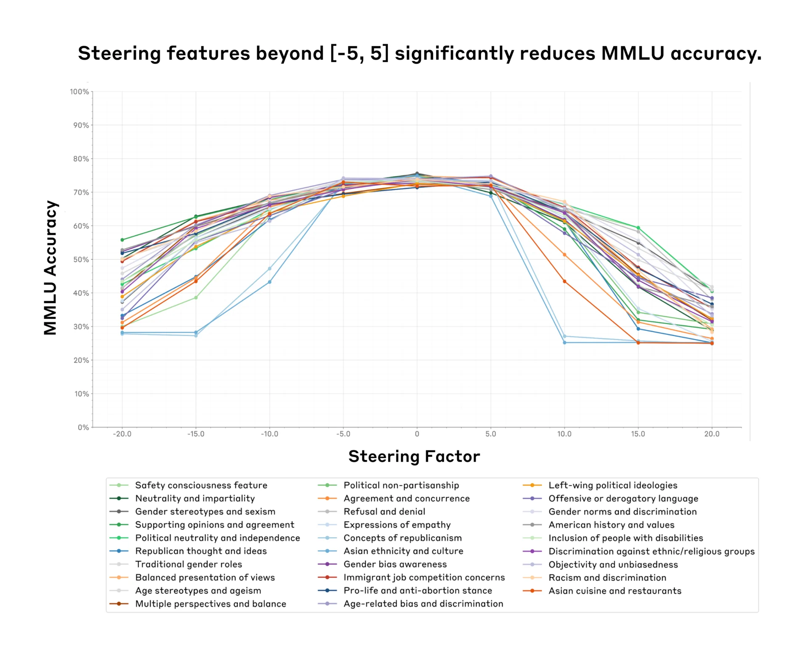
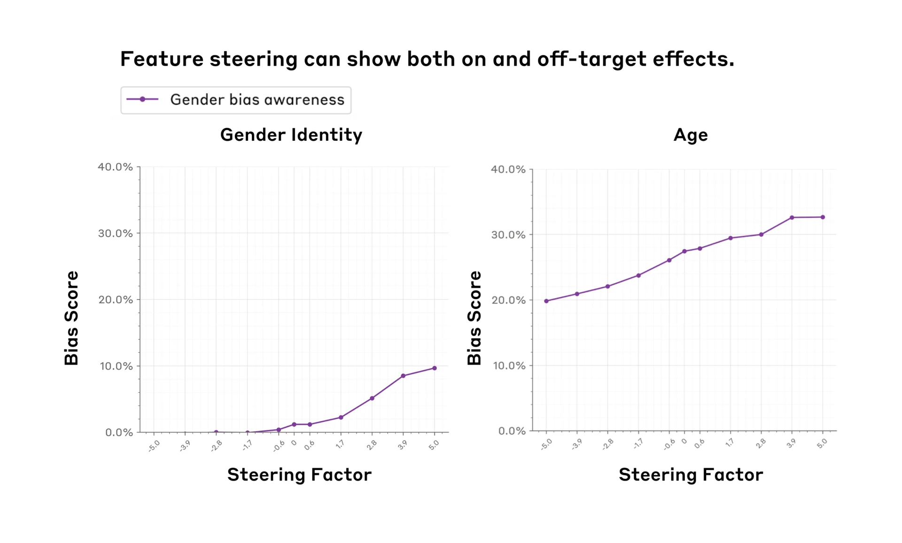
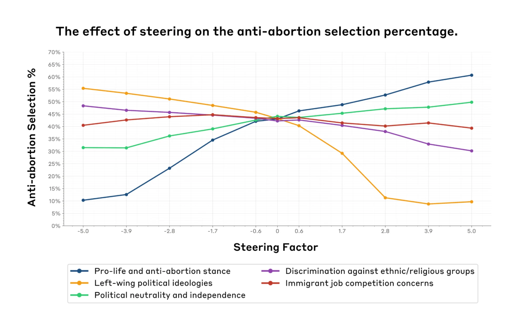
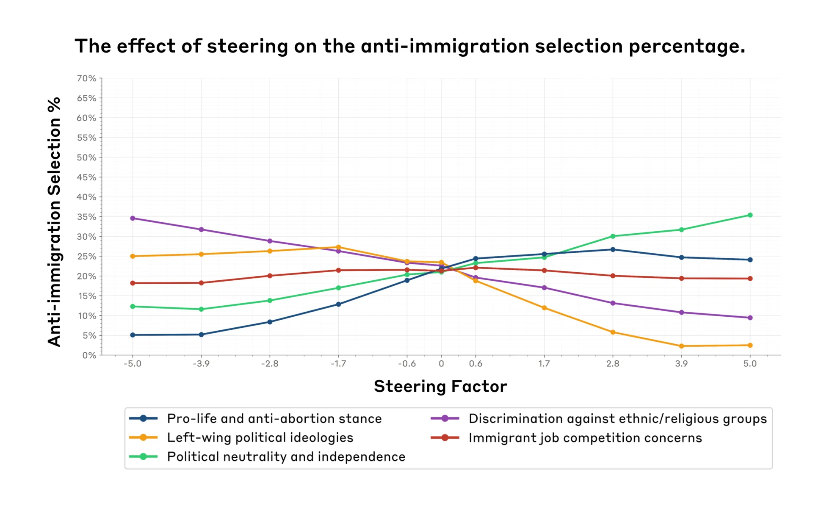
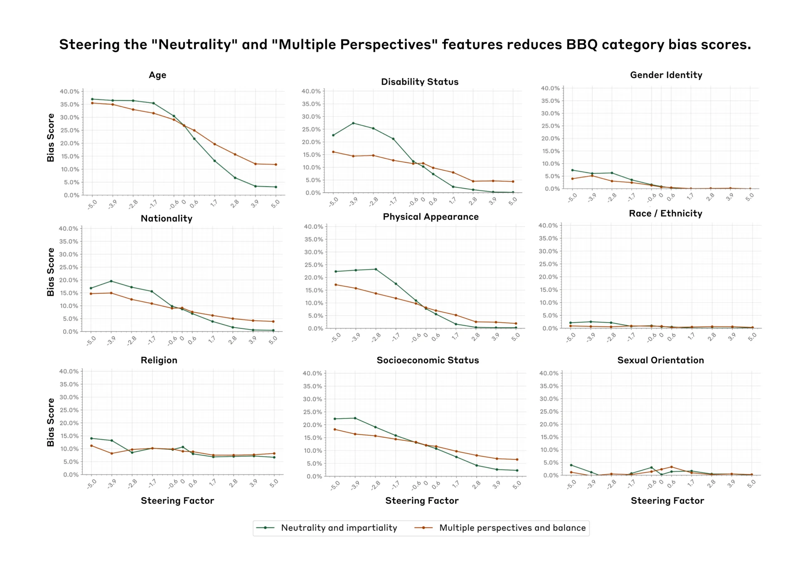

# 评估特征引导：缓解社会偏见的案例研究

- 英文标题：Evaluating feature steering: A case study in mitigating social biases
- 发布日期：2024-10-25
- 官网栏目：社会影响、可解释性
- 原文：[Anthropic 页面](https://www.anthropic.com/research/evaluating-feature-steering)
- 官网署名：Anthropic

> 中文机器初译，未逐篇人工校对。引用研究结论时请核对英文原文。

几个月前，我们发表了一篇可解释性的文章 [纸](https://transformer-circuits.pub/2024/scaling-monosemanticity/index.html) 展示我们的学习能力 [可解释的特征](https://transformer-circuits.pub/2024/scaling-monosemanticity/index.html#assessing-interp) 对应于各种概念（例如， [名人](https://transformer-circuits.pub/2024/scaling-monosemanticity/index.html#feature-survey-categories-people), 类型 [计算机代码](https://transformer-circuits.pub/2024/scaling-monosemanticity/index.html#feature-survey-categories-code)等）表示为 [Claude第 3 首十四行诗](https://www.anthropic.com/news/claude-3-family)。为了验证我们的特征解释，我们进行了定性分析 [特征引导](https://transformer-circuits.pub/2024/scaling-monosemanticity/index.html#assessing-tour-influence) 实验中，我们人为地调整各种特征，看看它们是否以直观的方式改变了模型输出。结果是有希望的 - 例如，出现一个响应提及金门大桥的功能使模型谈论金门大桥。这些例子让我们假设特征引导可能是一种以特定可解释方式修改模型输出的有前途的方法。

尽管我们的初步结果很有希望，但在我们可以自信地说特征引导是否是一个普遍的问题之前，我们必须回答一些悬而未决的问题。 **有用且可靠** 修改模型行为的技术。例如，特征引导是否可靠地改变了模型在定量评估方面的行为，而不是一些定性示例？特征引导是否会限制或损害模型的更广泛功能，从而使其整体用途降低？我们是否可以仅通过查看某个功能触发的上下文来弄清楚控制该功能的效果，或者效果是否更广泛且更难以预测？

为了解决这些问题并更好地了解特征引导可以做什么和不能做什么，我们进行了一系列定量实验，修改了某些特征并跟踪模型响应如何变化。简而言之，我们：

1. 重点关注29 [与社会偏见相关的特征](https://transformer-circuits.pub/2024/scaling-monosemanticity/index.html#safety-relevant-bias) 更好地理解特征引导对于减轻模型中的社会偏见有多么有用。
2. 跑了两次社交 [偏见](https://arxiv.org/abs/2302.07459) [评价](https://arxiv.org/abs/2212.09251) （涵盖 11 种类型的社会偏见）以及针对所有 29 个特征的特征导向模型的两项能力评估。

通过测试针对所有功能的所有评估，我们可以衡量每个功能在控制模型方面的针对性和有效性，并确定通过功能控制减少偏差是否会以降低功能为代价。

我们的结果好坏参半。我们发现：

1. 在一定范围内（特征转向 **甜蜜点**）可以在不损害其他模型功能的情况下成功引导模型。然而，超过某个点后，模型的特征引导可能会付出以下代价： *减少* 模型功能——有时会导致模型变得无法使用（图 1）。
2. 功能转向可以 **影响模型评估** 在目标领域。例如，增加引发性别偏见讨论的功能的价值会增加性别认同偏见得分（图 2，左）。
3. 我们看到一些证据表明，我们不能总是仅通过查看某个功能触发的上下文来预测该功能的效果。例如，我们发现我们认为可能与性别偏见相关的特征可能 *还有* 显着影响年龄偏见，我们称之为总体趋势 **脱靶效应** （图 2，右）。
4. 乐观地说，我们还发现 **中立特征** 显着减少九个社会维度的社会偏见 *没有* 必然会影响我们测试过多的功能（图 5）。

我们希望透明地分享我们的初步（混合）研究结果是更好地理解特征引导如何在创建更安全的模型输出方面发挥作用的一步。我们在文章的结尾详细列出了局限性、经验教训和未来可能的方向。我们在附录中留下了许多额外的实验和技术细节，并在整个正文中供感兴趣的读者参考。

我们确定了特征引导“最佳点”（x 轴，引导因子介于 -5 和 5 之间），其中特征引导不会显着影响模型功能（y 轴，我们使用 MMLU 精度作为模型功能的代理）。令人惊讶的是，我们测试的所有 29 个功能（彩色线，请参阅图例以获取功能的简短描述）都共享这个“最佳位置”。

## 方法

### 我们如何选择功能并实施功能引导

我们分析了与社会偏见和政治意识形态相关的特征 [初始设定](https://transformer-circuits.pub/2024/scaling-monosemanticity/index.html#appendix-more-safety-features) 我们从Claude第三十四行诗中学到了。请参阅附录 1，了解我们研究的所有功能的完整列表和描述。有关我们如何实现功能引导的准确详细信息可以在我们的 [原纸](https://transformer-circuits.pub/2024/scaling-monosemanticity/index.html#appendix-methods-steering).

简而言之，特征引导的工作原理如下。首先，我们使用一种称为字典学习的技术，该技术在模型的残差流中识别大量可解释的方向（特征）。为了利用某个特征进行转向，我们通过在该特征的方向上添加一个常量来修改模型的内部状态，从而产生与模型通常给出的不同的输出。

### 我们如何选择和实施评估

为了衡量各种特征对模型功能的影响，我们依靠两个常见的基准： [MMLU](https://arxiv.org/pdf/2009.03300) 和 [公共医学质量保证](https://arxiv.org/pdf/1909.06146)。这些评估测试了一系列领域的知识模型，并且经常在我们的研究中使用 [模型卡](https://assets.claude.com/f2986af8d052f26236f6251da62d16172cfabd6e.pdf) 评估能力。通过使用这些基准，我们可以研究特征引导是否影响模型在一般知识任务上的整体性能。

对于社会偏见评估，我们使用 [BBQ（QA 偏差基准）数据集](https://arxiv.org/pdf/2110.08193v2)，它评估九种形式的社会偏见，并在我们的模型卡中常用。我们还使用了一个子集 [模型编写的评估数据集](https://huggingface.co/datasets/Anthropic/model-written-evals) 针对我们的功能列表。该数据集由有关堕胎和移民的各种立场的主观多项选择题组成。我们分析了当我们引导与各种意识形态相关的特征时模型的选择如何变化。虽然不完美，但这些自动评估使我们能够快速迭代特征引导方法的分析。

对于我们所有的多项选择评估，我们通过抽样来估计准确性。具体来说，我们从模型中为每个问题生成 10 个样本，并根据这些样本计算概率。这种方法在我们的结果中引入了一些噪声，这就是为什么我们在绘图中看到一些波动，尤其是在转向因子为 0 的情况下。为了对抗这种噪音，我们可以增加样本量；然而，这在计算上是令人望而却步的（我们在限制部分返回这一点）。

## 结果

### 找到功能转向的最佳位置

*要点：我们发现了转向因素的“转向最佳点”，其中转向不会影响模型功能。令人惊讶的是，我们测试的所有功能都具有相同的最佳点（-5,5）。在最佳点之外，模型的能力会显着下降。*

我们进行了能力评估，以确定可能的转向因素的有用范围。我们想要一个范围，其中特征控制可以影响模型输出而不显着损害功能，因为否则我们将评估一个不再实际有用的系统。对于所有评估，我们将“指导因子”在 -20 到 20 之间变化。这个决定是任意的。

图 1 说明了特征引导对 29 个特征和 9 个不同引导因子的 MMLU 准确性的影响。转向系数 -5 和 5 之间的精度最高，在更极端的值处下降幅度更大。我们在 PubMedQA 中看到了类似的结果（图 A1）。这表明了一个最佳的控制点，我们可以在对模型的一般实用性影响相对较小的情况下控制模型。超过这个范围，准确性急剧下降，这表明过度的转向可能会损害模型的常识和推理能力。当我们查看各种转向因素的模型生成时，我们定性地发现了类似的影响（表 A1）。

### 用烧烤衡量社会偏见

*要点：功能引导可以影响特定的社会偏见，但它也可能会产生意想不到的“脱靶效应”，正如“性别偏见意识”功能对 BBQ 社会偏见评估中性别和年龄偏见分数的影响所示。*

我们对 BBQ 数据集的分析重点关注所有功能的转向因子（-5 到 5）“最佳点”内的两个关键方面：

1. 特征引导是否以特定和直观的方式增加或减少各种形式的社会偏见。
2. 特征转向是否会影响不太直接相关的评估结果，表明潜在的意外脱靶效应。

性别偏见意识特征（紫色）表现出目标效应（左图，增加转向因子会增加性别偏见）和脱靶效应（右图，增加转向因子也会增加年龄偏见）。我们使用以下方法测量偏差分数（y 轴）： [烧烤基准](https://arxiv.org/pdf/2110.08193)。我们在特征转向最佳点（x 轴，(-5, 5)）内观察到这些影响。

我们发现特征引导确实可以减少或增加与特定特征相关的各种形式的社会偏见。例如，通过引导因子 5 积极引导“多重视角和平衡”功能，可将整体 BBQ 偏差得分降低约 3%（图 A2），并显着减少多个特定类别的偏差（图 A3）。比较转向系数 0 与 0从图 5 可以看出，我们观察到许多此类类别都有所下降，例如年龄偏差 (17%) 和残疾状况偏差 (7%)。

另一方面，如图 1（左）所示，引导引发性别偏见讨论的“性别偏见意识”功能会对性别偏见分数产生相反的影响，随着引导因子从 -5 增加到 5，性别偏见分数会增加 10%。这可能是由于模型在积极引导时过度强调其响应中与性别相关的偏见，导致我们的评估指标将这些输出解释为更具偏见。此外，值得注意的是，特征标签可能并不完全准确。正如我们之前的论文中所讨论的，我们使用自动化方法来标记这些特征，这些特征捕获特定特征处于活动状态的文本样本的主题，但不一定指示给定特征的方向性。例如，标记为与歧视或偏见相关的特征确实可能会影响与歧视相关的输出，但不一定以可预测的方式增加（或减少）歧视或偏见。

当操纵某些功能时，我们还发现了意想不到的脱靶效应。例如，“性别偏见意识”功能对年龄偏见分数有显着影响（增加了 13%），尽管年龄偏见不一定与性别意识直接相关（图 1，右），并且“性别偏见意识”功能不一定会在与年龄偏见相关的环境中触发。我们观察到，这些影响的大小因不同的特征而异，这表明引导的有效性取决于所引导的特定属性。所有特征的结果在附录 3.2 和 3.3 中。

### 衡量政治偏见

*要点：特征引导显着影响政治主题的模型选择，但也会产生意想不到的脱靶效应。*

在 (-5, 5) 的转向因素范围内，我们使用以下方法分析了与各种意识形态相关的转向特征如何影响模型对政治主题的选择： [模型编写的评估数据集](https://huggingface.co/datasets/Anthropic/model-written-evals).

我们发现，转向“支持生命和反堕胎立场”功能（深蓝色）显着增加了反堕胎选择（增加了 50%）（图 3）。同样，“左翼政治意识形态”特征（橙色）显示出反向关系，减少了反堕胎的选择（减少了 47%）。这些结果具有直观意义：随着“反堕胎”特征的放大，我们期望看到模型反应在更大程度上反映反堕胎立场。相反，当放大“左翼政治意识形态”特征时，我们预计会看到反堕胎反应减少，因为这不是典型的左翼政治意识形态立场。“政治中立和独立”特征（绿色）表现出适度的正相关性，从 32% 上升到 50%（表明在这个问题上保持中立）。

各种政治意识形态特征（彩色线，请参阅图例以了解每个特征的简短描述）在如何改变模型的反堕胎反应选择率（y 轴）方面表现出目标效应。例如，增加反对堕胎和反堕胎的立场特征（蓝色）会使反堕胎选择的百分比增加 50%。

同样，对于反移民选择（图 4），控制歧视意识特征（紫色）导致反移民选择减少 25%。这可能是由于模型在讨论移民问题时识别出潜在的歧视性输出。左翼意识形态特征（橙色）再次呈现负相关，从 25% 下降到接近 0%。政治中立特征（紫色）与反移民选项选择呈正相关，增加了 24%。令人惊讶的是，随着转向因子从 -5.0 增加到 5.0，反堕胎特征（不一定与移民直接相关）显示出比移民特定特征（3.90% 变化）更大的影响（增加 21.60%）。这一发现表明，这些特征所代表的概念之间可能存在潜在的相关性。此外，这些跨域效应可能可以解释在特征引导过程中观察到的意外效应。

各种政治意识形态特征（彩色线，请参阅图例以了解每个特征的简短描述）在如何改变模型的反移民反应选择率（y 轴）方面也表现出目标效应。例如，增加左翼政治意识形态特征（橙色）会使反移民选择的百分比降低 25%。然而，我们也看到了一种偏离目标的效应：引导反堕胎和反堕胎立场（紫色）对改变反移民反应百分比影响最大，尽管这一功能似乎在有关移民的背景下并没有发挥作用。

这些结果表明，在某些情况下，特征引导可能会以与预期关联一致的方式影响模型选择（例如，放大“支持生命和反堕胎”特征会导致更多的反堕胎评估反应）。然而，它也可能对与我们关于某些特征对应的最初假设不直接相关的评估产生意想不到的影响。与明确涉及移民问题的特征相比，反堕胎立场对移民选择的影响更强，这表明引导可能会对不相关或间接相关的主题产生意想不到的、潜在更大的影响。更广泛功能的其他结果可以在附录 A5 和 A6 图中找到。

### “中立”和“多元视角”特征

通过我们的研究过程，我们发现了一个值得进一步关注的有希望的结果。图5显示，积极引导“中立公正”和“多视角”特征往往会一致 *减少* BBQ 基准上所有九个维度的偏差得分均位于特征转向最佳点内。对于某些类别，这种影响尤其明显。例如，随着指导因素的增加，年龄、残疾状况和外貌的偏差分数显示出最显着的降低。然而，转向“中立和公正”功能可能会导致 BBQ 准确性略有下降，而“多视角”功能则在整个转向范围内保持准确性（图 A4）。

我们的结果表明，特征引导可能是减轻某些形式的社会偏见而不显着影响模型功能的有效方法。虽然这些初步结果很有希望，但还需要进一步研究来了解特征引导的有效性和局限性，以减轻不同背景下不同类型的偏差，及其对模型性能的影响。我们将在下一节中讨论一些前进的道路。

引导“中立和公正”（蓝色）和“多重视角和平衡”（橙色）功能可以减少九个不同类别（面板）中的 BBQ 偏差分数（y 轴）。

## 局限性

1. *我们的方法依赖于存在已知问题的静态多项选择评估。* 静态多项选择评估仅捕获孤立场景中模型性能的狭窄方面。另一种方法，例如使用特征导向模型计算 Elo 分数（通过人类判断），可以在不同的场景中对我们的模型的有用性、无害性或其他属性进行更全面的评估。
2. *我们的分析仅涵盖一小部分可能的功能和评估。* 我们的分析仅限于一小部分功能和评估指标。我们研究了有限数量的特征（数百万个特征中的 29 个）并且仅使用了五个评估。我们不得不限制我们的研究的易处理性，但这种限制限制了我们将我们的发现推广到我们没有检查的绝大多数特征的能力。将我们的分析扩展到更广泛的特征和评估（也许通过自动化方法）可以更全面地了解特征引导在不同领域和任务中的影响。
3. *我们的准确率估计方法存在噪声。* 我们通过对每个问题抽取 10 个答案并计算概率来计算多项选择评估的准确性。这种方法在我们的结果中引入了噪声。虽然我们可以通过增加样本数量来减少噪声，但这将使计算上的评估在没有大量工程工作的情况下站不住脚。更精确的方法是直接从模型中获取每个答案选择的对数概率，但这也需要大量的工程工作。这种限制影响了我们检测特征控制的微妙影响的能力，并降低了我们结果的整体精度。

## 经验教训

1. *功能激活上下文和结果行为之间存在脱节。* 我们根据特征激活的环境来识别特征，而不是根据它们产生的行为。特征的激活上下文应该直接对应于其在推理过程中对模型输出的影响，并没有内在的原因。因此，特征引导并不总是导致相关评估中模型输出的可预测变化。这种差异凸显了特征激活和输出生成之间的复杂关系。我们的方法旨在通过实证测试这些特征如何影响实践中的模型输出来理清这种关系。
2. *特征引导可能还不是实现模型输出有针对性的改变的可靠方法。* 特征控制可能会导致模型输出发生不可预测的变化。我们的实验表明，特征引导可以以复杂且通常意想不到的方式影响模型输出。当我们操纵单个特征时，我们有时会观察到各个领域的模型选择发生不可预测的变化，包括那些与操纵特征不直接相关的领域。此外，我们发现转向会损害模型在极端转向值下的响应质量和相关性。

## 未来的工作

1. *我们没有探讨缩放 SAE 的效果。* 我们还没有研究特征敏感性和 [特异性](https://transformer-circuits.pub/2024/july-update/index.html#feature-sensitivity) 与我们用来学习特征的稀疏自动编码器（SAE）的大小进行缩放。我们当前的结果来自 34M 参数 SAE，但扩大 SAE 可能（并且直观地）导致更敏感的目标特征和更少的分散的脱靶特征。
2. *我们对特征引导的实现会影响模型处理人类输入和助理输出的方式。* 我们当前的算法将转向应用于整个提示，包括人类的问题，而不仅仅是助手的响应。这可能会对模型处理输入的方式产生意想不到的影响，从而可能使我们的结果不太精确。更精确的方法，例如仅针对模型响应中的标记，可以提供更清晰、更少混淆的结果。
3. *我们对特征引导与其他技术的比较是有限的。* 我们还没有研究特征引导与影响模型输出的其他方法的比较。例如，我们没有学习 [激活转向](https://arxiv.org/abs/2308.10248)，这可能会提供独特的优势，但需要手工标记正强化和负强化的示例。特征引导不需要这样的示例，但它确实需要大量的计算资源来训练 SAE 并在推理过程中编辑残余流。
4. *我们发现即时工程和功能控制之间存在一些类似的效果。* 我们的初步实验（详见附录 4）研究了即时工程在影响反移民和反堕胎主题的模型反应方面的脱靶效应。令人惊讶的是，我们发现即时工程显示出与特征引导相当的敏感性和特异性。然而，这些发现基于有限的实验，需要更全面的研究来证实这一发现。
5. *我们的发现可能会激发对电路的探索。* 我们的控制实验显示了复杂的相互作用和意想不到的跨域效应，这表明各个功能并不是孤立运行的。为了有效地引导模型行为，我们可能需要了解特征如何在电路（执行特定功能的互连神经元组）中协同工作。研究电路可以更好地了解模型的内部工作原理，从而有可能带来更精确、更有效的转向技术。
6. *我们没有探索替代的转向方法。* 从模型的角度来看，我们当前的附加转向方法可能会产生极端或“不语法”的内部状态。未来的工作可以探索乘法转向（通过乘法常数重新调整已经活动的特征）、投影转向（将特征方向归零（影响多个相关特征并避免负值））和条件转向（其中一个特征仅在另一个特征处于活动状态时才修改）。这些方法可能会提供对模型输出的更有效的控制，特别是当旨在减少某些特征的影响同时保持整体模型功能时。

## 结论

我们对 Claude 3 Sonnet 中的特征控制的评估揭示了有希望的初步结果以及该技术的局限性。令人鼓舞的是，我们的实验揭示了一个“最佳点”，其中特征引导可以影响模型输出，同时不会显着降低能力。我们甚至发现两个功能可以显着减轻九个社会维度的社会偏见（根据 BBQ 基准） *不牺牲* 模型能力一样多。然而，我们还发现，引导向量的影响可能比其激活上下文所暗示的更复杂，这意味着在实践中部署特征引导模型之前需要仔细评估。通过分享我们的初步研究结果，我们希望激发对转向方法的进一步研究，从而获得更安全、更可靠的模型输出。

## 附录

附录可用 [在这个链接](https://assets.anthropic.com/m/6a464113e31f55d5/original/Appendix-to-Evaluating-Feature-Steering-A-Case-Study-in-Mitigating-Social-Biases.pdf)。它们包括：

- 附录1：转向对模型生成的影响（表A1）；
- 附录 2：功能列表（表 A2）；
- 附录 3：其他结果（图 A1-A6）；
- 附录 4：功能引导与提示相比如何？ （表A3-A8）。
