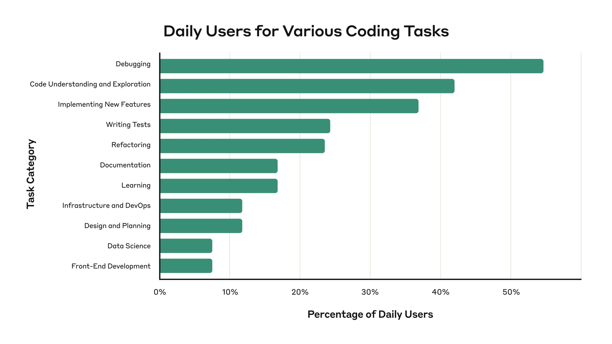
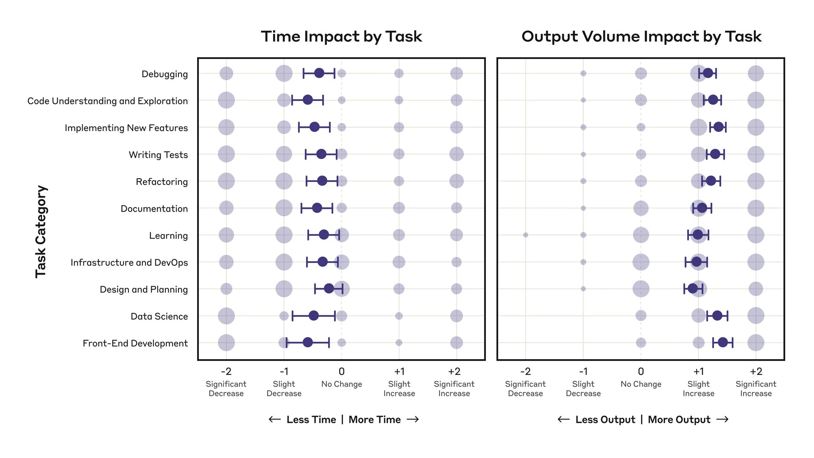
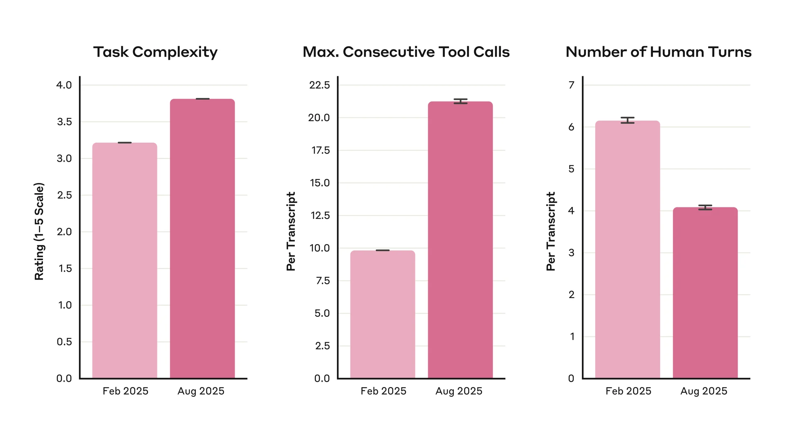
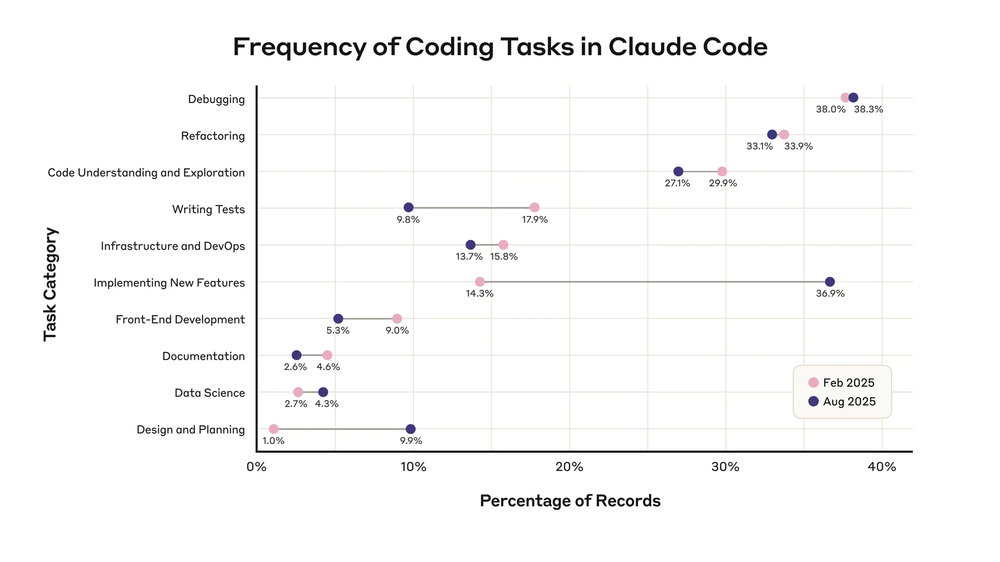
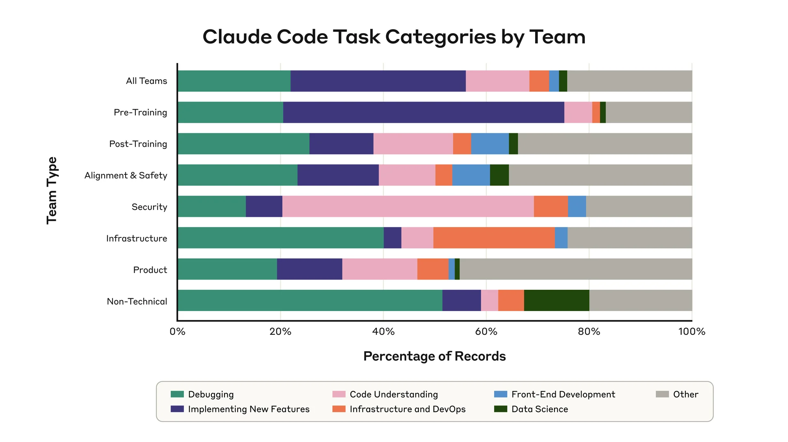

# AI 如何改变 Anthropic 的工作方式

- 英文标题：How AI is transforming work at Anthropic
- 发布日期：2025-12-02
- 官网栏目：社会影响
- 原文：[Anthropic 页面](https://www.anthropic.com/research/how-ai-is-transforming-work-at-anthropic)
- 官网署名：Anthropic

> 中文机器初译，未逐篇人工校对。引用研究结论时请核对英文原文。

人工智能如何改变我们的工作方式？我们的 [先前的研究](https://www.anthropic.com/economic-index) 关于人工智能的经济影响的研究着眼于整个劳动力市场，涵盖各种不同的工作。但是，如果我们更详细地研究一些人工智能技术最早的采用者——即我们自己，会怎样呢？

将镜头转向内部，2025 年 8 月，我们调查了 132 名 Anthropic 工程师和研究人员，进行了 53 次深度定性访谈，并研究了内部 [克劳德·科德](https://www.anthropic.com/claude-code) 使用数据来了解人工智能的使用如何改变 Anthropic 的事物。我们发现人工智能的使用正在从根本上改变软件开发人员的工作性质，既带来了希望，也带来了担忧。

我们的研究揭示了工作场所面临重大变革：工程师正在完成更多工作，变得更加“全栈”（能够成功完成超出其正常专业知识的任务），加快学习和迭代速度，并解决以前被忽视的任务。这种广度的扩展也让人们想知道其中的权衡——一些人担心这可能意味着失去更深层次的技术能力，或者变得更无法有效地监督Claude的成果，而另一些人则抓住了更广泛、更高层次思考的机会。一些人发现，更多的人工智能协作意味着他们与同事的合作更少；一些人想知道他们最终是否会因为自动化而失业。

我们认识到，研究人工智能对构建人工智能的公司的影响意味着代表着一种特权地位——我们的工程师可以尽早使用尖端工具，在相对稳定的领域工作，并且他们自己正在为影响其他行业的人工智能转型做出贡献。尽管如此，我们认为研究和发表这些发现总体上是有用的，因为对于工程师来说，Anthropic 内部发生的事情可能仍然是更广泛的社会变革的一个有启发性的预兆。我们的研究结果暗示了一些挑战和考虑因素，可能需要跨部门尽早关注（尽管请参阅 [附录](https://anthropic.com/research/how-ai-is-transforming-work-at-anthropic#appendix) 警告）。在收集此数据时，Claude Sonnet 4 和 Claude Opus 4 是可用的功能最强大的型号，并且功能在不断进步。

更强大的人工智能带来了生产力优势，但也引发了有关维持技术专业知识、保持有意义的协作以及为不确定的未来做好准备的问题，这可能需要在人工智能增强的工作场所中采用新的学习、指导和职业发展方法。我们将在下面的“展望”部分中讨论我们为内部探索这些问题而采取的一些初步步骤。我们还在最近的博客文章中探讨了潜在的政策反应 [人工智能相关经济政策的想法](https://www.anthropic.com/research/economic-policy-responses).

## 主要发现

在本节中，我们简要总结了我们的调查、访谈和Claude代码数据的结果。我们将在下面的后续部分中提供详细的发现、方法和注意事项。

**调查数据**

1. **人类工程师和研究人员最常使用 Claude 来修复代码错误和了解代码库**。调试和代码理解是最常见的用途（图 1）。
2. **人们报告Claude的使用率不断增加，生产力也得到提高。** 员工自我报告称，60% 的工作都使用 Claude，生产率提高了 50%，比去年同期提高了 2-3 倍。这种生产力看起来每个任务类别的时间略有减少，但产出量却大大增加（图 2）。
3. **Claude协助的工作中有 27% 是原本无法完成的任务**，例如扩展项目、制作必备工具（例如交互式数据仪表板）以及如果手动完成则不具有成本效益的探索性工作。
4. **大多数员工经常使用 Claude，同时表示他们可以将 0-20% 的工作“完全委托”给它。** Claude是一个持续的合作者，但使用它通常需要积极的监督和验证，特别是在高风险的工作中，而不是移交根本不需要验证的任务。

**定性访谈**

1. **员工正在培养对人工智能授权的直觉**。工程师倾向于委派易于验证的任务，他们“可以相对轻松地嗅探检查正确性”、低风险（例如“一次性调试或研究代码”），或者无聊（“我对完成任务越兴奋，我就越有可能不使用Claude”）。许多人描述了信任的进展，从简单的任务开始，逐渐委派更复杂的工作——虽然他们目前保留了大部分设计或“品味”任务，但随着模型的改进，这个边界正在重新协商。
2. **技能组合正在扩展到更多领域，但有些技能的练习却越来越少。** Claude使人们能够将他们的技能扩展到更多领域（软件工程（“我可以非常有能力地从事前端或事务数据库......以前我会害怕接触这些东西”），但一些员工也矛盾地担心编写和评论代码所需的更深层次技能的萎缩——“当生成输出如此简单和快速时，真正花时间学习东西变得越来越困难。”
3. **改变与编码技术的关系。** 一些工程师接受人工智能辅助并关注结果（“我认为我真的很喜欢编写代码，但我认为我实际上只是喜欢从编写代码中获得的东西”）；其他人则说“我确实怀念[编写代码]的某些部分。”
4. **工作场所的社会动态可能正在发生变化。** Claude现在成为了解决过去向同事提出问题的第一站——一些人报告说，因此指导和合作的机会减少了。 （“我喜欢与人一起工作，但遗憾的是我现在‘需要’他们的次数减少了……更多的初级人员不再像以前那样经常来找我问问题了。”）
5. **职业发展和不确定性。** 工程师报告称，他们正在转向管理人工智能系统的更高级别工作，并报告生产力显着提高。然而，这些变化也引发了人们对软件工程作为职业的长期发展轨迹的疑问。一些人对未来表达了矛盾的感受：“短期内我感到乐观，但从长远来看，我认为人工智能最终会做所有事情，让我和其他许多人变得无关紧要。”其他人强调真正的不确定性，只是说“很难说”几年后他们的角色会是什么样子。

**Claude Code 使用趋势**

1. **Claude正在更加自主地处理日益复杂的任务**。六个月前，Claude Code 在需要人工输入之前可以自行完成大约 10 个操作。现在，它通常可以处理 20 个左右，需要更少的人工操作来完成更复杂的工作流程（图 3）。工程师越来越多地使用 Claude 来执行复杂的任务，例如代码设计/规划（使用量的 1% 到 10%）和实现新功能（14% 到 37%）（图 4）。
2. **Claude修复了很多“剪纸”。** 8.6% 的 Claude Code 任务涉及修复可提高生活质量的小问题，例如重构代码以提高可维护性（即“修复剪纸问题”），人们认为这些问题通常会被忽视。这些小修复加起来可以带来更大的生产力和效率提升。
3. **每个人都变得更加“全栈”。** 不同的团队以不同的方式使用 Claude，通常是为了增强他们的核心专业知识 - 安全部门使用它来分析不熟悉的代码，对齐和安全部门使用它来构建数据的前端可视化，等等（图 5）。

## 调查数据

我们对整个组织的 132 名 Anthropic 工程师和研究人员进行了调查，了解他们对 Claude 的使用情况，以更好地了解他们日常使用 Claude 的具体情况。我们通过内部沟通渠道分发调查结果，并直接向代表研究和产品职能的不同团队的员工进行宣传。我们在附录中包含了一个限制部分，其中包含更多方法细节，并且我们正在分享 [我们的调查问题](https://assets.anthropic.com/m/6cd21f7d4f82afcb/original/Claude-at-Work-Survey.pdf) 这样其他人就可以评估我们的方法并使其适合他们自己的研究。

### 人们使用 Claude 执行哪些编码任务？

我们要求接受调查的工程师和研究人员评价他们使用 Claude 执行各种类型编码任务的频率，例如“调试”（使用 Claude 帮助修复代码中的错误）、“代码理解”（让 Claude 解释现有代码以帮助人类用户理解代码库）、“重构”（使用 Claude 帮助重构现有代码）和“数据科学”（例如让 Claude 分析数据集并制作条形图）。

以下是最常见的日常任务。大多数员工 (55%) 每天都使用 Claude 进行调试。42% 的人每天使用 Claude 来理解代码，37% 的人每天使用 Claude 来实现新功能。不太常见的任务是高级设计/规划（可能是因为这些任务人们往往掌握在人手中），以及数据科学和前端开发（可能是因为它们总体上是不太常见的任务）。这与“Claude Code 使用趋势”部分中报告的 Claude Code 使用数据分布大致一致。

各种编码任务（y 轴）的日常用户比例（x 轴）。

### 使用率和生产力

员工自我报告称，12 个月前，他们在 28% 的日常工作中使用 Claude，生产率提高了 20% 以上，而现在，他们在 59% 的工作中使用 Claude，平均生产率提高了 50% 以上。 （这大致证实了当我们采用 Claude Code 时，每个工程师每天合并的拉取请求增加了 67%，即成功合并了对代码的更改） [整个工程组织](https://newsletter.pragmaticengineer.com/p/how-claude-code-is-built).) 同比比较非常引人注目——这表明这两个指标在一年内增长了 2 倍以上。使用率和生产力也密切相关，在分布的最末端，14% 的受访者通过使用 Claude 将生产力提高了 100% 以上——这些是我们内部的“超级用户”。

为了说明这一发现（以及下面其他自我报告的生产力发现），生产力很难精确测量（参见 [附录](https://anthropic.com/research/how-ai-is-transforming-work-at-anthropic#appendix) 了解更多限制）。有 [METR 最近的工作](https://metr.org/blog/2025-07-10-early-2025-ai-experienced-os-dev-study/)是一家人工智能研究非营利组织，该研究表明，在非常熟悉的代码库上使用人工智能的经验丰富的开发人员高估了人工智能带来的生产力提升。话虽如此，METR 认为导致生产率低于预期的因素（例如，人工智能在大型、复杂的环境中或需要大量隐性知识/上下文的情况下表现较差）与我们的员工所说的任务类型密切相关 *不要* 委托给Claude（参见 [人工智能授权方法](https://anthropic.com/research/how-ai-is-transforming-work-at-anthropic#ai-delegation-approaches)，如下）。我们的生产力提升，自我报告 *跨越* 任务，可能反映出员工正在发展战略性人工智能授权技能——METR 研究中没有考虑到这一点。

当向员工询问他们目前使用 Claude 的任务类别，以及它如何影响他们在该任务类别中花费的总时间和工作产出量时，出现了一个有趣的生产力模式。在几乎所有任务类别中，我们都看到花费的时间净减少，而输出量的净增加更大：

按任务（y 轴）对花费时间（左图）和输出量（右图）的影响。每个图上的 x 轴对应于与不使用 Claude 相比，Claude 辅助任务类别的自我报告的减少（负值）、增加（正值）或没有变化（垂直虚线）。误差线显示 95% 的置信区间。圆圈面积与每个评级点的响应数量成正比。仅包括报告在每个任务类别中使用Claude的受访者。

然而，当我们深入研究原始数据时，我们发现节省时间的响应集中在两端——有些人花费了大量时间 *更多* Claude协助的任务的时间。

这是为什么？人们普遍解释说他们必须对Claude的代码进行更多的调试和清理（例如“当我把自己的代码逼到墙角时”），并承担更多的认知开销来理解Claude的代码，因为它们不是他们自己编写的。一些人提到在有利的意义上花更多的时间在任务上——有人说使用Claude可以帮助他们“坚持我以前会立即放弃的任务”；另一位表示，这有助于他们进行更彻底的测试，并在新代码库中进行更多学习和探索。一般来说，节省时间的工程师可能是那些为 Claude 确定快速可验证任务范围的工程师，而那些花费更多时间的工程师可能是在调试 AI 生成的代码或在 Claude 需要更多指导的领域工作。

从我们的数据中也不清楚所报告的时间节省被重新投入到哪里——是否投入到额外的工程任务、非工程任务、与 Claude 交互或审查其输出，或者工作之外的活动。我们的任务分类框架并未涵盖工程师分配时间的所有方式。此外，节省的时间可能反映了自我报告中的认知偏差。需要进一步的研究来阐明这些影响。

产量的增加更加直接和实质性；所有任务类别都有较大的净增长。当我们考虑到人们正在报告任务类别（例如总体“调试”）而不是单个任务时，这种模式是有意义的——即人们可以花更少的时间作为一个类别进行调试，同时产生更多的总体调试输出。生产力很难直接衡量，但这些自我报告的数据表明，人工智能主要通过提高产量来提高 Anthropic 的生产力。

### Claude启用新工作

我们很好奇的一件事是：Claude是否能够实现高质量的新型工作，或者Claude协助的工作最终会由员工完成（尽管速度可能会较慢）？

员工们估计，如果没有它，他们 27% 的Claude协助工作就无法完成。工程师们提到，使用人工智能来扩展项目、锦上添花（例如交互式数据仪表板）、有用但乏味的工作（例如文档和测试）以及手动进行的探索性工作不具有成本效益。正如一个人解释的那样，他们现在可以修复更多以前损害生活质量的“剪纸”，例如重构结构不良的代码，或构建“有助于更快完成另一项任务的小工具”。我们也在使用数据分析中寻找了这一点，并且 [发现](https://anthropic.com/research/how-ai-is-transforming-work-at-anthropic#fixing-papercuts) 8.6% 的 Claude Code 任务涉及“剪纸修复”。

另一位研究人员解释说，他们同时运行了 Claude 的多个版本，所有版本都探索解决问题的不同方法：

> 人们倾向于将超能力模型视为单一实例，例如获得一辆更快的汽车。但是拥有一百万匹马......可以让你测试一堆不同的想法......当你有额外的探索广度时，这是令人兴奋和更有创造力的。

正如我们将在以下部分中看到的，这项新工作通常需要工程师处理其核心专业知识之外的任务。

### 有多少工作可以完全委托给Claude？

尽管工程师经常使用 Claude，但超过一半的人表示他们只能“完全委托”0-20% 的工作给 Claude。 （值得注意的是，受访者对“完全委托”的理解存在差异——从根本不需要验证的任务到那些足够可靠、只需要轻微监督的任务。）在解释原因时，工程师描述了与 Claude 积极、迭代地合作，并验证其输出——特别是对于代码质量标准至关重要的复杂任务或高风险领域。这表明工程师倾向于与 Claude 密切合作并检查其工作，而不是在未经验证的情况下交付任务，并且他们为“完全委托”设定了很高的标准。

## 定性访谈

虽然这些调查结果揭示了生产力的显着提高和工作模式的改变，但它们也提出了工程师如何每天实际经历这些变化的问题。为了了解这些指标背后的人为因素，我们对参与调查的 53 名 Anthropic 工程师和研究人员进行了深入访谈，以更深入地了解他们对工作场所这些变化的想法和感受。

### 人工智能授权方法

工程师和研究人员正在开发各种策略，以便在工作流程中高效地利用 Claude。人们通常委派以下任务：

**在用户上下文之外 *和* 低复杂度**:

“我用 Claude 来处理上下文较少的事情，但我认为整体复杂性也很低。”

“我遇到的大部分基础设施问题并不困难，可以由 Claude 处理……我不太了解 Git 或 Linux……Claude 很好地弥补了我在这些领域缺乏经验的情况。”

**容易验证：**

“这绝对是 *惊人的* 对于所有验证工作量与创建工作量相比并不大的事情。”

**明确定义或独立的：**

“如果该项目的一个子组件与其他组件充分脱钩，我会让 Claude 尝试一下。”

**代码质量并不重要：**

“如果是一次性调试[ging]或研究代码，它会直接交给 Claude。如果它在概念上很困难或需要某种非常特定类型的调试注入，或设计问题，我会自己做。”

**重复或无聊：**

“我对完成这项任务越兴奋，我就越有可能不使用Claude。然而，如果我感到很大的阻力……我常常发现与Claude就这项任务展开对话会更容易。”

在我们的调查中，平均而言，人们表示，Claude协助的工作中有 44% 是他们自己不喜欢做的任务。

**提示比执行更快：**

“[对于]一项我预计需要不到 10 分钟的任务......我可能不会费心使用Claude。”

“冷启动问题可能是目前最大的障碍。说到冷启动，我的意思是，我有很多关于我的团队的代码库如何工作的内在信息，而Claude默认情况下不会有这些信息……我可以花时间尝试迭代完美的提示[但]我只想自己去做。”

我们的员工在关于授权的决策中提到的这些因素与在人工智能相关的生产力下降的原因（例如开发人员对代码库、大型且复杂的存储库的高度熟悉）中发现的因素类似。 [外部学习](https://metr.org/blog/2025-07-10-early-2025-ai-experienced-os-dev-study/) 来自 METR。我们的采访中这些授权标准的趋同表明，适当的任务选择是人工智能生产力提高的一个重要因素（在未来的生产力研究中应仔细控制）。

#### 信任但验证

许多用户描述了他们 Claude 使用的进展，其中涉及随着时间的推移委派越来越复杂的任务：“起初，我使用 AI 工具来解决有关 Rust 编程语言的基本问题......最近，我所有的编码都使用 Claude Code。”

一位工程师将信任的进展比作采用其他技术，例如谷歌地图：

> 一开始我只会使用 [Google 地图] 来查找我不知道的路线......这就像我使用 Claude 编写我不会的 SQL，但没有要求它编写我所做的 Python。然后我开始在我最熟悉的路线上使用谷歌地图，但也许我不知道最后一英里......如今，我一直使用 Google 地图，甚至在日常通勤时也是如此。如果它说采取不同的方式，我就会这样做，并且相信它考虑了所有选择......我今天以类似的方式使用 Claude Code。

工程师们对于是否在其专业知识范围内或之外使用Claude存在分歧。有些将其用于“外围”域以节省实施时间；其他人更喜欢熟悉的领域，在那里他们可以验证输出（“我以这样的方式使用Claude，我仍然完全理解它在做什么”）。当Claude提出一个“在危险的方式上非常聪明，就像一个非常有才华的初级工程师可能会提出的事情”的解决方案时，一位安全工程师强调了经验的重要性。也就是说，只有具有判断力和经验的用户才能识别出问题。

其他工程师使用 Claude 来完成这两种类型的任务，要么以实验的方式（“我基本上总是使用 Claude 来解决任何编码问题”），要么根据他们在任务中的专业水平来调整他们的方法：

> 我使用这些工具来处理我的专业知识的核心内容（作为促进剂，我知道会发生什么并可以有效地指导代理），以及稍微超出我的专业领域的事情，我大致知道会发生什么，但Claude能够填补我记忆中的空白或熟悉特定的定义。

> 如果是我特别擅长的事情，我会更加自信，告诉Claude需要追踪什么。如果我不确定什么，我经常要求它成为专家，并就我应该考虑和研究的事情提供选择和见解。

#### 人们为自己保留什么任务？

人们一致表示，他们不会使用Claude来执行涉及高层或战略思维的任务，或者需要组织背景或“品味”的设计决策。一位工程师解释道：“我通常保持高层思维和设计。从新功能开发到调试，我都会委派一切我能做的事情。”这反映在我们的调查数据中，该数据显示设计和规划任务的生产力提升最少（图 2）。不过，许多人将委托边界描述为“移动目标”，随着模型的改进，会定期重新协商（下面的Claude代码使用数据显示，现在的编码设计/规划使用情况比六个月前相对较多）。

### 技能转变

#### 新功能...

调查发现，27% 的Claude协助的工作本来不会完成，否则反映了一个更广泛的模式：工程师使用人工智能在其核心专业知识之外工作。许多员工表示，之前完成的工作超出了他们的专业知识——后端工程师构建 UI；研究人员创建可视化。一位后端工程师描述了通过与 Claude 进行迭代来构建复杂的 UI：“它比我以前做得更好。我不可能做到这一点，绝对不能按时完成......[设计师]就像‘等等，你做到了这个？’我说：“不，Claude做到了这个 - 我只是提示它。’”

工程师报告“变得更加全栈......我可以非常有能力地处理前端、事务数据库或 API 代码，而以前我会害怕接触我不太专业的东西。”这种功能扩展可以实现更紧密的反馈循环和更快的学习——一位工程师表示，构建、安排会议和迭代的“几周过程”可能会变成“几个小时的工作会议”，同事们在场进行实时反馈。

总的来说，人们对快速原型制作、并行工作、减少辛劳的新能力感到兴奋，并普遍提高了他们的雄心壮志。一位高级工程师告诉我们，“这些工具肯定会让初级工程师变得更加高效，并且对于他们将要承担的项目类型更加大胆。”一些人还表示，使用Claude减少了“激活能量”，使他们能够更轻松地克服拖延症，“大大减少了我想要开始解决问题所需的能量，因此我愿意解决很多额外的事情。”

#### ......以及更少的实践练习

与此同时，一些人担心“随着[他们]授权更多，技能会萎缩”，并失去手动解决问题期间发生的附带（或“附带”）学习：

> 如果您要自己出去调试一个难题，您将花时间阅读对解决您的问题没有直接用处的文档和代码，但在整个过程中您都在构建系统如何工作的模型。这样的事情会少很多，因为Claude可以立即让你解决问题。

> 我曾经探索每个配置以了解该工具可以做什么，但现在我依靠人工智能来告诉我如何使用新工具，所以我缺乏专业知识。在与其他队友交谈时，我可以立即回忆起事情，而现在我必须询问人工智能。

> 使用 Claude 有可能跳过我通过解决简单实例来学习如何执行任务的部分，然后在稍后努力解决更复杂的实例。

一位高级工程师表示，如果他们的资历更浅，他们会更担心自己的技能：

> 我主要在知道答案应该是什么或应该是什么样子的情况下使用人工智能。我通过“艰难的方式”进行 SWE 培养了这种能力......但如果我（在我职业生涯的早期），我会认为需要付出很多刻意的努力来继续发展自己的能力，而不是盲目地接受模型输出。

编码技能萎缩令人担忧的原因之一是“监督悖论”——如上所述，有效使用Claude需要监督，而监督Claude需要的编码技能可能会因人工智能过度使用而萎缩。一个人说：

> 老实说，我更担心的是监督和监督问题，而不是我具体的技能组合……我的技能萎缩或无法发展主要会影响我安全使用人工智能完成我关心的任务的能力，而不是我独立完成这些任务的能力。

为了解决这个问题，一些工程师故意在没有人工智能的情况下进行练习：“每隔一段时间，即使我知道Claude可以解决问题，我也不会要求它这样做。它帮助我保持敏锐。”

#### 我们还需要那些动手编码技能吗？

也许软件工程正在向更高的抽象层次发展，就像它过去所做的那样。早期程序员的工作方式更接近机器——手动管理内存、用汇编语言编写，甚至切换物理开关来输入指令。随着时间的推移，出现了更高级、更易于人类阅读的语言，可以自动处理复杂的低级操作。也许，特别是随着“vibe编码”的兴起，我们现在正在转向英语作为编程语言。我们的一位员工建议有抱负的工程师“擅长使用人工智能[编写代码]，并专注于学习更高层次的概念和模式。”

一些员工表示，他们认为这种转变使他们能够在更高的层面上思考——“考虑最终产品和最终用户”，而不仅仅是代码。一个人通过将其与以前必须学习计算机科学中的链表（高级编程语言现在自动处理的基本结构）进行比较来描述当前的转变。“我很高兴我知道如何做到这一点......[但是]进行这些低级操作在情感上并不是特别重要。我更愿意关心代码允许我做什么。”另一位工程师也进行了类似的比较，但他指出，抽象是有代价的——随着转向高级语言，大多数工程师失去了对内存处理的深刻理解。

继续发展某个领域的技能可以更好地监督Claude并提高工作效率（“我注意到，当我熟悉的事情时，我通常会更快地完成它”）。但工程师们对于这是否重要存在分歧。一些人仍然乐观：

> 我不太担心技能侵蚀。人工智能仍然让我仔细思考问题并帮助我学习新方法。如果说有什么不同的话，那就是能够更快地探索和测试想法加速了我在某些领域的学习。

另一位则更为务实：“作为一名软件工程师，我的技能肯定在萎缩……但如果需要的话，这些技能可以回来，而我只是不再需要它们了！”一位人士指出，他们只是失去了制作图表等不太重要的技能，而且“我仍然可以很好地编写那种关键的代码。”

也许最有趣的是，一位工程师对这个前提提出了挑战：“‘生锈’框架依赖于这样一种假设，即编码有一天会回到 Claude 3.5 之前的方式。而且我认为不会。”

#### 软件工程的工艺和意义

​​工程师们对于是否错过动手编码的看法存在很大分歧。有些人感到真正的失落——“对我来说，这是一个时代的结束——我已经编程了 25 年，感觉自己能胜任该技能是我职业满意度的核心部分。”其他人则担心无法享受工作的新性质：“花一天时间督促Claude并不是一件很有趣或很有成就感的事情。放一些音乐并进入状态并自己实现一些东西会更有趣和更有成就感。”

一些人直接讨论了这种权衡并接受了它：“我确实错过了[编写代码]的某些部分 - 在重构代码时进入禅宗流状态，但总的来说，我现在的工作效率提高了很多，我很乐意放弃这一点。”

一个人说，与 Claude 一起迭代已经 *更多* 很有趣，因为他们对自己的反馈比对人类更加挑剔。其他人对结果更感兴趣。一位工程师说：

> 我预计此时我会感到害怕或无聊……但我并没有真正感觉到这些事情。相反，我感到非常兴奋，因为我可以做得更多。我以为我真的很喜欢编写代码，但实际上我只是喜欢从编写代码中获得的东西。

人们是接受人工智能的帮助还是哀悼动手编码的丧失似乎取决于他们认为软件工程的哪些方面最有意义。

### 改变工作场所的社会动态

更突出的主题之一是，Claude已成为曾经向同事提出问题的第一站。“现在我一般会问更多的问题，但其中 80-90% 的问题都会问Claude，”一名员工指出。这创建了一种过滤机制，让Claude处理日常询问，让同事们处理超出人工智能能力的更复杂、战略性或背景复杂的问题（“它使我对[我的团队]的依赖减少了80%，[但]最后20%至关重要，我会去和他们交谈”）。人们也会向Claude“传达想法”，类似于与人类合作者的互动。

大约一半的人表示团队协作模式没有变化。一位工程师表示，他仍在与人们会面，分享背景并选择方向，他认为在不久的将来仍然会有很多合作，但“你不会做标准的焦点工作，而是会与很多Claude交谈。”

然而，其他人则表示与同事的互动减少了（“我与Claude一起工作的时间比与任何同事一起工作的时间都多。”）有些人对减少社交摩擦表示赞赏（“我对占用同事的时间并不感到难过”）。其他人抵制这种改变（“实际上，我不喜欢常见的反应是‘你问过Claude了吗？’我真的很喜欢与人面对面工作，并且非常重视这一点”）或者怀念旧的工作方式：“我喜欢与人一起工作，但遗憾的是我现在‘需要’他们更少了。”一些人指出了这对传统导师制的影响，因为“Claude可以为初级员工提供大量指导”，而不是高级工程师。一位高级工程师表示：

> 令人遗憾的是，更多的初级人员不再经常向我提出问题，尽管他们的问题肯定会得到更有效的回答并且学得更快。

### 职业不确定性和适应

许多工程师描述了他们的角色从编写代码转变为管理人工智能。工程师们越来越多地将自己视为“AI 智能体的管理者”——有些工程师已经“持续运行至少几个 [Claude] 实例”。一个人估计他们的工作已经“70%+ 转变为代码审查者/修订者，而不是全新的代码编写者”，而另一个人则认为“对 1、5 或 100 个Claude的工作负责”是他们未来角色的一部分。

从长远来看，职业不确定性普遍存在。工程师们将这些变化视为更广泛的行业转型的先兆，许多人表示“很难说”几年后他们的职业生涯会是什么样子。一些人表示短期乐观与长期不确定性之间存在冲突。一位人士表示：“短期内我感到乐观，但从长远来看，我认为人工智能最终会做所有事情，让我和其他许多人变得无关紧要。”其他人则对此提出了更明确的观点：“感觉就像我每天来上班都是为了让自己失业。”

一些工程师更为乐观。其中一位表示：“我担心初级开发人员，但我也很欣赏初级开发人员可能是最渴望新技术的人。我总体上对这个职业的发展轨迹感到非常乐观。”他们认为，虽然缺乏经验的工程师存在发布有问题的代码的潜在风险，但更好的人工智能护栏、更多内置教育资源以及从错误中自然学习的结合将有助于该领域随着时间的推移进行适应。

我们询问人们如何设想自己未来的角色以及他们是否有任何适应策略。一些人提到了进一步专业化的计划（“发展有意义地审查人工智能工作的技能将需要更长的时间，并且需要更多的专业化”），一些人预计未来将重点放在更多的人际和战略工作上（“我们将花更多的时间寻找共识，让人工智能花更多的时间在实施上”）。一位员工表示，他们专门使用Claude来进行职业发展，从Claude那里获得有关工作和领导技能的反馈（“我学习东西的速度，甚至在没有完全学习东西的情况下提高效率的速度完全改变了。我几乎感觉天花板都碎了”）。

总体而言，许多人承认存在很大的不确定性：“我对哪些特定技能在未来有用的信心非常低。”一位团队负责人表示：“没有人知道会发生什么……重要的是要真正适应。”

## Claude Code 使用趋势

调查和采访数据显示，Claude使用率的增加正在帮助人们更快地工作并承担新类型的工作，尽管这会带来人工智能授权和技能开发方面的紧张局势。不过，自我报告的数据只能说明部分情况。为了补充这一点，我们还分析了 Anthropic 团队的实际 Claude 使用数据。由于调查受访者表示他们大部分使用的是 Claude Code，因此我们使用了 [隐私保护分析工具](https://www.anthropic.com/research/clio) 分析 2025 年 2 月至 8 月 Claude Code 的 200,000 份内部记录。

### 以更少的监督解决更棘手的问题

在过去六个月中，Claude Code 的使用已转向更困难和自主的编码任务：（图 3）：

- **员工正在使用 Claude Code 处理日益复杂的任务。** 我们以 1-5 的等级估计每个转录本的任务复杂性，其中 1 对应于“基本编辑”，5 对应于“需要数周/数月的人类专家工作的专家级任务”。任务复杂度平均从 3.2 增加到 3.8。为了说明分数之间的差异：平均分 3.2 的任务包括“排除 Python 模块导入错误”，而平均分 3.8 的任务包括“实施和优化缓存系统”。
- **Claude Code 使每个记录的连续工具调用的最大数量增加了 116%。** 工具调用对应于 Claude 使用外部工具执行的操作，例如编辑文件或运行命令。Claude 现在将 21.2 个独立工具调用链接在一起，无需人工干预，而六个月前为 9.8 个工具调用。
- **人类回合数减少了33%。** 每个转录本的平均人工轮数从 6.2 次减少到 4.1 次，这表明与六个月前相比，现在完成给定任务所需的人力投入更少。

2025 年 8 月至 2025 年 2 月期间 Claude Code 使用情况的变化（x 轴）。平均任务复杂度随着时间的推移而增加（左图），每个记录的平均最大连续工具调用随着时间的推移而增加（中图），而人工轮数随着时间的推移而减少（右图）。误差线显示 95% 的置信区间。数据表明，随着时间的推移，人们越来越多地向Claude授予更多的自主权。

这些使用数据证实了调查数据：工程师将日益复杂的工作委托给Claude，而Claude需要的监督更少。这似乎有理由推动观察到的生产率提高。

### 任务分配

我们将Claude代码成绩单分为一种或多种类型的编码任务，研究不同任务的用途在过去六个月中如何演变：

各种编码任务（y 轴）占记录总数（x 轴）的百分比的分布。我们比较 6 个月前（粉色）和现在（紫色）的分布。y 轴按 2025 年 2 月的频率排序。

根据使用数据估计的总体任务频率分布与自我报告的任务频率分布大致一致。2025 年 2 月至 8 月之间最显着的变化是，现在使用 Claude 实现新功能（14.3% → 36.9%）和进行代码设计或规划（1.0% → 9.9%）的成绩单比例明显增加。Claude Code 任务相对分布的这种变化可能表明 Claude 在这些更复杂的任务上变得更好，尽管它也可能反映了团队在不同工作流程中采用 Claude Code 的方式的变化，而不是绝对工作量的增加（请参阅附录了解更多限制）。

#### 修复剪纸

我们从调查中发现，工程师现在花更多的时间来改善生活质量；与此相一致，当前 Claude Code 任务中有 8.6% 被归类为“剪纸修复”。其中包括较大的任务，例如创建性能可视化工具和重构代码以实现可维护性，以及较小的任务，例如创建终端快捷方式。这可能有助于工程师报告的生产力提高（解决以前被忽视的生活质量改进可能会随着时间的推移提高效率），并有可能减少日常工作中的摩擦和挫折。

#### 团队之间的任务差异

为了研究目前不同团队的任务有何不同，我们改进了分类方法，将每个 8 月的成绩单分配给一个主要编码任务，并按内部团队（y 轴）分割数据。堆积条形图显示了每个团队的编码任务细分：

每个水平条代表一个团队（y 轴），其中的分段显示该团队在不同编码任务（x 轴）中使用 Claude 代码的比例，并按编码任务进行颜色编码（图例）。顶部栏（“所有团队”）代表总体分布。

“所有团队”栏显示总体分布，最常见的任务是构建新功能、调试和代码理解。这为特定于团队的比较提供了基线。

值得注意的团队特定模式：

1. 的 **预训练** 团队（帮助训练 Claude）经常使用 Claude 代码来构建新功能（54.6%），其中大部分是运行额外的实验。
2. 的 **对准与安全** 和 **培训后** 大部分团队使用 Claude Code 进行前端开发（7.5% 和 7.4%），通常用于创建数据可视化。
3. 的 **安全** 团队经常使用 Claude Code 进行代码理解（48.9%），专门分析和理解代码库不同部分的安全影响。
4. **非技术性** 员工经常使用 Claude Code 进行调试（51.5%），例如排除网络问题或 Git 操作，以及数据科学（12.7%）；Claude似乎对于弥合技术知识的差距很有价值。

许多特定于团队的模式都展示了我们在调查和访谈中观察到的相同的能力扩展：实现团队中的人员没有时间或技能来完成的新类型的工作。例如，预训练团队进行了大量额外的实验，非技术员工能够修复代码中的错误。尽管数据表明团队确实使用 Claude 来完成核心任务（例如，基础设施团队最常使用 Claude Code 来完成基础设施和 DevOps 工作），但 Claude 也经常会增强他们的核心任务（例如，研究人员使用 Claude 进行前端开发，以更好地可视化他们的数据）。这表明Claude正在使每个人在工作中变得更加全栈。

## 展望未来

在过去的一年里，Anthropic 员工大大增加了对 Claude 的使用，用它不仅可以加速现有工作，还可以学习新的代码库、减少辛苦工作、扩展到新领域，并解决以前被忽视的改进问题。随着Claude变得更加自主和有能力，工程师们正在发现使用人工智能委托的新方法，同时也弄清楚他们未来需要哪些技能。这些转变带来了明显的生产力和学习效益，同时也带来了软件工程工作长期轨迹的真正不确定性。人工智能是否会像过去的软件工程转变一样——从低级编程语言到高级编程语言，或者像几位工程师建议的那样从个人贡献者到管理者？还是会更进一步？

现在还处于早期阶段——Anthropic 内部有许多早期采用者，情况正在迅速变化，我们的研究结果目前可能无法推广到其他组织或环境（更多限制请参阅附录）。这项研究反映了这种不确定性：研究结果细致入微，没有出现单一共识或明确指示。但这确实引发了我们如何深思熟虑、有效应对这些变化的问题。

为了跟进这项初步工作，我们正在采取几个步骤。我们正在与人类工程师、研究人员和领导层交谈，以应对所提出的机遇和挑战。这包括检查我们如何将团队聚集在一起并相互协作，我们如何支持专业发展，和/或我们如何为人工智能增强工作建立最佳实践（例如，以我们的指导为指导） [AI流畅度框架](https://www.anthropic.com/learn/claude-for-you)）。我们还将这项研究扩展到工程师之外，以了解人工智能转型如何影响整个组织的角色，并支持 CodePath 等外部组织调整计算机科学课程以适应人工智能辅助的未来。展望未来，我们还在考虑随着人工智能能力的进步而变得越来越重要的结构方法，例如组织内角色演变或再培训的新途径。

随着我们的思维成熟，我们预计在 2026 年分享更多具体计划。Anthropic 是一个负责任的工作场所转型实验室；我们不仅想研究人工智能如何进行变革，还想尝试如何深思熟虑地驾驭这种变革，首先从我们自己开始。

## 附录

### 局限性

我们的调查结果受到一些方法学上的限制。我们通过便利抽样和有目的抽样（以确保广泛的组织代表性）来选择受访者。我们在多个内部 Slack 渠道上发布了调查，收到了 68 份回复，我们还从组织结构图中选择了 20 个跨研究和产品职能的不同团队，并直接向每个团队的 5-10 个人发送了消息（n = 207 人），最终 64 份回复的回复率为 31%。我们采访了最先做出回应的 53 人。这里可能存在一些选择偏差，因为那些与Claude特别接触或有强烈意见（正面或负面）的人可能更有可能做出回应，而那些具有更中立经历的人可能代表性不足。

此外，回答可能会受到社会期望偏差（由于回答不是匿名的，并且所有参与者都是 Anthropic 员工，因此受访者可能夸大了对 Claude 影响的积极评估）和新近度偏差（要求参与者回忆 12 个月前的生产力和使用模式会导致记忆扭曲）。此外，正如所讨论的，生产力通常很难估计，因此这些自我报告应该持保留态度。这些自我报告的看法应该与我们更客观的Claude代码使用数据一起解释，未来的研究将受益于匿名数据收集和更可靠验证的测量工具。

我们的Claude代码分析使用跨时间段的比例采样，这意味着我们只能测量任务分布的相对变化，而不是工作量的绝对变化。例如，当我们报告功能实现从 Claude Code 使用率的 14% 增加到 37% 时，这并不一定表明正在完成更多的功能工作。

最后，这项研究于 2025 年 8 月进行，当时 Claude Sonnet 4 和 Claude Opus 4 是我们最先进的模型。鉴于人工智能发展的快速步伐，随着新模型的出现，我们观察到的模式可能已经发生了变化。
