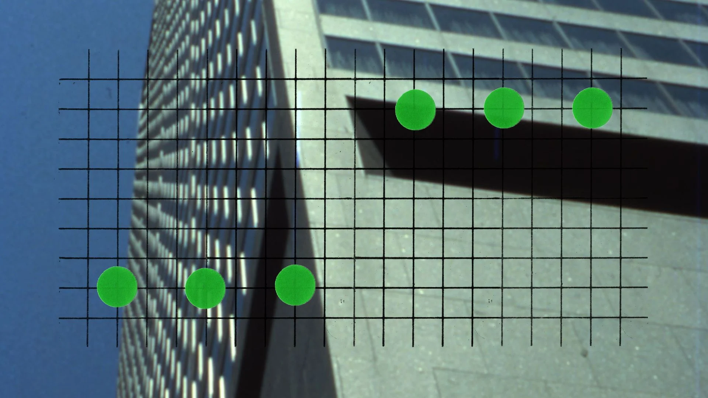
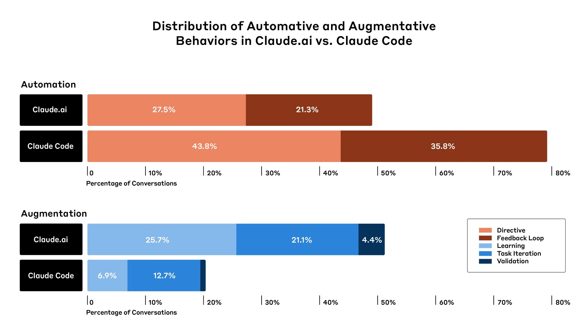
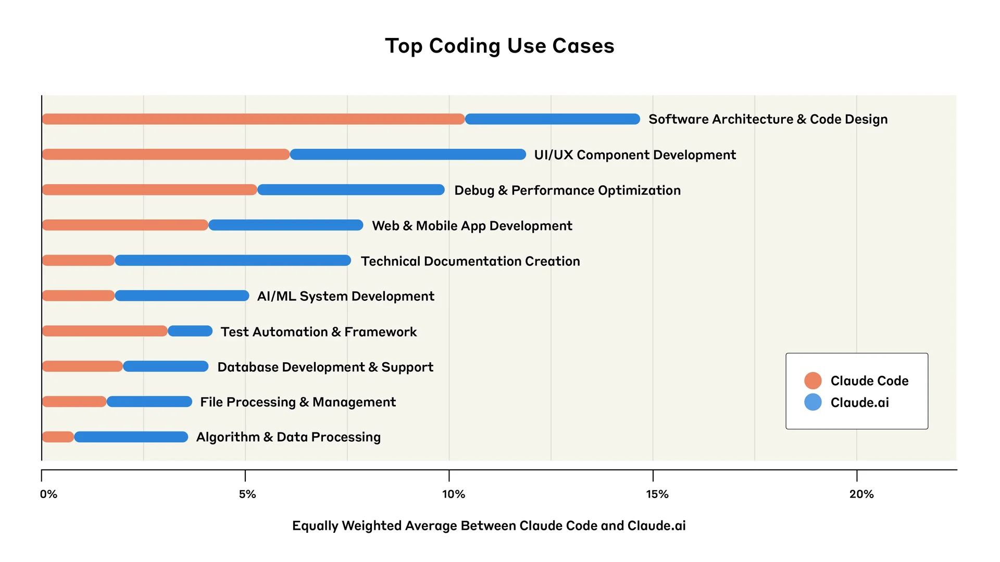
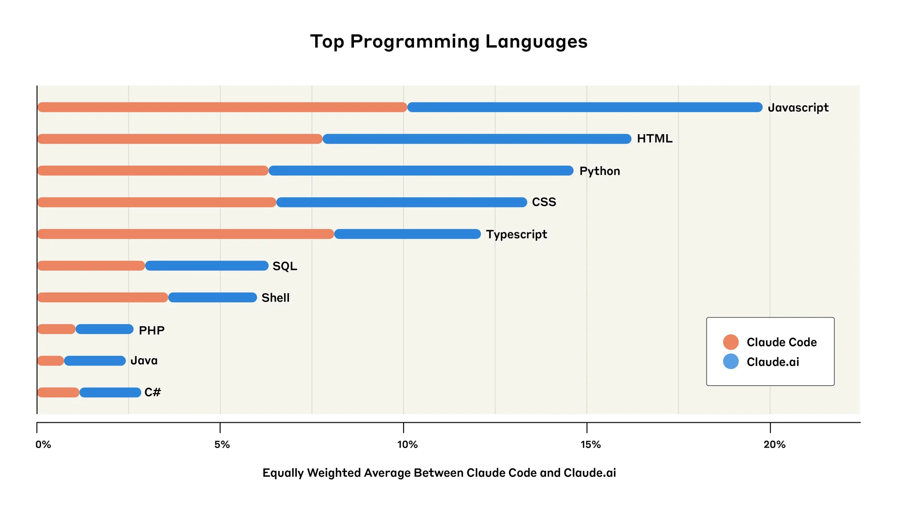
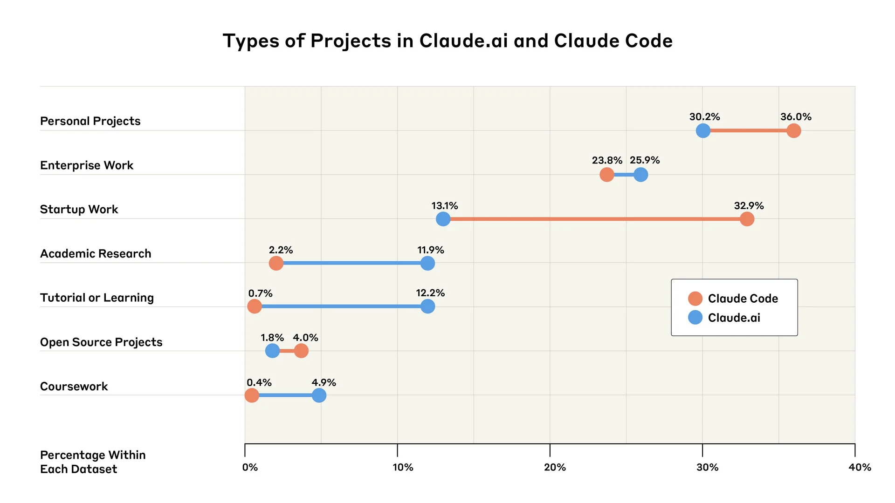
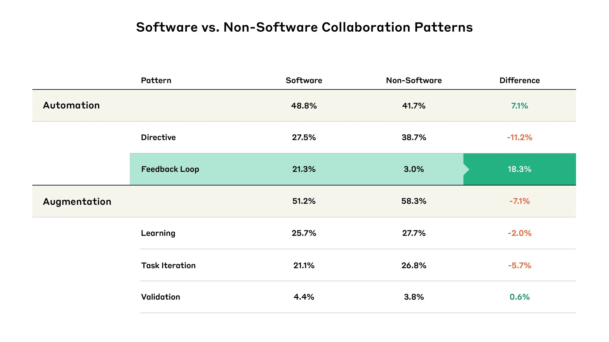

# Anthropic 经济指数：AI 对软件开发的影响

- 英文标题：Anthropic Economic Index: AI’s impact on software development
- 发布日期：2025-04-28
- 官网栏目：社会影响、经济学
- 原文：[Anthropic 页面](https://www.anthropic.com/research/impact-software-development)
- 官网署名：Anthropic

> 中文机器初译，未逐篇人工校对。引用研究结论时请核对英文原文。

涉及计算机编程的工作只是现代经济的一小部分，但却是一个有影响力的部分。在过去的几年里，随着人工智能系统的引入，它们发生了巨大的变化，这些系统可以协助并自动化大量的编码工作。

在我们的 [之前的经济指数研究](https://www.anthropic.com/news/the-anthropic-economic-index)，我们发现美国工人在计算机相关职业中对Claude的使用非常不成比例：也就是说，与Claude关于计算机相关任务的对话比根据从事相关工作的人数预测的要多得多。也是一样的 [教育背景](https://www.anthropic.com/news/anthropic-education-report-how-university-students-use-claude)：计算机科学学位（涉及大量编码）显示人工智能的使用极不成比例。

为了更详细地了解这些变化，我们对 500,000 个与编码相关的交互进行了分析 [Claude.ai](http://claude.ai) （大多数人与Claude互动的“默认”方式）和 [克劳德·科德](https://docs.anthropic.com/en/docs/agents-and-tools/claude-code/overview) （我们新的专家编码“代理”可以使用各种数字工具独立完成一系列复杂的任务）。

我们发现了三个关键模式：

1. **编码代理用于提高自动化程度。** Claude Code 上 79% 的对话被认为是“自动化”（人工智能直接执行任务），而不是“增强”（人工智能与人类协作并增强人类能力）（21%）。相比之下，只有 49% 的 Claude.ai 对话被归类为自动化。 *这可能意味着，随着AI 智能体变得更加普遍，并且随着更多代理人工智能产品的诞生，我们应该期待更多的任务自动化。*
2. **程序员通常使用人工智能来构建面向用户的应用程序。** JavaScript 和 HTML 等 Web 开发语言是我们数据集中最常用的编程语言，而用户界面和用户体验任务是最常用的编码用途。 *这表明，以制作简单应用程序和用户界面为中心的工作可能比那些纯粹专注于后端工作的工作更早面临人工智能系统的干扰*.
3. **初创公司是 Claude Code 的主要早期采用者，而企业则落后。** 在初步分析中，我们估计 Claude Code 上的对话有 33% 是与初创公司相关的工作，而只有 13% 的对话被确定为与企业相关的应用程序。 *采用率差距表明使用尖端人工智能工具的灵活组织与传统企业之间存在分歧。*

## 我们如何分析 Claude Code 和 Claude.ai 上的对话

我们分析了总共 500,000 次 Claude 交互（分为 Claude Code 和 Claude.ai[1](https://www.anthropic.com/research/impact-software-development#footnote-1)）使用我们的 [隐私保护分析工具](https://www.anthropic.com/research/clio)，它将用户对话提炼成更高级别的匿名见解。在这里，我们用它来识别对话的主题（例如“UI/UX 组件开发”），或者——正如我们将在下面解释的——将对话分类为关注“增强”与“自动化”。

## 开发者如何与 Claude 互动？

在我们之前的经济指数报告中，我们将“自动化”（人工智能直接执行任务）与“增强”（人工智能与用户协作执行任务）分开。在这里，我们发现 Claude Code 显示出显着更高的自动化率 — 79% 的对话涉及某种形式的自动化，而 Claude.ai 上的这一比例为 49%。

我们还将自动化和增强分为几个子类型（如我们的 [以前的工作](https://www.anthropic.com/news/the-anthropic-economic-index)）。“反馈循环”模式，即Claude在人工验证的帮助下自主完成任务（例如，用户将任何错误发送回Claude），在Claude代码（35.8％的交互）上的常见程度几乎是 Claude.ai（21.3％）的两倍。Claude 以最少的用户交互完成任务的“指令”对话在 Claude Code 上也更高（43.8%，而 Claude.ai 上为 27.5%）。所有增强模式（包括“学习”，即用户从 AI 模型中获取知识）在 Claude Code 上的表现均明显低于 Claude.ai。

子类型定义如下。指令：以最少的交互完成任务委派；反馈循环：以环境反馈引导任务完成；任务迭代：协同细化过程；学习：知识的获取和理解；验证：工作验证和改进。

这些结果说明了专业的、以编码为中心的代理（在本例中为 Claude Code）与用户与大型语言模型交互的更“标准”方式（即通过 Claude.ai 等聊天机器人界面）之间的差异。随着更多代理产品的发布，我们可能会看到人工智能融入人们工作的方式有所不同。至少在编码的情况下，这可能涉及更多的任务自动化。

这引发了人们的疑问：随着人工智能的使用变得更加普遍，开发人员仍会在多大程度上参与其中。重要的是，我们的结果确实表明，即使在自动化中，人类仍然经常参与：“反馈循环”交互仍然需要用户输入（即使该输入只是将错误消息粘贴回 Claude）。但并不能确定这种模式是否会持续到未来，因为功能更强大的代理系统可能需要逐渐减少的用户输入。

## 开发人员正在与 Claude 一起开发什么？

总的来说，我们发现开发人员通常使用 Claude 为网站和移动应用程序构建用户界面和交互元素。尽管没有单一语言占据主导地位，但主要以 Web 为中心的 JavaScript 和 TypeScript 开发语言合计占所有查询的 31%，而 HTML[2](https://www.anthropic.com/research/impact-software-development#footnote-2) 和 CSS（面向用户的代码的其他语言）合计又增加了 28%。

百分比代表两个平台上编码相关任务的总百分比。由于 Claude Code 和 Claude.ai 的权重相同，因此与每个平台对应的条形部分代表该平台使用量的一半。

后端开发语言（用于幕后逻辑、数据库和基础设施，以及 API 和 AI 开发）也有所体现：值得注意的是，Python 占查询的 14%。然而，Python 有双重用途——既用于后端开发，又用于数据分析。与 SQL（另一种以数据为中心的语言，占查询的 6%）相结合，这些语言可能包括传统后端开发之外的许多数据科学和分析应用程序。

编码语言的使用百分比代表两个平台上的总百分比。由于 Claude Code 和 Claude.ai 的权重相同，因此与每个平台对应的条形部分代表该平台使用量的一半。

这些模式进一步扩展到涉及 Claude 的常见编码任务类型。排名前五的任务中有两项专注于面向用户的应用程序开发：“UI/UX 组件开发”和“Web 和移动应用程序开发”分别占对话的 12% 和 8%。此类任务越来越容易出现一种被称为“氛围编码”的现象——不同经验水平的开发人员用自然语言描述他们期望的结果，并让人工智能掌控实施细节。

与更通用用途相关的对话，例如“软件架构和代码设计”以及“调试和性能优化”，在 Claude.ai 和 Claude Code 中也得到了高度体现。

据推测，这些发现表明，如果功能的增加导致“氛围编码”更多地转移到主流工作流程中，以制作简单应用程序和用户界面为中心的工作可能会更早地面临人工智能系统的干扰。随着人工智能越来越多地处理组件创建和样式任务，这些开发人员可能会转向更高级别的设计和用户体验工作。

## 谁在使用 Claude 进行编码？

我们还分析了哪些开发人员群体可能正在使用 Claude。我们使用我们的分析系统来识别最能描述用户与编码相关的交互的项目类型（例如个人项目与初创公司完成的项目）。因为我们不知道Claude的回答被使用的现实世界背景，所以这些分析依赖于不完整数据的不确定推论。因此，我们认为这些发现比上述发现更为初步。

点之间的距离表示 Claude.ai（蓝色）和 Claude Code（橙色）上每种类型项目的流行程度差距。

初创公司似乎是 Claude Code 的主要早期采用者，而企业采用则滞后。初创公司工作占 Claude Code 对话的 32.9%（比 Claude.ai 使用率高出近 20%），而企业工作仅占 Claude Code 对话的 23.8%（略低于 Claude.ai 上 25.9% 的份额）[3](https://www.anthropic.com/research/impact-software-development#footnote-3)).

此外，涉及学生、学者、个人项目构建者和教程/学习用户的使用总共占两个平台交互的一半。换句话说，个人（而不仅仅是企业）是编码辅助工具的重要采用者。

这些采用模式反映了过去的技术转变，初创公司使用新工具来获得竞争优势，而成熟的组织则更加谨慎，并且通常在全公司范围内采用新工具之前进行详细的安全检查。人工智能的通用性质可能会加速这种动态：如果AI 智能体能够显着提高生产力，那么早期采用者和后期采用者之间的差距可能会转化为巨大的竞争优势。

## 局限性

我们的分析基于现实世界的人工智能使用——开发人员如何在他们的工作流程中实际使用 Claude。尽管这种方法使我们的研究结果具有实际意义，但它也带来了固有的局限性。这些包括：

- 我们仅分析了 Claude.ai 和 Claude Code 的数据。我们排除了可能表现出不同模式的团队、企业和 API 使用情况，特别是在专业环境中；
- 使用 Claude Code 等代理工具，自动化和增强之间的界限变得越来越模糊。例如，“反馈循环”模式与传统自动化有本质上的不同，因为它仍然需要用户监督和输入。我们可能需要扩展自动化/增强框架以适应新的代理功能；
- 我们对谁使用 Claude 进行编码的分类依赖于有限上下文的推断。当将对话分类为“初创公司”与“企业”工作，或“个人”与“学术”项目时，我们的分析工具根据不完整的信息做出了有根据的猜测。因此，某些分类可能不正确。此外，我们还提供了“无法分类”选项，Claude 在 5% 的 Claude.ai 对话和 2% 的 Claude Code 对话中选择了该选项。我们从分析中排除了这一类别并对结果进行了重新标准化；
- 我们的数据集可能吸引了早期采用者。这些用户可能并不代表更广泛的开发人员群体，这种自我选择可能会使使用模式偏向更有经验或技术上更具冒险精神的用户；
- 出于隐私考虑，我们仅分析特定保留窗口内的数据，可能会遗漏软件开发中的周期性模式（例如冲刺周期或发布时间表）；
- 相对于整体人工智能编码辅助采用率，Claude使用的代表性尚不清楚。许多开发人员使用 Claude 之外的多种 AI 工具，这意味着我们仅提供他们的 AI 参与模式的部分视图；
- 我们只研究了开发人员委托给人工智能的内容，而不是他们最终如何在代码库中使用人工智能输出、生成的代码的质量，或者这些交互是否有效地提高了生产力或代码质量。

## 展望未来

人工智能正在从根本上改变开发人员的工作方式。我们的分析表明，在使用像 Claude Code 这样的专业代理系统的情况下尤其如此，对于面向用户的应用程序开发工作特别强大，并且可能为初创企业（而不是更成熟的商业企业）带来特殊的优势。

我们的研究结果提出了许多问题。随着人工智能能力的进步，人类仍然参与这一过程的“反馈循环”的盛行是否会持续下去，还是我们会看到向更全面的自动化的转变？随着人工智能系统能够构建更大规模的软件，开发人员是否会转向主要管理和指导这些系统，而不是自己编写代码？哪些软件开发角色变化最大，哪些可能完全消失？

人工智能编码技能的提高也可能对人工智能开发本身产生特别重要的影响。由于人工智能研究和开发很大程度上依赖于软件，因此人工智能辅助编码的进步可能有助于加速突破，创造一个积极强化的循环，进一步加速人工智能的进步。

从宏观角度来看，人工智能系统是极其新颖的。但相对而言，编码是人工智能在经济中最发达的用途之一。这使得它值得一看。尽管我们不能假设我们从软件开发中汲取的经验教训会直接延续到其他类型的职业中，但软件开发可能是一个领先指标，它为我们提供了有用的信息，让我们了解随着未来功能日益强大的人工智能模型的推出，其他职业可能会如何变化。

### 与我们合作

如果您有兴趣在 Anthropic 工作以研究人工智能对劳动力市场的影响，我们鼓励您申请我们的 [经济学家](https://job-boards.greenhouse.io/anthropic/jobs/4555010008) 和 [数据科学家（政策）](https://job-boards.greenhouse.io/anthropic/jobs/4502440008) 角色。

## 附录

作为补充分析，我们还将与软件相关的自动化和增强模式的结果与不涉及软件的交互模式进行了比较。我们专门在 Claude.ai 上进行了这项分析，因为 Claude Code 专门研究软件应用程序。

Claude.ai 中软件与非软件用例的自动化和增强细分。有关每个模式的描述，请参阅上面第一张图的标题。

与不涉及软件的用例相比，软件开发更加自动化。反馈循环的显着增加 (+18.3%) 推动了这一点，值得注意的是，抵消了明显的 *减少* 指令行为（-11.2%）。换句话说，相对于非编码任务，人工智能辅助编码目前需要大量的人工审查和迭代，即使 Claude 承担了大部分工作。

## 脚注

01Claude.ai 的对话专门来自 Claude.ai 免费版和专业版。此示例仅包含由第一方 API 提供支持的 Claude Code 会话（Claude Code 可以由 Anthropic 第一方 API 或第三方云提供商 API 提供支持）。我们分析 Claude.ai 和 Claude Code 时使用的所有对话均来自 2025 年 4 月 6 日至 13 日。初始样本在 Claude.ai 和 Claude Code 之间均匀分配，对于 Claude.ai，我们应用基于 Claude 的过滤器来选择与编码相关的对话。为了考虑过滤器，我们重新规范化了分析，以同等权重 Claude Code 和 Claude.ai 交互（如果适用）。

02Claude.ai 的 HTML 数字可能略有夸大，因为 [文物](https://support.anthropic.com/en/articles/9487310-what-are-artifacts-and-how-do-i-use-them) 利用 HTML。虽然我们过滤掉与编码无关的工件，但我们不会从分析中显式过滤掉包含编码相关内容的工件，因为大量的编码使用发生在工件内。

03Claude.ai 的使用量不包括 Claude For Work（团队和企业计划）的使用量，这意味着 Claude.ai 的企业数量可能被低估，因为 Claude.ai 上的大量企业使用量发生在 Claude For Work 产品中。
