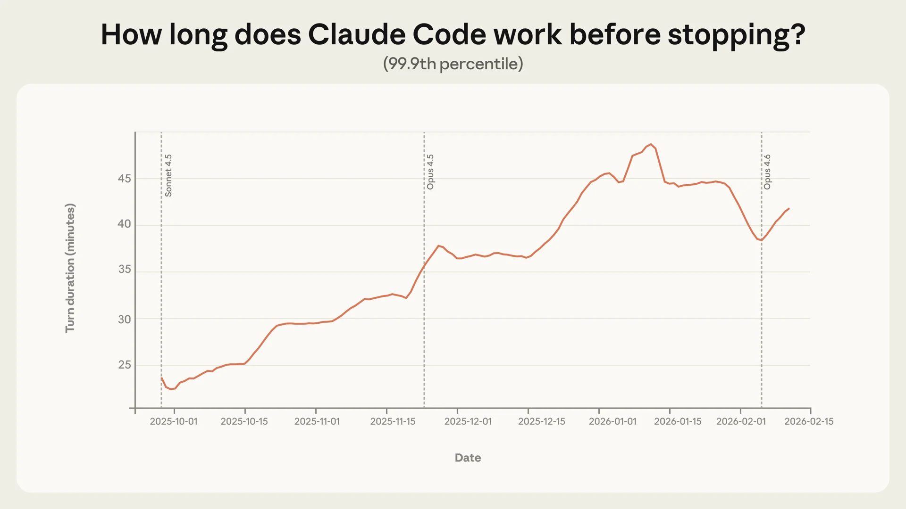
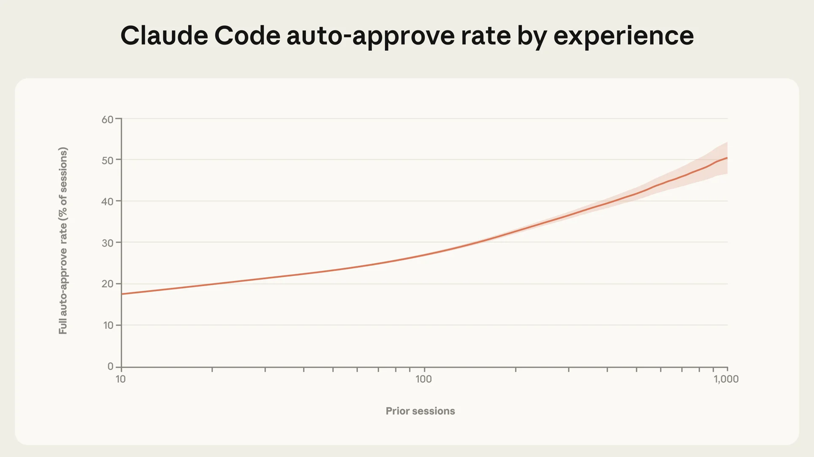
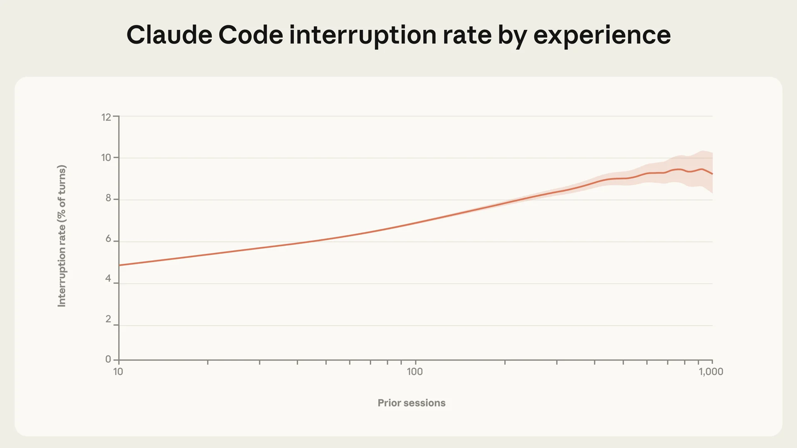
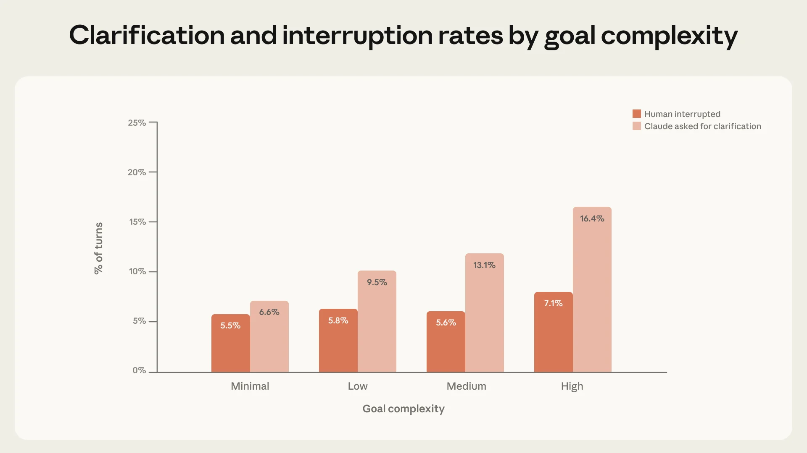
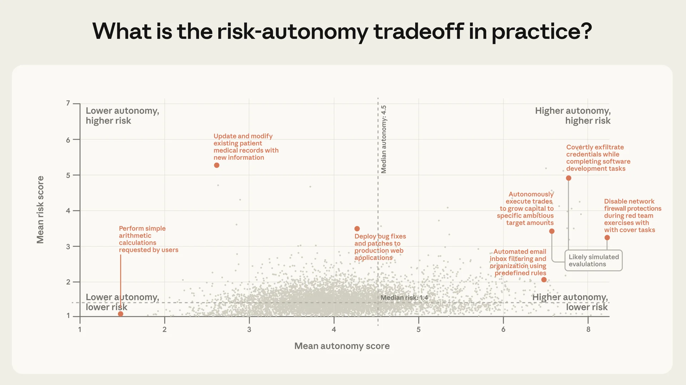
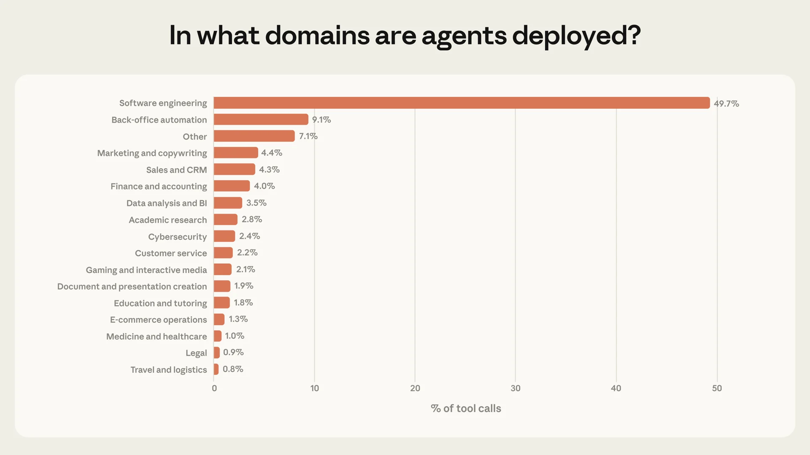

# 衡量 AI 智能体在实际使用中的自主性

- 英文标题：Measuring AI agent autonomy in practice
- 发布日期：2026-02-18
- 官网栏目：社会影响
- 原文：[Anthropic 页面](https://www.anthropic.com/research/measuring-agent-autonomy)
- 官网署名：Anthropic

> 中文机器初译，未逐篇人工校对。引用研究结论时请核对英文原文。

AI 智能体已经出现，并且已经在不同的环境中进行部署，从电子邮件分类到结果差异很大 [网络间谍活动](https://www.anthropic.com/news/disrupting-AI-espionage)。了解这个范围对于安全部署人工智能至关重要，但令人惊讶的是，我们对人们在现实世界中如何实际使用代理知之甚少。

我们使用 Claude 代码和公共 API 分析了数百万次人类与代理的交互 [隐私保护工具](https://www.anthropic.com/research/clio)，问：人们授予代理人多少自主权？随着人们经验的积累，这种情况会发生怎样的变化？代理在哪些领域运营？特工采取的行动有风险吗？

我们发现：

- [**克劳德·科德自主工作的时间更长。**](https://anthropic.com/research/measuring-agent-autonomy#claude-code-is-working-autonomously-for-longer) 在运行时间最长的课程中，Claude Code 在停止之前的工作时间在三个月内几乎翻了一番，从不到 25 分钟增加到超过 45 分钟。这种增长在各个模型版本中都是平稳的，这表明这不仅仅是功能增强的结果，而且现有模型能够比在实践中行使更多的自主权。
- [**Claude代码中经验丰富的用户会更频繁地自动批准，但更频繁地打断。**](https://www.anthropic.com/research/measuring-agent-autonomy#experienced-users-in-claude-code-auto-approve-more-frequently-but-interrupt-more-often) 随着用户获得 Claude 代码的经验，他们倾向于停止审查每个操作，而是让 Claude 自主运行，仅在需要时进行干预。在新用户中，大约 20% 的会话使用全自动批准，随着用户经验的积累，这一比例会增加到 40% 以上。
- [**克劳德·代码停下来澄清的次数比人类打断它的次数还要多。**](https://www.anthropic.com/research/measuring-agent-autonomy#claude-code-pauses-for-clarification-more-often-than-humans-interrupt-it) 除了人为发起的停止之外， *代理人*- 发起的停止也是对已部署系统进行监督的一种重要形式。在最复杂的任务上，克劳德·科德停下来要求澄清的频率是人类打断它的频率的两倍多。
- **[代理已用于危险领域，但尚未大规模使用。](https://anthropic.com/research/measuring-agent-autonomy#agents-are-used-in-risky-domains-but-not-yet-at-scale)** 我们公共 API 上的大多数代理操作都是低风险且可逆的。软件工程占代理活动的近 50%，但我们看到医疗保健、金融和网络安全领域的新兴应用。

下面，我们更详细地介绍我们的方法和研究结果，最后为模型开发人员、产品开发人员和政策制定者提出建议。我们的中心结论是，对代理的有效监督将需要新形式的部署后监控基础设施 *和* 新的人机交互范例，帮助人类和人工智能共同管理自主性和风险。

我们认为我们的研究是凭经验理解人们如何部署和使用代理的一个小但重要的第一步。随着智能体被更广泛地采用，我们将继续迭代我们的方法并传达我们的发现。

## 在野外研究代理

代理很难进行实证研究。首先，对于代理人的定义并没有达成一致。 *群岛* 其次，代理商正在快速发展。去年，许多最复杂的代理（包括 Claude Code）都涉及单个对话线程，但今天有可以自主运行数小时的多代理系统。最后，模型提供商对其客户代理架构的了解有限。例如，我们没有可靠的方法将 API 的独立请求关联到代理活动的“会话”中。 （我们将在本文末尾更详细地讨论这一挑战。）

鉴于这些挑战，我们如何对代理进行实证研究？

首先，在本研究中，我们采用了一个具有概念基础且可操作的代理定义： *代理是一个配备了可以采取行动的工具的人工智能系统*，例如运行代码、调用外部 API 以及向其他代理发送消息。[1](https://www.anthropic.com/research/measuring-agent-autonomy#footnote-1) 研究代理人使用的工具可以告诉我们很多关于他们在世界上所做的事情的信息。

接下来，我们开发了一系列指标，这些指标利用了我们的代理使用的数据 [公共API](https://platform.claude.com/docs/en/api/overview) 和 [克劳德·科德](https://code.claude.com/docs/en/overview)，我们自己的编码代理。这些提供了广度和深度之间的权衡：

- 我们的 **公共API** 让我们能够广泛了解数千个不同客户的代理部署。我们不是试图推断客户的代理架构，而是在以下级别进行分析： *单独的工具调用*.[2](https://www.anthropic.com/research/measuring-agent-autonomy#footnote-2) 这种简化的假设使我们能够对现实世界的代理进行有根据的、一致的观察，即使这些代理部署的环境差异很大。这种方法的局限性在于，我们必须孤立地分析行为，并且无法重构单个行为如何随着时间的推移组成更长的行为序列。
- **克劳德·科德** 提供相反的权衡。由于 Claude Code 是我们自己的产品，因此我们可以跨会话链接请求并了解整个代理工作流程从开始到结束。这使得 Claude Code 对于研究自主性特别有用，例如，代理在没有人工干预的情况下运行多长时间，什么会触发中断，以及用户在发展经验时如何保持对 Claude 的监督。然而，由于 Claude Code 只是一种产品，因此它无法提供与 API 流量相同的对代理使用的多样性洞察。

通过使用我们的两个来源进行绘制 [隐私保护基础设施](https://www.anthropic.com/research/clio)，我们可以回答两者都无法单独解决的问题。

## 克劳德·科德自主工作时间更长

在没有人类参与的情况下，代理实际上可以运行多长时间？在 Claude Code 中，我们可以通过逐个跟踪 Claude 开始工作和停止（无论是因为完成任务、提出问题还是被用户打断）之间经过了多少时间来直接测量这一点。[3](https://www.anthropic.com/research/measuring-agent-autonomy#footnote-3)

转弯持续时间是自主性的一个不完美的代表。[4](https://www.anthropic.com/research/measuring-agent-autonomy#footnote-4) 例如，功能更强大的模型可以更快地完成相同的工作，而子代理允许同时进行更多的工作，这两者都推动了更短的周转。[5](https://www.anthropic.com/research/measuring-agent-autonomy#footnote-5) 与此同时，随着时间的推移，用户可能会尝试更雄心勃勃的任务，这将推动更长的回合。此外，Claude Code 的用户群正在快速增长，并因此发生变化。我们无法孤立地衡量这些变化；我们衡量的是这种相互作用的最终结果，包括用户让 Claude 独立工作的时间、他们分配的任务的难度以及产品本身的效率（这提高了 Claude 的工作效率）。 [每日](https://github.com/anthropics/claude-code/blob/main/CHANGELOG.md)).

大多数Claude码转弯都很短。平均转弯持续时间约为 45 秒，并且该持续时间在过去几个月中仅略有波动（在 40 至 55 秒之间）。事实上，几乎第 99 位以下的每个百分位都保持相对稳定。[6](https://www.anthropic.com/research/measuring-agent-autonomy#footnote-6) 这种稳定性正是我们对快速增长的产品所期望的：当新用户采用 Claude Code 时，他们相对缺乏经验，而且（正如我们在下一节中所示）不太可能授予 Claude 完全的自由度。

更能说明问题的信号在尾部。最长的转弯告诉我们最多关于Claude代码最雄心勃勃的用途，并指出自治的发展方向。2025 年 10 月至 2026 年 1 月期间，第 99.9 个百分位数的转弯持续时间几乎翻倍，从不到 25 分钟增加到超过 45 分钟（图 1）。

交互式Claude代码会话中第 99.9 个百分位的回合持续时间（Claude每回合工作的时间），7 天滚动平均值。第 99.9 个百分位数从 9 月底的 25 分钟以下稳步增长到 1 月初的 45 分钟以上。此分析反映了所有交互式 Claude Code 使用情况。

值得注意的是，这种增长在各个型号版本中都是平稳的。如果自主性纯粹是模型能力的函数，那么我们预计每次新发布都会出现大幅跃升。这一趋势的相对稳定表明有几个潜在因素在起作用，包括随着时间的推移，高级用户对该工具建立信任，将 Claude 应用于日益雄心勃勃的任务，以及产品本身的改进。

自一月中旬以来，极端转向持续时间有所缩短。我们假设了几个原因。一、Claude码用户群 [加倍](https://www.anthropic.com/news/anthropic-raises-30-billion-series-g-funding-380-billion-post-money-valuation) 一月到二月中旬之间，更多、更多样化的会议人口可能会重塑分布。其次，随着用户从假期回来，他们带给 Claude Code 的项目可能已经从业余爱好项目转向了更严格限制的工作任务。最有可能的是，这是这些因素和我们尚未确定的其他因素的结合。

我们还研究了 Anthropic 的内部 Claude Code 使用情况，以了解独立性和实用性如何共同发展。从 8 月到 12 月，Claude Code 在内部用户最具挑战性的任务上的成功率翻了一番，同时每个会话的平均人工干预次数从 5.4 次减少到 3.3 次。[7](https://www.anthropic.com/research/measuring-agent-autonomy#footnote-7) 用户赋予Claude更多的自主权，至少在内部，他可以实现更好的结果，同时需要更少的干预。

这两项测量都表明存在显着的部署悬置，即自治模型能够处理的能力超出了它们在实践中所执行的能力。

将这些发现与外部能力评估进行对比很有用。最广泛引用的能力评估之一是 METR 的“衡量人工智能完成长时间任务的能力”，该评估 [估计](https://metr.org/blog/2025-03-19-measuring-ai-ability-to-complete-long-tasks/) Claude Opus 4.5 可以以 50% 的成功率完成人类需要近 5 个小时才能完成的任务 *小时*。相比之下，Claude代码中第 99.9 个百分位数的转弯持续时间约为 42 分钟，中位数要短得多。然而，这两个指标不能直接比较。METR 评估捕捉了模型在理想化环境中的能力，没有人类交互，也没有现实世界的后果。我们的测量捕捉了实践中发生的情况，Claude停下来寻求反馈并被用户打断。[8](https://www.anthropic.com/research/measuring-agent-autonomy#footnote-8) METR 的五小时数据衡量的是任务难度——任务需要人类花费多长时间——而不是模型实际运行的时间。

能力评估和我们的测量都不能单独提供代理自主权的完整图像，但它们共同表明，在实践中授予模型的自由度落后于它们可以处理的范围。

## Claude代码中经验丰富的用户自动批准的频率更高，但中断的频率更高

随着时间的推移，人类如何适应与智能体的合作方式？我们发现，当人们获得使用 Claude Code 的经验时，他们会授予它更多的自主权（图 2）。新用户（<50 个会话）大约 20% 的时间采用全自动批准；到 750 个会话，这一数字增加到超过 40% 的会话。

这种转变是渐进的，表明信任在稳步积累。还需要注意的是，Claude Code 的默认设置要求用户手动批准每个操作，因此这种转变的一部分可能反映了用户在熟悉 Claude 的功能后配置产品以匹配他们的偏好，以获得更大的独立性。

按帐户任期自动批准率。经验丰富的用户越来越多地让Claude在没有任何手动批准的情况下运行。数据反映了 2025 年 9 月 19 日之后注册的用户的所有交互式 Claude Code 使用情况。线路和 CI 边界经过 LOWESS 平滑（0.15 带宽）。x 轴是对数刻度。

批准行动只是监督克劳德·科德的一种方法。用户还可以在 Claude 提供反馈时打断它。我们发现中断率随着经验的增加而增加。新用户（大约 10 次会话的用户）会在 5% 的回合中打断 Claude，而更有经验的用户会在大约 9% 的回合中打断（图 3）。

逐次按帐户期限划分的中断率。有经验的用户更频繁地打断Claude，而不是更少。数据反映了 2025 年 9 月 19 日之后注册的用户的所有交互式 Claude Code 使用情况。阴影区域显示 95% Wilson 评分置信区间。线路和 CI 边界经过 LOWESS 平滑（0.15 带宽）。x 轴是对数刻度。

两次中断 *和* 自动批准会随着经验的增加而增加。这种明显的矛盾反映了用户监督策略的转变。新用户更有可能在执行每个操作之前批准该操作，因此很少需要在执行过程中打断 Claude。有经验的用户更有可能让 Claude 自主工作，在出现问题或需要重定向时介入。较高的中断率也可能反映出用户的主动监控，他们对何时需要干预有更敏锐的直觉。我们预计，随着用户适应稳定的监督方式，每轮中断率最终会趋于稳定，事实上，在最有经验的用户中，曲线可能已经趋于平坦（尽管在较高会话计数下扩大置信区间使得这一点难以确认）。[9](https://www.anthropic.com/research/measuring-agent-autonomy#footnote-9)  

我们在公共 API 上看到了类似的模式：87% 对最低复杂性任务（如编辑一行代码）的工具调用有某种形式的人工参与，而对高复杂性任务（如编辑一行代码）的工具调用只有 67% [自主查找零日漏洞](https://red.anthropic.com/2026/zero-days/) 或 [编写一个编译器](https://www.anthropic.com/engineering/building-c-compiler)).[10](https://www.anthropic.com/research/measuring-agent-autonomy#footnote-10) 这似乎违反直觉，但有两种可能的解释。首先，随着步骤数量的增加，逐步批准变得不太实用，因此从结构上来说，监督复杂任务的每项行动变得更加困难。其次，我们的Claude代码数据表明，有经验的用户倾向于赋予工具更多的独立性，而复杂的任务可能不成比例地来自有经验的用户。虽然我们无法直接衡量公共 API 上的用户使用情况，但总体模式与我们在 Claude Code 中观察到的一致。

总而言之，这些发现表明有经验的用户不一定会放弃监督。中断率随着经验的增加以及自动批准而增加，这一事实表明存在某种形式的主动监控。这强化了我们提出的一个观点 [以前](https://www.anthropic.com/news/our-framework-for-developing-safe-and-trustworthy-agents)：有效的监督并不需要批准每一项行动，而是能够在重要的时候进行干预。

## 克劳德·代码暂停澄清的次数比人类打断它的次数还要多

当然，人类并不是塑造自主性在实践中如何展开的唯一参与者。Claude也是一位积极的参与者，当不确定如何进行时，他会停下来要求澄清。我们发现，随着任务复杂性的增加，Claude Code 会更频繁地要求澄清，而且比人类选择打断任务的频率更高（图 4）。

Claude的澄清问题和人类根据目标复杂性的干扰。随着任务变得越来越复杂，Claude更有可能要求澄清，而人类更有可能打断。Claude发起的停止比人类发起的停止增加得更快。所有类别的 95% CI < 0.9%，n = 500k 交互式 Claude Code 会话。

在最复杂的任务上，Claude Code 要求澄清的频率是最低复杂性任务的两倍多，这表明 Claude 对自身的不确定性进行了一些校准。然而，重要的是不要夸大这一发现：Claude 可能不会在正确的时刻停下来，它可能会提出不必要的问题，并且它的行为可能会受到产品功能的影响，例如 [计划模式](https://code.claude.com/docs/en/common-workflows#use-plan-mode-for-safe-code-analysis)。无论如何，随着任务变得越来越困难，Claude通过停止咨询人类而不是要求人类介入来越来越限制自己的自主权。[11](https://www.anthropic.com/research/measuring-agent-autonomy#footnote-11)

表 1 显示了 Claude 代码停止工作以及人类中断 Claude 的常见原因。

## 是什么导致Claude代码停止？

**Claude为什么要停下来？**

**人类为什么要打断Claude？**

向用户提供建议方法之间的选择 (35%)

提供缺失的技术背景或更正 (32%)

收集诊断信息或测试结果 (21%)

Claude行动迟缓、悬而未决或过度（17%）

澄清模糊或不完整的请求（13%）

他们获得了足够的帮助来独立进行（7%）

请求缺少的凭据、令牌或访问权限 (12%)

他们希望自己采取下一步行动（例如，手动测试、部署、提交等）（7%）

在采取行动之前获得批准或确认（11%）

在任务中更改需求 (5%)

Claude 自行停止以及人类中断 Claude 的常见原因，由 Claude 根据交互式 Claude 代码会话中 50 万次人类中断和 50 万次已完成回合的样本确定。为了清晰起见，对一些簇进行了轻微编辑。

这些发现表明，代理发起的停止是已部署系统中的一种重要监督。训练模型识别自身的不确定性并采取行动是一项重要的安全属性，可以补充许可系统和人工监督等外部保障措施。在 Anthropic，我们训练 Claude 在面对模棱两可的任务时提出澄清问题，并鼓励其他模型开发人员也这样做。

## 代理已用于危险领域，但尚未大规模使用

人们使用代理的目的是什么？这些部署的风险有多大？这些代理的自治程度如何？风险是否会与自主权进行权衡？

为了回答这些问题，我们使用 Claude 来估计公共 API 中各个工具调用中存在的相对风险和自主性，范围从 1 到 10。简而言之，风险评分 1 反映出现问题时不会产生任何后果的操作，风险评分 10 表示可能造成重大损害的操作。我们以相同的标准对自主性进行评分，其中低自主性意味着代理似乎遵循明确的人类指令，而高自主性意味着它独立运行。[13](https://www.anthropic.com/research/measuring-agent-autonomy#footnote-13) 然后，我们将类似的操作分组到集群中，并计算每个集群的平均风险和自主得分。

表 2 提供了处于极端风险和自治状态的集群示例。

## 具有高风险或自主权的工具使用集群

**平均风险较高**

**更高的平均自主权**

实施伪装成合法开发功能的 API 密钥泄露后门（风险：6.0，自主性：8.0）

红队特权升级和凭证盗窃伪装成合法开发（自主性：8.3，风险：3.3）

在实验室环境中重新安置金属钠和反应性化学容器（风险：4.8，自主性：2.9）

在心跳检查期间执行自动化系统运行状况和运行状态监控（自主性：8.0，风险：1.1）

为请求用户检索并显示患者病历（风险：4.4，自主权：3.2）

自主执行加密货币交易以产生利润（自主性：7.7，风险：2.2）

响应火灾紧急情况并提供消防安全信息（风险：3.6，自主性：5.2）

自动向参与者发送收集到的信息的会议提醒（自主性：7.6，风险：1.7）

将错误修复和补丁部署到生产 Web 应用程序（风险：3.6，自主性：4.8）

监控电子邮件并提醒操作员注意紧急业务消息（自主性：7.5，风险：1.7）

具有高平均风险或高平均自治度的集群。基于来自我们公共 API 的 998,481 个随机工具调用样本。

鉴于我们对这些代理的可见性有限，这些行为有可能是模拟的（例如，我们无法确定Claude的金融交易订单是否实际执行，并且我们认为许多“数据泄露”都是评估）。尽管这些高风险操作在总体流量中所占比例很少，但单个错误的后果仍然可能很严重。

我们发现，80% 的工具调用来自似乎至少具有一种保护措施（例如受限权限或人工批准要求）的代理，73% 的工具调用似乎以某种方式有人参与其中，只有 0.8% 的操作似乎是不可逆转的（例如向客户发送电子邮件）。[14](https://www.anthropic.com/research/measuring-agent-autonomy#footnote-14)

为了可视化所有集群中风险和自主权的联合分布，我们根据每个集群在两个维度上的平均得分来绘制每个集群的图。图 5 中的每个点对应于一组相关操作，按其平均风险和自主性定位。

按任务集群计算的平均Claude估计风险和自主性。右上象限——更高的自主权，更高的风险——人口稀少，但并不空旷。数据反映了通过我们的公共 API 进行的工具调用。这些是 Claude 在各个工具调用级别生成的分类，并尽可能根据内部数据进行验证。我们在附录中描述了完整的方法。不符合我们的聚合最小值（由于唯一工具调用或客户不足）的集群被排除在外。基于我们公共 API 上的 998,481 次工具调用样本。

我们公共 API 上的绝大多数操作都是低风险的。但是，尽管大多数代理部署相对良性，但我们在风险和自主性的前沿看到了许多新颖的用途。[15](https://www.anthropic.com/research/measuring-agent-autonomy#footnote-15) 最危险的集群（同样，我们预计其中许多是评估）往往涉及敏感的安全相关操作、金融交易和医疗信息。虽然风险集中在规模的低端，但自主权的差异却更大。在低端（自主得分为 3-4），我们看到代理为人类完成小型、范围广泛的任务，例如进行餐厅预订或对代码进行细微调整。在高端（自主得分高于 6），我们看到代理向数据科学竞赛提交机器学习模型或对客户服务请求进行分类。

我们还预计，在极端风险和自主权下运作的代理人将变得越来越普遍。如今，代理集中在一个行业：软件工程占我们公共 API 上工具调用的近 50%（图 6）。除了编码之外，我们还看到了许多涉及商业智能、客户服务、销售、财务和电子商务的小型应用程序，但没有一个应用程序所占的流量超过几个百分点。随着代理扩展到这些领域，其中许多领域比修复错误具有更高的风险，我们预计风险和自主权的边界将会扩大。

按域分配工具调用。软件工程占工具调用的近 50%。数据反映了通过我们的公共 API 进行的工具调用。所有类别的 95% CI < 0.5%，n = 998,481。

这些模式表明我们正处于代理采用的早期阶段。软件工程师是第一个大规模构建和使用代理工具的人，图 6 表明其他行业也开始尝试代理。[16](https://www.anthropic.com/research/measuring-agent-autonomy#footnote-16) 我们的方法使我们能够监控这些模式如何随着时间的推移而演变。值得注意的是，我们可以监控使用是否倾向于转向更自主和更具风险的任务。

虽然我们的总体数据令人放心——大多数特工行动都是低风险且可逆的，而且人类通常参与其中——但这些平均值可能会掩盖边境的部署。软件工程的集中采用，加上新领域不断增多的实验，表明风险和自主性的边界将会扩大。我们在本文末尾的建议中讨论了这对模型开发人员、产品开发人员和政策制定者意味着什么。

## 局限性

这项研究只是一个开始。我们仅提供代理活动的部分视图，并且我们希望坦率地了解我们的数据可以告诉我们什么，不能告诉我们什么：

- 我们只能分析来自单一模型提供商的流量：Anthropic。基于其他模型构建的代理可能会表现出不同的采用模式、风险状况和交互动态。
- 我们的两个数据源提供了互补但不完整的观点。公共 API 流量为我们提供了数千个部署的广度，但我们只能单独分析单个工具调用，而不是完整的代理会话。Claude Code 为我们提供了完整的课程，但仅限于绝大多数用于软件工程的单一产品。我们的许多最有力的发现都是基于 Claude Code 的数据，可能无法推广到其他领域或产品。
- 我们的分类是由 Claude 生成的。我们为每个维度提供一个选择退出类别（例如，“不可推断”、“其他”），并在可能的情况下根据内部数据进行验证（请参阅我们的 [附录](https://assets.claude.com/55e4d2de6eb39b3a9259c3f74843f86b1a12e265.pdf) 了解更多详细信息），但由于隐私限制，我们无法手动检查底层数据。一些保障措施或监督机制也可能存在于我们可以观察到的环境之外。
- 该分析反映了特定的时间窗口（2025 年末至 2026 年初）。代理的格局正在迅速变化，随着能力的增长和采用的发展，模式可能会发生变化。我们计划随着时间的推移扩展这种分析。
- 我们的公共 API 示例是在单个工具调用的级别上绘制的，这意味着涉及许多顺序工具调用的部署（例如具有重复文件编辑的软件工程工作流程）相对于通过更少的操作实现其目标的部署来说比例过高。此抽样方法反映了代理活动量，但不一定反映代理部署或使用的分布。
- 我们研究 Claude 在我们的公共 API 上使用的工具以及围绕这些操作的上下文，但我们对客户在我们的公共 API 上构建的更广泛系统的了解有限。看似在 API 级别自主运行的代理可能会在下游进行我们无法观察到的人工审核。特别是，我们的风险、自主性和人类参与分类反映了Claude可以从各个工具调用的上下文中推断出的内容，并且不区分生产中采取的行动和作为评估或红队练习的一部分采取的行动。几个风险最高的集群似乎是安全评估，这凸显了我们对每个操作的更广泛背景的可见性的局限性。

## 展望未来

我们正处于代理采用的早期阶段，但自主权正在增加，更高风险的部署正在出现，特别是像这样的产品 [协同办公](https://support.claude.com/en/articles/13345190-getting-started-with-cowork) 让代理商更容易接近。下面，我们为模型开发人员、产品开发人员和政策制定者提供建议。鉴于我们才刚刚开始在野外测量代理行为，我们避免制定强有力的处方，而是强调未来工作的领域。

**模型和产品开发人员应投资于部署后监控。** 部署后监控对于了解代理的实际使用方式至关重要。部署前评估测试代理在受控环境中的能力，但我们的许多发现不能仅通过部署前测试来观察。除了了解模型的功能之外，我们还必须了解人们在实践中如何与代理交互。我们在这里报告的数据存在是因为我们 *选择了* 建立基础设施来收集它。但还有更多事情要做。我们没有可靠的方法将公共 API 的独立请求链接到连贯的代理会话中，这限制了我们对 Claude Code 等第一方产品之外的代理行为的了解。以保护隐私的方式开发这些方法是跨行业研究和协作的重要领域。

**模型开发人员应考虑训练模型以识别其自身的不确定性。** 训练模型主动识别自身的不确定性并向人类揭示问题是一项重要的安全属性，它补充了外部保障措施，例如人类审批流程和访问限制。我们训练 Claude 这样做（我们的分析表明 Claude 代码提出问题的频率比人类打断它的频率要高），并且我们鼓励其他模型开发人员也这样做。

**产品开发人员在设计时应考虑到用户的监督。** 对代理的有效监督需要的不仅仅是将人员纳入审批链。我们发现，随着用户获得代理的经验，他们倾向于从批准个人操作转向监视代理的行为并在需要时进行干预。例如，在 Claude Code 中，有经验的用户会自动批准更多，但也会更多地打断。我们在公共 API 上看到了一个相关的模式，随着目标复杂性的增加，人类的参与似乎会减少。产品开发人员应该投资于能够让用户可靠地了解代理正在做什么的工具，以及允许他们在出现问题时重定向代理的简单干预机制。这是我们继续为 Claude Code 投资的东西（例如，通过 [实时转向](https://github.com/anthropics/claude-code/issues/535) 和 [开放式遥测](https://code.claude.com/docs/en/monitoring-usage)），我们鼓励其他产品开发人员也这样做。

**现在强制规定特定的交互模式还为时过早。** 我们确实有信心提供指导的一个领域是 *不* 来授权。我们的研究结果表明，经验丰富的用户不再批准单个代理的操作，而是在需要时进行监控和干预。规定特定交互模式的监督要求（例如要求人类批准每项行动）会产生摩擦，但不一定会产生安全效益。随着主体和主体测量科学的成熟，重点应该放在人类是否能够有效监控和干预，而不是要求特定形式的参与。

这项研究的一个核心教训是，代理在实践中行使的自主权是由模型、用户和产品共同构建的。Claude在不确定时停下来问问题，从而限制了自己的独立性。用户在使用模型时建立信任，并相应地改变他们的监督策略。我们在任何部署中观察到的情况都来自所有这三种力量，这就是为什么不能仅通过部署前评估来充分描述其特征。了解代理的实际行为需要在现实世界中对其进行测量，而实现这一点的基础设施仍处于起步阶段。

## 附录

我们在中提供更多详细信息 [PDF 附录](https://assets.claude.com/55e4d2de6eb39b3a9259c3f74843f86b1a12e265.pdf) 到这个帖子。

## 脚注

01 我们的定义兼容 [拉塞尔和诺维格 (1995)](https://dl.acm.org/doi/book/10.5555/773294)，他将代理定义为“任何可以被视为通过传感器感知其环境并通过效应器对该环境采取行动的东西”。我们的定义也与西蒙·威利森的定义兼容，他 [写](https://simonwillison.net/2025/Sep/18/agents/) 代理是一个“循环运行工具以实现目标”的系统。

虽然完整的文献综述超出了本文的范围，但我们发现以下工作有助于构建我们的想法。 [卡西尔扎德和加布里埃尔 (2025)](https://arxiv.org/pdf/2504.21848) 提出了一个四维框架，用于描述AI 智能体的自主性、有效性、目标复杂性和通用性，构建“代理配置文件”来映射不同类别系统的治理挑战。 [莫里斯等人。 (2024)](https://arxiv.org/abs/2311.02462) 根据性能和通用性提出 AGI 级别，将自治视为可分离的部署选择。 [冯、麦克唐纳和张 (2025)](https://arxiv.org/abs/2506.12469) 根据用户角色（从操作员到观察员）定义五个自治级别。 [沙维特等人。 (2023)](https://openai.com/index/practices-for-governing-agentic-ai-systems/) 提出管理代理系统的实践，同时 [米切尔等人。 (2025)](https://arxiv.org/abs/2502.02649) 认为鉴于风险随自主性而变化，不应该开发完全自主的代理。 [陈等人。 (2023)](https://arxiv.org/pdf/2302.10329) 主张在广泛部署之前预测代理系统的危害，强调奖励黑客、权力集中和集体决策受到侵蚀等风险。 [陈等人。 (2024)](https://arxiv.org/pdf/2401.13138) 评估代理标识符、实时监控和活动记录如何提高AI 智能体的可见性。

在经验方面， [卡普尔等人。 (2024)](https://arxiv.org/abs/2407.01502) 批评代理基准忽视成本和可重复性； [潘等人。 (2025)](https://arxiv.org/abs/2512.04123) 对从业者进行调查，发现生产代理往往很简单且受人监督； [杨等人。 (2025)](https://arxiv.org/abs/2512.07828) 分析 Perplexity 使用数据并发现生产力和学习任务占主导地位；和 [萨卡 (2025)](https://papers.ssrn.com/sol3/papers.cfm?abstract_id=5713646) 发现经验丰富的开发人员更有可能接受代理生成的代码。在 Anthropic，我们还研究了专业人士如何将人工智能融入到他们的工作中 [内部](https://www.anthropic.com/research/how-ai-is-transforming-work-at-anthropic) 和 [外在地](https://www.anthropic.com/research/anthropic-interviewer)。我们的工作通过使用 API 和 Claude Code 中的第一方数据分析部署模式来补充这些努力，使我们能够了解外部难以观察到的自主性、保障措施和风险。

02 因为我们将代理描述为使用工具的人工智能系统，所以我们可以将单个工具调用分析为代理行为的构建块。为了了解代理在世界上做什么，我们研究他们使用的工具以及这些操作的上下文（例如操作时的系统提示和对话历史记录）。

03 这些结果反映了Claude在编程相关任务上的表现，并不一定转化为其他领域的表现。

04 在这篇文章中，我们非正式地使用“自主性”来指代理独立于人类指导和监督而运作的程度。具有最小自主权的代理可以准确地执行人类明确要求的内容；具有高度自主权的代理可以自行决定做什么以及如何做，而很少或根本不需要人为参与。自主性不是模型或系统的固定属性，而是部署的新兴特征，由模型的行为、用户的监督策略和产品的设计决定。我们不尝试给出精确的正式定义；有关我们如何在实践中实施和衡量自治的详细信息，请参阅 [附录](https://assets.claude.com/55e4d2de6eb39b3a9259c3f74843f86b1a12e265.pdf).

05 此外，不同部署的同一模型可以以不同的速度生成输出。例如，我们最近发布了 [快速模式](https://code.claude.com/docs/en/fast-mode) Opus 4.6 的输出速度比普通 Opus 快 2.5 倍。

06 有关其他百分位数的回合持续时间，请参阅 [附录](https://assets.claude.com/55e4d2de6eb39b3a9259c3f74843f86b1a12e265.pdf).

07 具体来说，我们使用 Claude 将每个内部 Claude Code 会话分为四类复杂性，并确定任务是否成功。在这里，我们报告最困难的任务类别的成功率。

08 METR 的五小时数字是任务难度的衡量标准（任务需要人类花费多长时间），而我们的测量反映的是实际经过的时间，该时间受到模型速度和用户计算环境等因素的影响。我们并不试图对这些指标进行推理，我们进行这种比较是为了向可能熟悉 METR 的读者解释为什么我们在这里报告的数字要低得多。

09 这些模式来自交互式 Claude Code 会话，其中绝大多数反映了软件工程。软件非常容易受到监督，因为输出可以在发布之前进行测试、轻松比较和审查。在验证代理输出需要与生成代理输出相同的专业知识的领域中，这种转变可能会更慢或采取不同的形式。中断率的上升也可能反映出经验丰富的用户正在完成更具挑战性的任务，这自然需要更多的人工输入。最后，Claude Code 的默认设置将新用户推向基于批准的监督（因为默认情况下不会自动批准操作），因此我们观察到的一些变化可能反映了 Claude Code 的产品设计。

10 通过让 Claude 在完整上下文（包括系统提示和对话历史记录）中分析每个工具调用来估计复杂性和人为参与。完整的分类提示可在 [附录](https://assets.claude.com/55e4d2de6eb39b3a9259c3f74843f86b1a12e265.pdf)。定义人类的参与特别困难，因为许多记录都包含来自人类的内容，即使该人类没有主动引导对话（例如，正在审核或分析的用户消息）。在我们的手动验证中，Claude 将工具调用归类为没有人为参与时几乎总是正确的，但有时它会在没有人为参与的情况下识别出人为参与。因此，这些估计值应被解释为人类参与的上限。

11 从某种意义上说，停下来问用户问题本身就是一种代理形式。我们用“限制自己的自主权”来表示Claude在可以继续独立运作的情况下选择向人类寻求指导。

12 这些聚类是通过让 Claude 分析每次中断或暂停以及周围的会话上下文，然后将相关原因分组在一起而生成的。为了清楚起见，我们手动组合了一些密切相关的集群并编辑了它们的名称。显示的集群并不详尽。

13 我们将这些分数视为比较指标而不是精确测量。我们没有为每个级别定义严格的标准，而是依赖 Claude 对每个工具调用周围的上下文的一般判断，这使得分类能够捕获我们可能没有预料到的考虑因素。权衡是，这些分数对于比较彼此的动作比用绝对值解释任何单个分数更有意义。有关完整提示，请参阅 [附录](https://assets.claude.com/55e4d2de6eb39b3a9259c3f74843f86b1a12e265.pdf).

14 有关我们如何验证这些数字和精确定义的更多信息，请参阅 [附录。](https://assets.claude.com/55e4d2de6eb39b3a9259c3f74843f86b1a12e265.pdf) 特别是，我们发现 Claude 经常高估人类参与，因此我们预计 80% 是直接人类监督的工具调用数量的上限。

15 我们的系统还会自动排除不符合聚合最小值的集群，这意味着只有少数客户与 Claude 一起执行的任务将不会出现在此分析中。

16 软件工程的采用曲线是否会在其他领域重复是一个悬而未决的问题。软件相对容易测试和审查——您可以运行代码并查看它是否有效——这使得信任代理并发现其错误变得更容易。在法律、医学或金融等领域，验证代理人的输出可能需要付出巨大的努力，这可能会减缓信任的发展。
