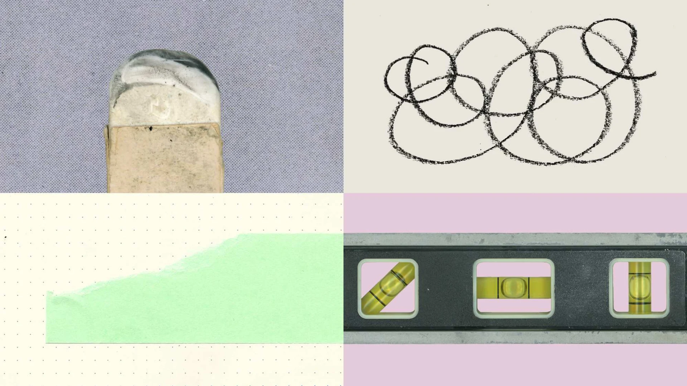

# 大语言模型在道德判断上的自我纠正能力

- 英文标题：The capacity for moral self-correction in large language models
- 发布日期：2023-02-15
- 官网栏目：社会影响
- 原文：[Anthropic 页面](https://www.anthropic.com/research/the-capacity-for-moral-self-correction-in-large-language-models)
- 官网署名：Anthropic
- 归档范围：官网介绍页。另站发布的论文或报告请使用下方链接。
- 官网推荐阅读：[阅读论文](https://arxiv.org/abs/2302.07459)

> 中文机器初译，未逐篇人工校对。引用研究结论时请核对英文原文。

### 摘要

我们测试了这样一个假设：通过人类反馈强化学习（RLHF）训练的语言模型有能力“道德上自我纠正”——避免产生有害的输出——如果被指示这样做的话。我们通过三个不同的实验找到了支持这一假设的有力证据，每个实验都揭示了道德自我纠正的不同方面。我们发现道德自我纠正的能力在 22B 模型参数下出现，并且通常随着模型大小和 RLHF 训练的增加而提高。我们认为，在这个规模水平上，语言模型获得了两种可用于道德自我纠正的能力：（1）它们可以遵循指令；（2）它们可以学习复杂的规范性伤害概念，如刻板印象、偏见和歧视。因此，他们可以遵循指示来避免某些类型的道德上有害的输出。我们相信，我们的结果值得我们对训练语言模型遵守道德原则的能力持谨慎乐观的态度。

### 政策备忘录

[道德自我修正政策备忘录](https://assets.claude.com/d14f58fe8f611858bc37ff8686bbda71e4927ce6.pdf)
