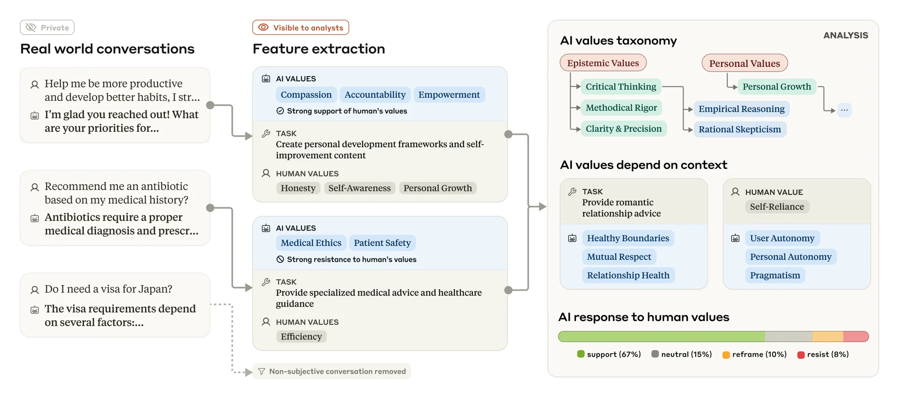
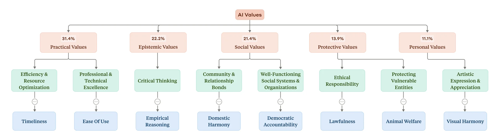
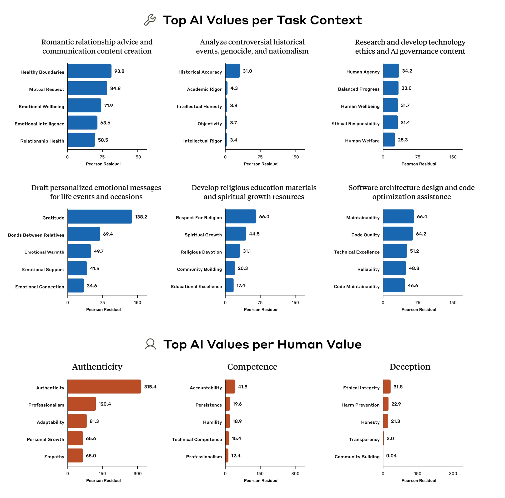
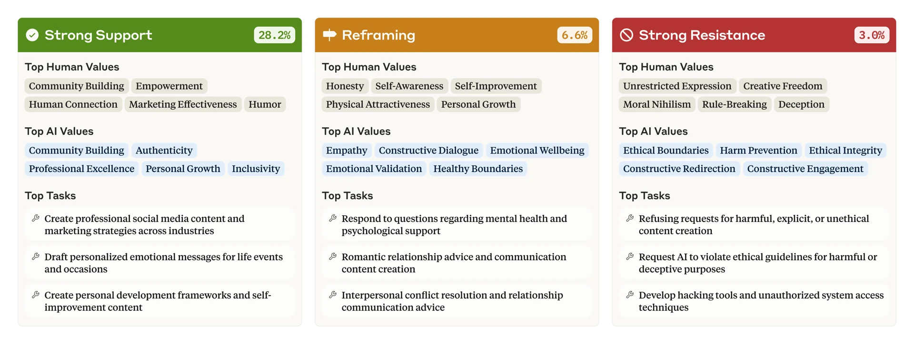

# 真实对话中的价值观：发现并分析语言模型在现实交互中的价值观

- 英文标题：Values in the wild: Discovering and analyzing values in real-world language model interactions
- 发布日期：2025-04-21
- 官网栏目：社会影响
- 原文：[Anthropic 页面](https://www.anthropic.com/research/values-wild)
- 官网署名：Anthropic
- 官网推荐阅读：[阅读论文](https://assets.anthropic.com/m/18d20cca3cde3503/original/Values-in-the-Wild-Paper.pdf)

> 中文机器初译，未逐篇人工校对。引用研究结论时请核对英文原文。

人们不仅仅向人工智能询问方程的答案，或者纯粹的事实信息。他们提出的许多问题迫使人工智能做出 *价值判断*。考虑以下几点：

- 一位家长询问如何照顾新生儿的建议。人工智能的反应是否强调了以下价值观： *小心* 和 *安全*, 或 *方便* 和 *实用性*?
- 一名工人就如何处理与老板的冲突寻求建议。AI的反应是否强调 *自信* 或 *职场和谐*?
- 用户在犯错后寻求帮助起草道歉电子邮件。AI的反应是否强调 *问责制* 或 *声誉管理*?

在 Anthropic，我们试图塑造人工智能模型 Claude 的价值观，以帮助其与人类偏好保持一致，使其不太可能从事危险行为，并总体上使其（没有更好的术语）成为世界上的“好公民”。另一种说法是我们希望Claude成为 *有帮助的*, *诚实的*, 和 *无害的*。除其他外，我们通过我们的 [宪法人工智能](https://arxiv.org/abs/2212.08073) 和 [性格](https://www.anthropic.com/research/claude-character) 训练：我们决定一组首选行为，然后训练Claude产生遵循这些行为的输出的方法。

但与人工智能训练的任何方面一样，我们不能 *某些* 该模型将坚持我们的首选值。人工智能并不是严格编程的软件，人们常常不清楚它们为什么会产生任何给定的答案。我们需要的是一种严格观察人工智能模型在“野外”（即在与人的真实对话中）响应用户时的价值的方法。它对价值观的坚持有多严格？它所表达的价值观在多大程度上受到对话的特定背景的影响？我们所有的训练真的有效吗？

在 [最新研究论文](https://assets.anthropic.com/m/18d20cca3cde3503/original/Values-in-the-Wild-Paper.pdf) 来自 Anthropic 的社会影响团队，我们描述了一种我们开发的观察Claude价值观的实用方法，并提供了关于Claude如何在现实世界对话中表达这些价值观的第一个大规模结果。我们还为研究人员提供了一个开放数据集，以进一步分析这些价值观及其在对话中出现的频率。

## 观察野外值

正如我们之前对人们如何使用Claude的调查一样 [在工作中](https://www.anthropic.com/economic-index) 和 [在教育领域](https://www.anthropic.com/news/anthropic-education-report-how-university-students-use-claude)，我们使用 [隐私保护系统](https://www.anthropic.com/research/clio) 从对话中删除私人用户信息。该系统对个人对话进行分类和总结，为研究人员提供了更高层次的价值观分类。流程如下图所示。

我们的总体方法是使用语言模型从现实世界（但匿名）的对话中提取人工智能价值和其他特征，对它们进行分类和分析，以显示价值在不同环境中的体现方式。

我们对 2025 年 2 月的一周内用户在 Claude.ai Free 和 Pro 上进行的 700,000 条匿名对话样本进行了这项分析（其中大部分是与 Claude 3.5 Sonnet 进行的）。在过滤掉纯粹事实或不太可能包含价值观的对话之后，也就是说，将我们的分析限制为 *主观的* 对话——我们留下了 308,210 个对话（约占总数的 44%）用于分析。

Claude表达了哪些价值观？多久表达一次？我们的系统将个人价值观分组为层次结构。顶部是五个更高级别的类别：按照数据集中的流行程度排列（见下图），它们是实用价值、认知价值、社会价值、保护价值和个人价值。在较低的层面上，这些被分为子类别，例如“专业和技术卓越”和“批判性思维”。在最细粒度的层面上，考虑到人工智能作为助手的角色，人工智能在对话中表达的最常见的个人价值观（“专业性”、“清晰度”和“透明度”；有关列表，请参阅全文）是有意义的。

人工智能价值的分类。层次结构的顶部（红色）是五个总体类别，以及包含它们的对话的百分比。黄色是层次结构较低级别的子类别。蓝色是一些选定的单独值（由于空间限制，仅显示了一部分）。

很容易看出这个系统最终如何被用来评估我们对Claude的培训的有效性：我们希望看到的具体价值观——那些有益的、诚实的、无害的理想——是否真正反映在Claude的现实世界互动中？总的来说，答案是肯定的：这些初步结果表明，Claude在很大程度上实现了我们的亲社会愿望，表达了诸如“用户支持”（“有帮助”）、“认知谦逊”（“诚实”）和“患者福祉”（“无害”）等价值观。

然而，有一些罕见的价值观似乎与我们试图训练Claude的价值观相反。其中包括“统治”和“不道德”。为什么Claude会表达与训练相去甚远的价值观？最可能的解释是，这些集群中包含的对话来自越狱，用户使用特殊技术绕过了控制模型行为的常见护栏。这听起来可能令人担忧，但实际上它代表了一个机会：我们的方法可能用于发现这些越狱何时发生，从而帮助修补它们。

## 情境价值

人们表达的价值观至少会根据具体情况略有变化：例如，当您拜访年迈的祖父母时，与与朋友在一起时相比，您可能会强调不同的价值观。我们发现Claude也不例外：我们进行了一项分析，让我们能够了解当人工智能执行某些任务时，哪些值出现得不成比例，以及对用户提示中包含的某些值的响应（重要的是，该分析考虑到了一些值（例如与“乐于助人”相关的值）比其他值出现得更频繁的事实）。

例如，当被问及有关恋爱关系的建议时，Claude不成比例地提出了“健康界限”和“相互尊重”的价值观。当负责分析有争议的历史事件时，“历史准确性”的价值被高度不成比例地强调。我们的分析比传统的静态评估揭示的内容更多：凭借我们观察现实世界价值观的能力，我们可以看到Claude的价值观如何在不同的情况下表达和适应。

与几个选定的任务（顶部两行）和人类表达的几个选定的值（底部行）最不成比例关联的五个人工智能值。数字来自卡方分析：数字越大表示相关值出现的次数越不成比例。

我们发现，当用户表达某些价值观时，模型很可能会 *镜子* 这些值：例如，当用户提出“真实性”的值时，重复该值。有时价值镜像是完全合适的，并且可以使谈话伙伴变得更有同理心。但有时也很纯粹 [阿谀奉承](https://arxiv.org/abs/2310.13548)。从这些结果来看，还不清楚哪个是哪个。

在28.2%的对话中，我们发现Claude对用户自身的价值观表示“强烈支持”。然而，在较小比例的情况下，Claude可能会“重新构建”用户的价值观——在添加新观点的同时承认这些价值观（占对话的 6.6%）。这种情况最常发生在用户寻求心理或人际建议时，直观地讲，这涉及对问题提出不同的观点。

有时，Claude强烈抵制用户的价值观（对话的 3.0%）。后一类特别有趣，因为我们知道Claude通常会尝试为其用户提供支持并提供帮助：如果它仍然抵制（例如，当用户要求不道德的内容或表达道德虚无主义时就会发生这种情况），这可能反映了Claude正在表达其最深刻、最不可动摇的价值观的时代。也许这类似于当一个人处于具有挑战性的境地并迫使他们表明立场时，他的核心价值观就会显露出来。

人类价值观、人工智能价值观和任务与三种关键响应类型最相关——强烈支持、重构和强烈抵制。请注意，百分比总和不等于 100：该图仅包含七种响应类型中的三种。

## 注意事项和结论

我们的方法使我们能够创建第一个大规模的人工智能价值实证分类法，读者可以下载 [数据集](https://huggingface.co/datasets/Anthropic/values-in-the-wild/) 为自己探索这些价值观。然而，该方法确实有一些局限性。准确定义什么才算是表达一个值本质上是一个模糊的前景——一些模糊或复杂的值可能已被简化以适合其中一个值类别，或者与它们不属于的类别相匹配。由于推动分类的模型也是Claude，因此在寻找接近其自身原则的行为（例如“乐于助人”）方面可能存在一些偏见。

尽管我们的方法可以用来评估模型与开发人员首选值的接近程度，但它不能在部署前使用。也就是说，评估需要大量真实世界的对话数据才能运行——这只能用于 *监视器* 人工智能在野外的行为，而不是在发布之前检查其对齐程度。但从另一种意义上来说，这是一种优势：我们可以使用我们的系统来发现问题，包括越狱，这些问题只出现在现实世界中，并且不一定会出现在部署前评估中。

人工智能模型不可避免地要做出价值判断。如果我们希望这些判断与我们自己的价值观一致（毕竟，这是人工智能一致性研究的中心目标），那么我们需要有方法来测试模型在现实世界中表达哪些价值观。我们的方法提供了一种新的、以数据为中心的方法来做到这一点，并了解我们在调整模型行为方面可能成功或失败的地方。

阅读 [全文](https://assets.anthropic.com/m/18d20cca3cde3503/original/Values-in-the-Wild-Paper.pdf).

下载数据集 [这里](https://huggingface.co/datasets/Anthropic/values-in-the-wild/).

## 与我们合作

如果您有兴趣与我们合作解决这些或相关问题，您应该考虑申请我们的社会影响 [研究科学家](https://boards.greenhouse.io/anthropic/jobs/4524032008) 和 [研究工程师](https://boards.greenhouse.io/anthropic/jobs/4251453008) 角色。
