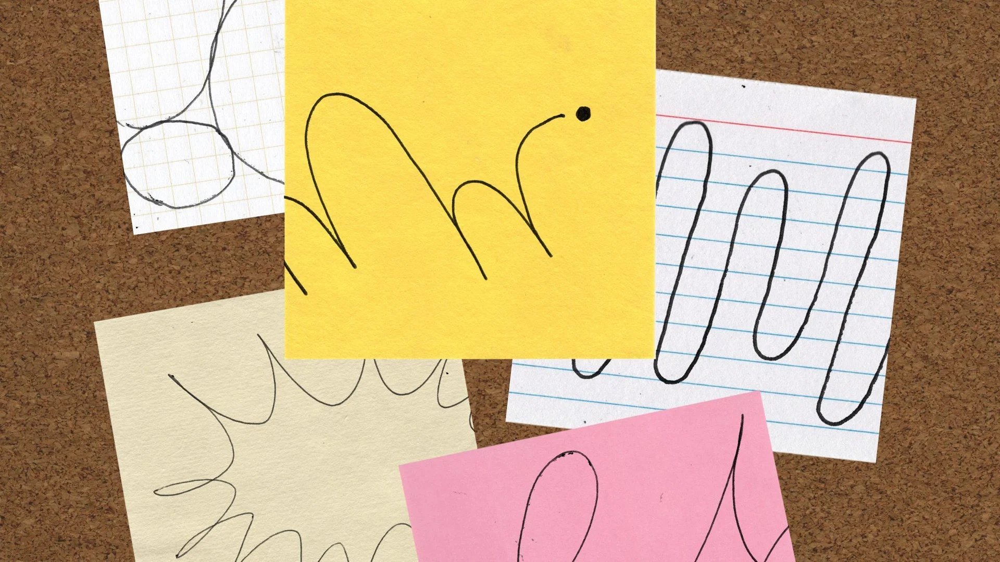

# 你希望 AI 为你做什么？

- 英文标题：What do you want from AI?
- 发布日期：2026-09-29
- 官网栏目：社会影响
- 原文：[Anthropic 页面](https://www.anthropic.com/research/your-thoughts-on-ai)
- 官网署名：Anthropic

> 中文机器初译，未逐篇人工校对。引用研究结论时请核对英文原文。

*我们正在开展一项新研究，使用 [人性采访者](https://www.anthropic.com/about-anthropic-interviewer) 从您的人工智能经验中学习，我们希望您参与其中。完成后，您可以决定公开您的采访，以便任何人（不仅仅是 Anthropic）都可以阅读并从中学习。你可以 [在这里参加](https://claude.ai/anthropic-interviewer/your-thoughts-on-ai?from=blog).*

我们正处于人工智能发展的关键时刻，因为它不断增长的能力意味着它可能变得更有用，但也更危险。Frontier AI 正在迅速加速以下领域的发现： [科学](https://www.anthropic.com/research/Claude-accelerates-protein-design) 和 [医学](https://openai.com/index/diagnose-rare-childhood-diseases/)，同时其滥用的成本也在增加 [更重要的](https://darioamodei.com/post/we-must-pace-the-frontier)—[单一安全事件](https://metr.org/blog/2026-08-26-openai-hugging-face-incident-investigation/#core-takeaways-about-this-incident) 可能会造成比一年前更大的损害。

如何权衡这些收益和风险不应由人工智能公司独自承担。当我们共同应对这个不确定的未来时，您的声音可以帮助指导我们、其他人工智能实验室和政策制定者。我们的大问题是：

- 您对人工智能最有意义的经历是什么，无论是积极的还是消极的？
- 您希望人工智能帮助改变世界运作方式（如工作、学校、医疗保健或政府）的哪些方面？
- 您希望从开发人工智能的公司那里得到什么？

该项目以去年 12 月进行的一项类似研究为基础，其中 [81,000 人](https://www.anthropic.com/features/81k-interviews) 告诉我们他们对人工智能的希望和担忧。这项研究塑造了 [人类研究所的议程](https://www.anthropic.com/research/anthropic-institute-agenda)，在世界经济论坛上向国际领导人和决策者提出，并将继续指导我们正在进行的工作 [社会影响](https://www.anthropic.com/research/team/societal-impacts) 和 [经济学研究](https://www.anthropic.com/research/81k-economics).

从那时起，AI 和 Anthropic 发生了很大变化。人工智能已经进步，更多的人使用Claude，人们对这项技术的感受也发生了转变。之前的研究只公开了高水平的结果和少量的引用。这一次，我们希望您的想法能够被广泛传播，以便任何人都可以从中学习。

我们编写了常见问题解答，以便您可以就是否公开您的采访以及分享哪些内容做出明智的决定。您可以选择 [在这里参加](https://claude.ai/anthropic-interviewer/your-thoughts-on-ai?from=blog).

## 常见问题解答

### 采访内容是什么？

面试会询问您使用人工智能的经历以及您想从中得到什么。我们将询问对您来说最重要的人工智能时刻，无论是积极的还是消极的，您是否希望人工智能帮助改变世界的运作方式，以及您希望从包括 Anthropic 在内的开发人工智能的公司获得什么。没有正确答案；我们希望用您自己的话来听听您的经历……并且我们不想在您接受之前透露太多！

### 我必须公开分享我的采访吗？

不。这是可选的。

### 如果我公开采访，哪些内容会被公开？

我们将公布您的完整采访以及与您的谈话相关的国家/地区。我们不会包含您的Claude帐户信息，例如姓名或电子邮件地址。

### 公开分享我的采访有什么好处？

您的观点不仅会被我们听到，也会被任何对研究和改进人工智能感兴趣的人听到。我们希望任何人都能够研究人工智能如何影响人类以及人工智能的发展应该如何进步。

世界各地的研究人员和政策制定者可以阅读用自己的语言进行的采访，阅读不同地区分享的回复，并提出我们不想问的问题。许多人带来了我们员工所没有的专业知识，他们可能有我们没有想到的见解。任何人都可以检查我们发表的研究结果是否真实反映了参与者的说法。

您的采访也将成为人工智能这一时刻公共记录的一部分，向未来的历史学家、记者和研究人员开放，并可以告诉社会如何应对这一时刻。对于人工智能公司和其他影响人工智能发展的人来说，这一记录也很难忽视。如果许多参与者表示像 Anthropic 这样的公司应该采取不同的做法，那么这种语言就会公开，任何人都可以参考。

### 公开分享我的采访有哪些风险？

虽然我们不会公布您的Claude帐户信息，例如您的姓名或电子邮件地址，但我们鼓励参与者考虑到任何人都可以阅读公开采访。这包括雇主、朋友和亲戚，以及政府和其他公司。根据参与者分享的内容，其他人可能能够将参与者链接回他们的采访。年龄、工作、城市或学习地点等本身看似无害的细节可以让人们更容易识别您的身份。我们不会在采访中询问这些细节，并鼓励参与者避免分享这些细节。

一旦公开，采访可能会以参与者不希望的方式使用，包括诈骗者和其他可能试图滥用个人信息的人。我们可以根据要求删除您的采访副本，但我们无法删除人们已经保存的内容。因此，请将您公开采访的决定视为永久性决定。

### 有人可以从我的公开采访中认出我吗？

我们不会附上您的姓名或帐户信息，但我们不会编辑采访内容，因此我们不能保证您的言论不会被重新识别。有人可以使用人工智能结合一些小细节，比如雇主或过去的项目，来找出参与者是谁。研究人员 [已经表明](https://arxiv.org/abs/2602.16800) 这可以与 Anthropic Interviewer 的采访一起使用。

最好的保护是不共享可能识别您或他人身份的信息。在采访过程中，我们会展示您不应分享的信息示例，您在决定是否公开之前先查看完整的采访内容。

### 我该如何决定是否公开分享我的采访？

[原文媒体](https://assets.claude.com/4c4202c1f0e4f90c4dc9ffbfda949f28620a22e1.mp4)

在采访之前，我们会解释公开采访涉及哪些内容。我们告诉参与者，我们不会在公开发布中包含他们的Claude帐户信息，但其他人可能能够从他们分享的内容中识别出他们的身份。我们还解释说，公开采访意味着任何人都可以阅读、保存和使用它。我们可以根据要求删除我们的副本，但我们无法删除人们已经保存的内容。

在采访过程中，您将看到我们建议不要分享的敏感信息类型的示例。采访结束后，您可以重新阅读您所说的内容，然后再决定是否公开分享。我们会提醒您收益和风险，如果您选择分享，我们将最后一次确认您的决定。

### 如果我不公开我的采访会怎样？

我们仍会将其作为社会影响研究的一部分进行分析，但您的完整采访不会发表。我们仍可能发布和分享您采访中得出的汇总或去识别化的调查结果。如果您也不希望我们分析，您可以提前结束采访（更多详情请参阅下面的“我可以决定提前结束采访并删除记录吗？”）。

### 如果我公开采访，我可以改变主意吗？

不完全。一旦您的采访公开，任何人都可以阅读、保存和使用它。我们可以根据要求删除您的采访副本，但我们无法删除人们已经保存的内容。将决定视为永久决定。 [了解更多](https://privacy.claude.com/en/collections/19084219-anthropic-interviewer).

### 你们会在发布我的采访之前对其进行编辑吗？

不，我们不打算在发布采访之前对其进行编辑。研究完成后，我们将进行最终审查，并可能删除我们认为不负责发布的采访，例如涉及机密信息的采访或违反我们的规定的采访。 [使用政策](https://www.anthropic.com/legal/aup) 或 [服务条款](https://www.anthropic.com/legal/consumer-terms).

### Anthropic 将如何利用我的采访？

作为社会影响研究的一部分，我们将分析访谈，公开分享我们的发现，并利用结果来指导我们如何开发模型和产品。 [了解更多](https://privacy.claude.com/en/collections/19084219-anthropic-interviewer).

### 我可以决定提前结束采访并删除记录吗？

是的，您可以随时单击“结束采访”按钮停止采访。如果您提前结束，您的部分采访将被永久删除，并且不会被分析或发布，包括由 Anthropic 分析或发布。

### 谁可以参加面试以及需要多长时间？

这项研究将于 2026 年 9 月 29 日至 10 月 6 日进行，并向 Claude 和 Claude Code 上帐户至少两周的 Free、Pro 和 Max 用户开放。每次面试大约需要 15 分钟，由 [人性采访者](https://www.anthropic.com/research/anthropic-interviewer)，一个会问你问题的人工智能。

### 这与 [2025年12月研究](https://www.anthropic.com/features/81k-interviews)?

我们更新了问题，该研究针对更多Claude产品开放，并且您第一次可以选择公开您的采访。

### 采访内容将在何时何地发布？

一旦我们完成研究和初步分析，采访将在网上发布。

### 这项研究的局限性是什么？

这项研究的参与者将全部是使用Claude的人，这并不是公众的代表性样本。已发表的采访是进一步的子集，因为选择公开发布的人可能与不公开发布的人不同。与任何采访一样，我们提出的问题决定了人们分享的内容。即便如此，类似的事情以前从未公开过。我们相信它可以显着推进人工智能如何改变人们生活的研究。
