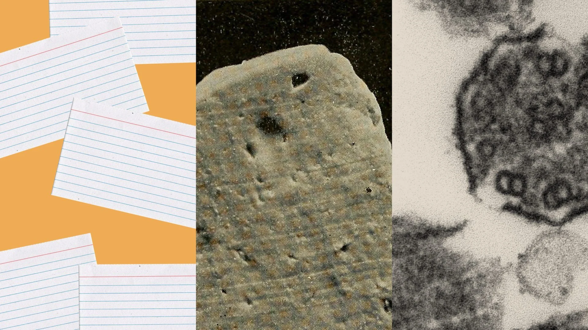

# 科学家如何用 Claude 加快研究与发现

- 英文标题：How scientists are using Claude to accelerate research and discovery
- 发布日期：2026-01-15
- 官网栏目：官网未标注栏目
- 原文：[Anthropic 页面](https://www.anthropic.com/research/accelerating-scientific-research)
- 官网署名：Anthropic

> 中文机器初译，未逐篇人工校对。引用研究结论时请核对英文原文。

去年 10 月，我们推出了 Claude for Life Sciences，这是一套连接器和技能，使 Claude 成为更好的科学合作者。从那时起， [我们投入巨资使Claude成为最有能力的科学工作典范](https://www.anthropic.com/news/healthcare-life-sciences#tab-media-0)，Opus 4.5 在图形解释、计算生物学和蛋白质理解基准方面显示出显着改进。这些进步得益于我们与学术界和工业界研究人员的合作，反映了我们致力于准确了解科学家如何利用人工智能来加速进步。

我们还通过我们的技术与科学家密切合作 [科学人工智能](https://www.anthropic.com/news/ai-for-science-program) 计划，该计划为世界各地从事高影响力科学项目的领先研究人员提供免费的 API 学分。

这些研究人员开发了定制系统，其使用Claude的方式远远超出了文献综述或编码协助等任务。在我们采访的实验室中，Claude是一位跨研究过程各个阶段的合作者：让我们更容易且更具成本效益地了解要运行哪些实验，使用各种工具帮助将通常需要数月时间的项目压缩为数小时，以及在海量数据集中找到人类可能忽视的模式。在许多情况下，它正在消除瓶颈，处理需要深入知识且以前无法扩展的任务；在某些方面，它使研究人员能够采用与传统上完全不同的研究方法。

换句话说，Claude开始重塑这些科学家的工作方式，并引导他们获得新颖的科学见解和发现。

## Biomni：一种通用生物医学代理，可以访问数百种工具和数据库

生物学研究的一个瓶颈是工具的碎片化：可用的数据库、软件包和协议有数百种，研究人员花费大量时间来选择和掌握各种平台。在完美的世界中，这些时间将花在运行实验、解释数据或开展新项目上。

[比奥姆尼](https://biomni.stanford.edu/)是斯坦福大学的一个代理人工智能平台，它将数百个工具、包和数据集收集到一个系统中，由 Claude 支持的代理可以通过该系统进行导航。研究人员用简单的英语向其提出请求； Biomni 自动选择合适的资源。它可以形成假设、设计实验方案并在超过 25 个生物子领域进行分析。

以全基因组关联研究 (GWAS) 为例，该研究旨在寻找与某些性状或疾病相关的遗传变异。例如，完美的音高具有强大的遗传基础。研究人员会召集一大群人——其中一些人能够在没有任何参考音调的情况下发出音符，而另一些人你永远不会邀请去卡拉OK——扫描他们的基因组，寻找在一组中比另一组中出现频率更高的基因变异。

基因组扫描（相对）简单。分析和理解数据的过程非常耗时：基因组数据的格式混乱，需要大量清理；研究人员必须控制混杂并处理缺失数据；一旦他们识别出任何“命中”，他们就需要弄清楚它们的实际含义——附近有什么基因（因为 GWAS 只指向基因组中的位置）、它在什么细胞类型中表达、它可能影响什么生物途径，等等。每个步骤可能涉及不同的工具、不同的文件格式和大量的手动决策。这是一个乏味的过程。一次 GWAS 可能需要数月时间。但在 Biomni 的早期试验中，需要 20 分钟。

这听起来好得令人难以置信——我们能确定这种人工智能分析的准确性吗？比奥姆尼团队有 [已验证](https://www.biorxiv.org/content/10.1101/2025.05.30.656746v1.full.pdf) 该系统通过不同领域的多个案例研究。其中，Biomni 设计了一个分子克隆实验；在盲目评估中，该协议和设计与具有五年以上经验的博士后的协议和设计相匹配。在另一项研究中，Biomni 在短短 35 分钟内分析了来自 30 个不同人的 450 多个可穿戴数据文件的数据（包括连续血糖监测、体温和身体活动）——这项任务估计需要人类专家三周的时间。在第三项研究中，Biomni 分析了取自人类胚胎组织的超过 336,000 个单个细胞的基因活性数据。该系统证实了科学家们已经知道的调控关系，但也发现了新的转录因子——控制基因何时开启和关闭的蛋白质——研究人员此前从未将其与人类胚胎发育联系起来。

Biomni 并不是一个完美的系统，这就是为什么它包含护栏来检测Claude是否偏离了轨道。它也还不能做到开箱即用的一切。然而，如果出现问题，专家可以将他们的方法编码为 [技能](https://platform.claude.com/docs/en/agents-and-tools/agent-skills/overview)——教导代理专家如何解决问题，而不是让其即兴发挥。例如，当与未诊断疾病网络合作进行罕见疾病诊断时，该团队发现Claude的默认方法与临床医生的做法有很大不同。于是他们采访了一位专家，一步步记录了他们的诊断过程，并教给了Claude。凭借这些新的、先前隐性的知识，智能体表现良好。

Biomni 代表了一种方法：一种通用系统，可将数百种工具集中在一个屋檐下。但其他实验室正在构建更专业的系统——针对自己研究工作流程中的特定瓶颈。

## Cheeseman Lab：自动解释大规模基因敲除实验

当科学家想要了解基因的作用时，一种方法是将其从相关细胞或有机体中取出，看看会发生什么破坏。2012 年左右出现的基因编辑工具 CRISPR 使大规模精确实现这一过程变得容易。但 CRISPR 的效用仍然有限：实验室生成的数据远多于其分析带宽。

这正是 Iain Cheeseman 面临的挑战 [实验室](https://cheesemanlab.wi.mit.edu/) 在怀特海德研究所和麻省理工学院生物系。他们使用 CRISPR 敲除数千万个人类细胞中的数千个不同基因，然后对每个细胞拍照以查看发生了什么变化。这些图像中的模式表明，执行相似功能的基因在被移除后往往会产生相似的损伤。软件可以检测这些模式并自动将基因分组在一起——Cheeseman 的实验室构建了一个管道来完成这一任务，称为 [布瑞夫洛](https://www.biorxiv.org/content/10.1101/2025.05.26.656231v1) （是的，布里干酪）。

但解释这些基因分组的含义——为什么基因聚集在一起，它们可能有什么共同点，是已知的生物关系还是新的东西——仍然需要人类专家逐个基因地梳理科学文献。很慢。一个屏幕可以产生数百个簇，并且大多数簇从未得到研究，仅仅是因为实验室没有时间、带宽或对细胞所做的各种事情的深入了解。

多年来，奇斯曼亲自完成了所有的解释。他估计他可以从头顶回忆起大约 5,000 个基因的功能，但有效分析这些数据仍然需要数百个小时。为了加速这一过程，博士生 Matteo Di Bernardo 试图构建一个系统来自动化 Cheeseman 的方法。与 Cheeseman 密切合作，准确了解他如何进行解释——他查阅了哪些数据源，他寻找哪些模式，是什么让发现变得有趣——他们构建了一个由 Claude 支持的系统，名为 [莫扎尔法学硕士](https://github.com/cheeseman-lab/mozzarellm) （您可能会在这里看到一个正在发展的主题）。

它需要一组基因，并做像奇斯曼这样的专家会做的事情：识别它们可能共享的生物过程，标记哪些基因被充分理解，哪些基因研究不足，并突出显示哪些基因可能值得跟进。这不仅大大加速了他们的工作，而且还帮助他们做出了重要的额外生物学发现。奇斯曼发现Claude总是能抓住他错过的东西。“每次我经历的时候，我都会想，我没有注意到那个！在每种情况下，这些都是我们可以理解和验证的发现，”他说。

MozzareLLM 如此有用的原因在于它不是一门只会一招的小马：它可以像科学家一样整合不同的信息和推理。最值得注意的是，它提供了其研究结果的置信度，奇斯曼强调这一点至关重要。它帮助他决定是否投入更多资源来跟进其结论。

在构建 MozzareLLM 时，Di Bernardo 测试了多个 AI 模型。Claude（Claude）的表现优于其他方法——在一种情况下，他正确识别了一种 RNA 修饰途径，而其他模型则将其视为随机噪音。

Cheeseman 和 Di Bernardo 设想将这些由 Claude 注释的数据集公开，让其他领域的专家跟进他的实验室没有时间研究的集群。例如，线粒体生物学家可以深入研究奇斯曼团队已标记但从未研究过的线粒体簇。随着其他实验室采用 MozzareLLM 进行自己的 CRISPR 实验，它可以加速对多年来功能不明的基因的解释和验证。

## Lundberg 实验室：测试人工智能主导的假设生成，以研究哪些基因

Cheeseman 实验室使用光学联合筛选——这种技术可以让他们在一次实验中敲除数千个基因。他们的瓶颈是解释。但并非每种细胞类型都适用于联合方法。一些实验室，例如 [斯坦福大学伦德伯格实验室](https://lundberglab.stanford.edu/)，运行更小的、聚焦的屏幕，他们的瓶颈来得更早：首先决定要瞄准哪些基因。

由于单个聚焦屏幕的成本可能高达 20,000 美元，并且成本随着尺寸的增加而增加，因此实验室通常会针对他们认为的数百个基因 *最有可能* 参与特定条件。传统的过程包括一组研究生和博士后坐在谷歌电子表格周围，逐一添加候选基因，并附上一句理由，或者可能是一篇论文的链接。这是一个有教养的猜谜游戏，以文献综述、专业知识和直觉为基础，但受到人类带宽的限制。它也容易出错，因为它是基于其他科学家已经弄清楚并写下的内容，以及房间里的人们碰巧回忆起来的内容。

伦德伯格实验室正在利用Claude来扭转这种方法。他们的系统不是问“我们可以根据研究人员已经研究过的内容做出什么猜测？”，而是问“什么” *应该* 基于分子特性进行研究？”

该团队绘制了细胞中每个已知分子（蛋白质、RNA、DNA）的图谱，以及它们之间的相互关系。他们找出了哪些蛋白质结合在一起，哪些基因编码哪些产物，以及哪些分子在结构上相似。然后，他们可以给Claude一个目标，例如哪些基因可能控制特定的细胞结构或过程，Claude导航该图谱，根据其生物学特性和关系识别候选基因。

伦德伯格实验室目前正在进行一项实验，以研究这种方法的效果如何。为此，他们需要确定一个几乎没有进行过研究的主题（如果他们看过一些经过充分研究的内容，Claude可能已经知道了既定的发现）。他们选择了初级纤毛：我们对细胞上类似天线的附属物知之甚少，但它与各种发育和神经系统疾病有关。接下来，他们将进行全基因组筛选，看看哪些基因实际上影响纤毛的形成，并确定事实真相。

该测试是将人类专家与Claude进行比较。人类将使用电子表格方法进行猜测。Claude将使用分子关系图生成自己的。如果Claude（假设）捕获了 200 只中的 150 只，而人类捕获了 200 只中的 80 只，那就证明该方法效果更好。即使他们在发现基因方面大致相同，Claude仍然可能工作得更快，并且可以使整个研究过程更加高效。

如果该方法有效，该团队预计它将成为聚焦扰动筛选的标准第一步。实验室可以对目标基因进行明智的押注，而不是依靠直觉或使用当代研究中流行的蛮力方法，从而获得更好的结果，而不需要全基因组筛查的基础设施。

### 展望未来

这些系统都不是完美的。但他们指出，在短短几年内，科学家们已经开始将人工智能纳入研究伙伴，其能力远远超出基本任务——事实上，越来越能够加速，在某些情况下甚至取代研究过程的许多不同方面。

在与这些实验室的交谈中，出现了一个共同的主题：他们构建的工具的实用性随着人工智能功能的不断增长而不断增长。每个模型的发布都会带来显着的改进。就在两年前，早期的模型仅限于编写代码或总结论文，而更强大的智能体已经开始复制这些论文所描述的工作，尽管速度很慢。

随着工具的进步和人工智能模型不断变得更加智能，我们将继续观察和学习科学发现如何随之发展。

*有关扩展的Claude生命科学功能的更多详细信息， [看这里](https://claude.com/solutions/life-sciences)，以及我们的 [教程在这里](https://claude.com/resources/tutorials-category/life-sciences)。我们也持续接受 [应用](https://docs.google.com/forms/d/e/1FAIpQLSfwDGfVg2lHJ0cc0oF_ilEnjvr_r4_paYi7VLlr5cLNXASdvA/viewform) 加入我们的人工智能科学计划。申请将由我们的团队进行审核，其中包括相关领域的主题专家。*
