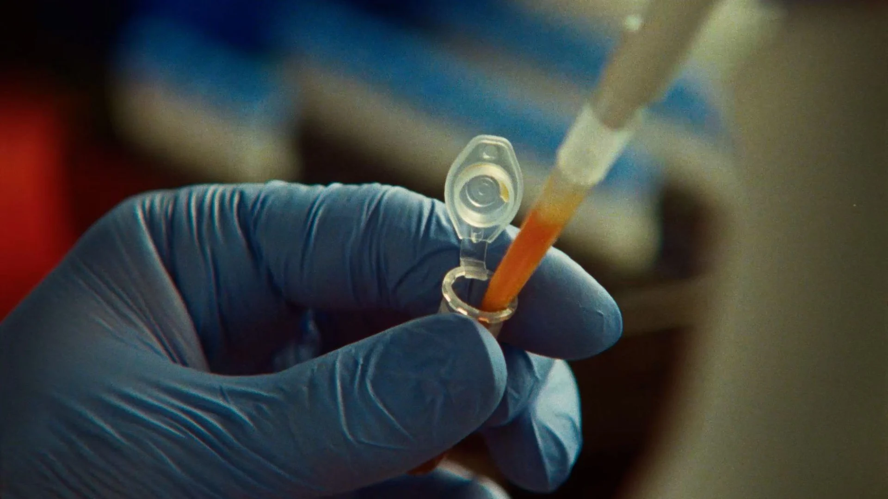
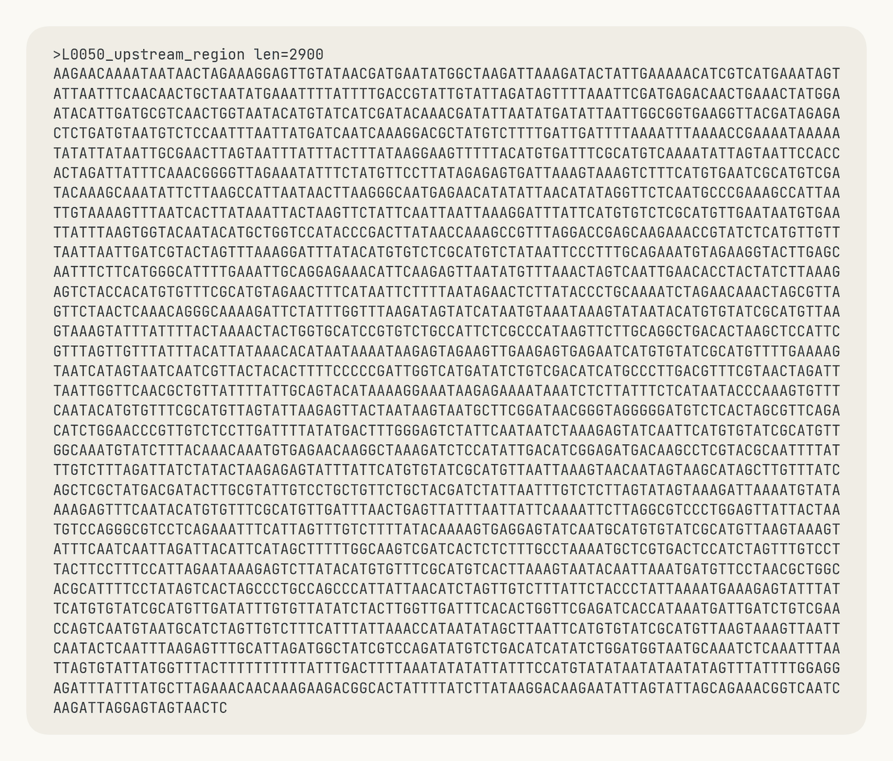

# Claude 发现带有类似 CRISPR 重复序列的新型酶系统

- 英文标题：Claude discovers a novel enzyme system with CRISPR-like repeats
- 发布日期：2026-09-23
- 官网栏目：官网未标注栏目
- 原文：[Anthropic 页面](https://www.anthropic.com/research/claude-discovers-novel-enzyme-system)
- 官网署名：Anthropic

> 中文机器初译，未逐篇人工校对。引用研究结论时请核对英文原文。

*我们正在 Anthropic 引入一个新的生命科学研究小组和实验室。我们的重点是使用 Claude 进行基础生物学研究：探索 DNA 数据集以识别未表征的蛋白质家族，大规模生成假设，并通过实验室实验对其进行测试。这篇文章介绍了这项工作背后的团队，并分享了 Claude 发现了一种新型酶系统的早期结果，其特性让人想起 CRISPR，而我们的科学家只提供了高水平的指导。*许多彻底改变生物学和医学的发现都始于科学家注意到自然界中发现的分子机器的惊人多样性中的一些奇怪的东西。限制性内切酶*,* 在特定短序列处切割 DNA 的蛋白质*,* 存在于细菌免疫系统中，它们会破坏入侵病毒的 DNA。研究人员意识到，他们可以使用这些酶在选定的位置切割 DNA，并将一种生物体的基因拼接到另一种生物体中，从而启动了生物技术产业。Taq 聚合酶是一种在高温下复制 DNA 的酶，在黄石温泉的细菌中被发现。它成为 PCR 的基础，PCR 是许多现代诊断中使用的 DNA 复制方法。CRISPR 最初被认为是某些细菌 DNA 中不寻常的重复序列，现在已成为基因编辑药物的基础。  

2026年春天，我们成立了一个研究小组，看看通用的AI模型能否系统化、系统化。 [加速此类发现](https://darioamodei.com/essay/machines-of-loving-grace#1-biology-and-health)。我们相信，这种加速将来自于建立一种新的生物学研究方式，在这种方式中，智能体在整个过程的每一步都与人类合作。开发这种新的工作方式需要我们建立自己的实验室和一个团队，负责从生物学培训Claude到在实验室进行实验的所有工作。

今天，我们将分享我们第一个研究项目的早期结果，其中 Claude 自主发现了一种与一系列 DNA 重复序列相关的新型酶系统，这种模式让人想起 CRISPR。虽然我们还不知道它的功能，但Claude发现的系统具有一系列特征，这些特征只在少数其他系统中被发现过，所有这些特征都是可编程的，并执行诸如剪切、复制和粘贴 DNA 等操作。除了已经改变了科学和医学的 CRISPR 之外，其他几种此类系统目前正在开发中，作为有前途的工具。

Claude发现的系统基于逆转录酶 (RT)，这种酶可将 RNA 复制到 DNA 中。虽然这种在巨型噬菌体中发现的潜在 RT 在之前的研究中已经被识别出来，但 Claude 似乎是第一个注意到该系统定义特征的人——一组相关的非编码 DNA 序列和一个功能未知的附加辅助蛋白。

CRISPR 基因组编辑的先驱之一、麻省理工学院和布罗德研究所的教授张锋在审阅预印本后表示：

> *这是AI 智能体如何为生物发现做出贡献的一个令人兴奋的例子。与逆转录酶相关的 RNA 重复阵列的鉴定确实很有趣，值得进一步研究。我希望这项工作能够鼓励更多科学家探索人工智能如何支持他们的研究。*

我们提示 Claude 在庞大的 DNA 序列数据库中搜索有趣的新 RT 示例。我们的参与仅限于最初的提示和实验室工作，而 Claude 特工则梳理数据库，调查不同的 RT 家族，并利用自己的判断来识别感兴趣的候选者。大约 950 名特工使用 2.1 亿个代币花了 21 个小时搜索这些数据，其中一名特工发现了一些值得注意的事情：在一个奇怪的 RT 基因旁边出现了 DNA 序列的重复模式。经过实验室的进一步分析和测试，我们认识到这种模式标志着在噬菌体（感染细菌的病毒）中发现的以前未表征的酶系统，我们称之为阵列相关逆转录酶（ART）。

我们正在努力了解 ART 的主要功能。然而，我们认为尽早分享这些发现非常重要，这既可以展示 Claude 的能力，也可以让更广泛的社区了解我们正在开展的工作。我们已经发布了预印本（[这里](https://www.biorxiv.org/content/10.64898/2026.10.05.755809v1)）更详细地讨论了这一点。

## 关于我们的实验室

我们是一个科学家团队，他们的职业生涯都在探索不寻常的蛋白质，专门从事使用计算方法系统地读取 DNA、解释其进化并挑选生物系统进行进一步表征。我们在加入 Anthropic 之前的研究有助于更好地了解 [进化论](https://www.science.org/doi/10.1126/science.aei0498) 和 [监管](https://www.nature.com/articles/s41586-018-0557-5) CRISPR 系统，发现新的 [酶](https://www.nature.com/articles/s41586-024-07552-4) 为了下一代 [细胞和基因疗法](https://www.science.org/doi/10.1126/science.adz0276)，并构建 [工具](https://www.nature.com/articles/s41586-026-10176-5) 用于加速 DNA 异常的识别，例如人类致病变异。我们是 Anthropic 生命科学组织的一部分，其他团队的工作包括药物发现以及对Claude进行生物学和化学方面的培训。

我们的实验室位于湾区，看起来像一个典型的分子生物学实验室。我们进行的研究仅涉及较低水平的生物安全风险级别（BSL-1 和 BSL-2），并且我们不处理可感染人类的​​病原体。所有实验室工作均由人类科学家完成。尽管我们已经尝试使用人工智能来加速实验室工作，例如 [型号硬件标准](https://www.anthropic.com/news/model-hardware-standard-research-preview)，这种方法不太有利于我们分子生物学研究中涉及的那种临时工作流程。

## 我们如何工作

我们的许多工作流程都涉及让 Claude 搜索大量与未知功能的蛋白质相关的 DNA 序列。一种典型的模式始于对给定蛋白质家族的调查。Claude阅读了相关文献，并从公开数据中重现了既定结果，以检查其方法。然后，它搜索不适合所描述系统的家庭成员或基因组邻居，并为每个候选者编写一份简短的、人类可读的报告，提出一个功能并描述支持其主张的证据。在后续分析中，Claude批判性地评估证据——通常大多数候选人都会在这个阶段被淘汰。调查可能会以一个值得测试的候选者结束，也可能没有。

当候选者通过我们的审查后，我们会在实验室中对其进行测试，在标准实验室菌株中表达蛋白质并对其进行生化和结构表征，并由Claude帮助解释数据。我们的工作在 [克劳德·科学](https://claude.com/product/claude-science) 和 [克劳德·科德](https://claude.com/product/claude-code)，任何科学家都可以使用相同的工具，有时还可以使用我们自己的工具来协调许多并行运行的 Claude 会话。

由于Claude提出的假设如此之多，假设本身就成为我们研究的对象。由于一次竞选活动中有数百至数千份候选人报告，我们一直在询问我们认为值得测试的提案与我们搁置的提案有何区别。我们学到的东西会回到我们给Claude的指令中，并教它模仿我们自己的科学品味。

## Claude发现艺术

在过去的几年里，研究人员发现了更多的逆转录酶（RT），其中大多数存在于细菌中，它们充当免疫系统的一部分。几乎所有 RT 家族都是通过基因组分析或基因组挖掘发现的，这需要研究人员在序列数据库中搜索无人表征的基因，注意不寻常的基因，并弄清楚它们的作用。

Claude 代理收集了超过 200,000 个 RT，挑选出 3,500 个新的候选系统，并将范围缩小到 20 个最引人注目的候选系统，并对其进行分析以生成人类可读的报告。对于专家科学家来说，这种类型的分析可能需要几周到几个月的时间。

在研究过程中，Claude注意到一个不寻常的 RT 家族，并决定对其进行更详细的研究。在梳理 RT 附近的原始 DNA 序列时，特工惊呼道：“[RT 旁边的 DNA] 非常壮观：我可以用肉眼看到串联重复阵列……这是一个类似 CRISPR 的……重复阵列？！”

Claude在读取原始 DNA 时，发现了一种没有人注意到的重复模式

然后，它的进展就像人类科学家面对潜在发现时所做的那样。它计算了重复次数并测量了它们的间距，将布局与已知的 RT 系统进行了比较，并在文献中搜索了该模式的任何先前报告。经过彻底的分析后，它确信自己发现了一个新的生物系统，并提交了一份报告供人类审查。

它发现的系统 ART 主要存在于噬菌体中，由三部分组成：RT、旁边的伙伴基因以及一长串均匀间隔的 DNA 重复序列。重复布局类似于 CRISPR 阵列，其中包含一组不同的 RNA 序列，使 CRISPR-Cas 系统成为可编程生物技术工具。我们的第一个实验表明，ART 阵列也表达为一组不同的短 RNA，这表明类似的东西可能在该系统中发挥作用。

进一步的实验正在进行中，以确定 ART 的工作原理，我们正在分享这些早期发现，向社区展示 Claude 可以自主检测异常并驱动分析以启动生物学发现。

您可以在我们的技术报告中找到更多详细信息（[这里](https://www.biorxiv.org/content/10.64898/2026.10.05.755809v1)).

### 与我们合作

我们希望这项工作向更广泛的科学界展示人工智能驱动的假设生成的价值，并且我们希望与其他科学家合作，将这种方法扩展到基因组学和其他领域的广泛问题。如果您对研究问题有建议，我们希望收到您的来信。
